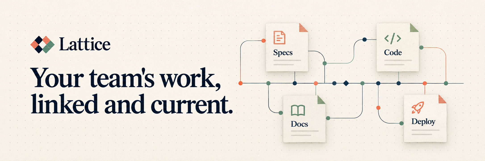

# Lattice · One database for your whole software team

[](https://github.com/moncifem/latticedb/actions/workflows/pr.yml) [](LICENSE) [](docs/gates/phase-2.md)

Your specs say one thing. Your code does another. Your docs find out last.

Lattice is an open-source Rust database being built to give software teams one shared history of
work items, docs, specs, designs and deployments—with agents working inside the same permissions.
The goal is to connect what the team knows, what it is building and what actually shipped.

**[Explore the architecture](docs/ARCHITECTURE.md) · [Follow the roadmap](https://github.com/users/moncifem/projects/1) · [Get involved](CONTRIBUTING.md)**

> **Pre-alpha.** The storage kernel and early row engine work today. There is no running server,
> SQL interface or connected team workspace yet. The Phase 1 gate remains open; Phase 2 development
> is proceeding under a [documented waiver](docs/gates/phase-1-review.md). Use test data only.

## Why build another database?

- **Team context belongs together.** A requirement, its implementation and the deployment that shipped
  it should be linked data, rather than a trail across disconnected tools.
- **History should answer questions.** The design preserves changes so questions like “when did this
  feature start?” can have an answer with evidence.
- **Agents should be teammates with boundaries.** Scoped grants, auditable changes and reviewable
  proposals are part of the design. The core makes no model calls; model acceleration is optional.
- **Trust starts below the interface.** A deterministic simulator, crash recovery and tests that plant
  deliberate defects come before the product features.

These are the design goals. The [phase status](docs/gates) separates them from implemented behavior.

## What works today

| Built | What it does |
|---|---|
| Durable kernel | Checksummed write-ahead log, crash recovery, group commits, deduplication and turn fencing |
| Row engine | Snapshot reads, write conflicts, a versioned catalog and secondary indexes rebuilt from the log |
| Schema tools | LSL parser, validation, formatting, compatibility checks and a typed-row codec |
| Verification tools | `lattice doctor`, a results ledger, fault simulation, fuzz targets and benchmark gates |

SQL, PostgreSQL clients, live sync, policy enforcement and the connected workspace are still ahead.
See the [delivery plan](docs/spec/README.md) and [milestones](https://github.com/moncifem/latticedb/milestones).

## Try the foundations

Nightly archives for Linux x86_64, Linux arm64 and macOS arm64 are available on the
[releases page](https://github.com/moncifem/latticedb/releases/tag/nightly). Or inspect the container:

```bash
docker run --rm ghcr.io/moncifem/latticedb:nightly --version
```

To build from source, use the Rust version pinned in `rust-toolchain.toml`:

```bash
cargo xtask ci                               # the complete pull request gate
cargo xtask gate --phase 1                    # collect a pending review package
cargo xtask sim --seeds 1000                  # replay crashes across five fault profiles
cargo run -p lattice-cli -- doctor --dir path/to/data
cargo run -p lattice-cli -- lsl compat old.lsl new.lsl
```

<details>
<summary><strong>How the foundation is checked</strong></summary>

The simulator replays seeded crashes, torn writes, disk errors and bit rot. Twenty-one planted kernel
bugs prove its checks can fail; the row engine has its own model and planted-bug tests. Mutation
checks, independent format fixtures, TLA+ models, fuzzing, Miri and AddressSanitizer provide different
kinds of evidence. Long-run evidence and known gaps stay visible in the [gate records](docs/gates).

Nightly archives include checksums, SBOMs and build provenance. See [release verification](docs/releasing.md).

</details>

## Build it with us

This is early enough to influence the foundations. Review a [design decision](docs/adr), try a
[open work package](https://github.com/moncifem/latticedb/issues?q=is%3Aissue+is%3Aopen+label%3A%22type%3A+feature%22), challenge an
assumption in [Discussions](https://github.com/moncifem/latticedb/discussions), or contribute a test
that makes the database harder to break. Start with [CONTRIBUTING.md](CONTRIBUTING.md).

**Want to follow the build?** [Star Lattice](https://github.com/moncifem/latticedb/stargazers) to keep it
on your radar. Use **Watch → Custom → Releases** for new builds, or **All Activity** to follow the work
as it lands. Progress is tracked in the [public roadmap](https://github.com/users/moncifem/projects/1)
and [changelog](CHANGELOG.md).

Apache-2.0. See [LICENSE](LICENSE).
