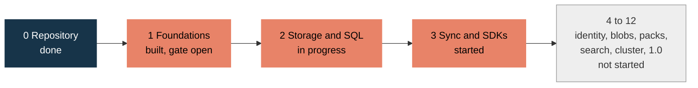
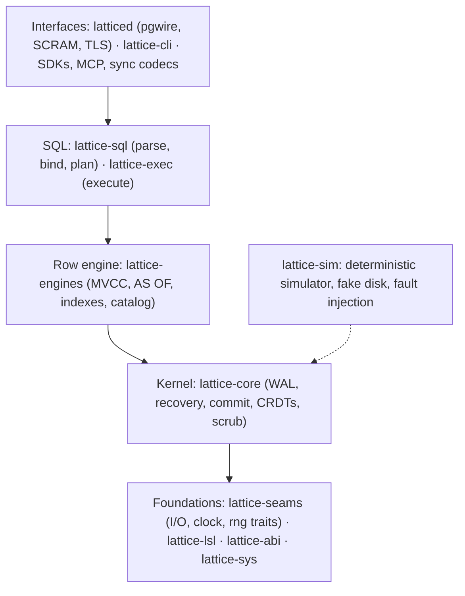

# Lattice · One database for your whole software team

[](https://github.com/moncifem/latticedb/actions/workflows/pr.yml) [](LICENSE) [](docs/gates/phase-2.md)

Your specs say one thing. Your code does another. Your docs find out last.

Lattice is an open-source Rust database that keeps one shared, permissioned history of a team's work
items, docs, specs, designs and deployments. People and AI agents work inside the same permissions,
and every change stays on the record. The core makes no model calls.

The database is built the hard way: a deterministic simulator replays crashes and disk faults,
deliberately planted bugs prove the checks can fail, decoders are fuzzed, and the trickiest rules
have formal models. Features come after the evidence that the layer below them holds.

**[Architecture](docs/ARCHITECTURE.md) · [Roadmap board](https://github.com/users/moncifem/projects/1) · [Contribute](CONTRIBUTING.md)**

> **Pre-alpha. Use test data only.** No release exists, no phase gate is signed, and nothing here is
> production ready. The numbers below come from the repository and CI; the
> [gate pages](docs/gates) are the source of truth.

## What works today

You can start a server, connect with a PostgreSQL client and run single-table SQL against a
write-ahead log that survives crashes.

| Area | What exists |
|---|---|
| Storage kernel | Checksummed write-ahead log (WAL), crash recovery that refuses a valid record at an unexpected position instead of truncating it, group commit, deduplication, turn fencing, scrubber |
| Row engine | MVCC tables, snapshot reads, `AS OF` history, first-committer-wins conflicts, secondary indexes (rebuilt on open from persisted definitions), versioned catalog, version vacuum, a capability guard so old readers refuse protected history |
| SQL | Parser, binder, logical plan and an executor for single-table `SELECT`, `INSERT`, `UPDATE`, `DELETE`, `CREATE TABLE`, `DROP TABLE`. Primary key and `UNIQUE` predicates read a key range or one entry instead of scanning |
| Server (`latticed`) | PostgreSQL wire v3 (simple and extended query), SCRAM-SHA-256 over TLS or loopback trust, bounded connections, timeouts, cancellation, row policy per account |
| CRDTs | Registers, observed-remove set, text sequence, tree with moves, with limits on what one hostile peer can make a replica hold |
| Sync pieces | Change-feed events with stable cursors, sync frame codec, WebSocket codec, principal-bound subscriptions |
| SDK pieces | Rust sync client state machine, outbox, plugin contract with a conformance suite, MCP server codec with scoped tools, experimental [TypeScript](clients/typescript) and [Python](clients/python) clients checked against vectors written by the Rust side |
| Schema language | LSL parser, validator, formatter, compatibility checker, typed-row codec |
| Tooling | `lattice doctor`, results ledger, scorecards, benchmark gates, a risk gate and serial merger for pull requests |

## What is not there yet

- Durable column definitions: after a restart, committed rows and table names come back but column
  definitions do not, so a recovered table cannot be queried ([#379](https://github.com/moncifem/latticedb/issues/379)).
- Joins, aggregates, `DISTINCT`, subqueries (they return `0A000`) and binary result formats.
- A PostgreSQL driver compatibility matrix ([#413](https://github.com/moncifem/latticedb/issues/413)).
- Authenticated agent permissions: row policy is a per-account allow-all or deny-all, supplied by the host.
- A sync server. The sync and SDK pieces are not connected to the listener yet.
- The connected team workspace (work items, docs, specs and the links between them) and everything after it.
- A release. Nightly builds exist, with checksums, SBOMs and build provenance, but the first alpha tag
  waits for the Phase 1 gate.

## Progress toward the product

Twelve phases, each with a written specification and an exit gate. The owner signs gates; no page
claims one passed before that. Phases 2 and 3 run ahead of the open earlier gates under a
[documented waiver](docs/gates/phase-1-review.md) that forbids release tags and exit-criteria claims
for them.



| Phase | State | Evidence |
|---|---|---|
| 0 Repository and conventions | Done | [phase-0](docs/gates/phase-0.md) |
| 1 Foundations and evaluation | Built. Gate open: 2 of 7 clean nightly runs recorded, Linux runtime numbers and two-maintainer sign-off pending | [phase-1](docs/gates/phase-1.md) |
| 2 Storage engines and SQL | Storage, wire, auth, parser and single-table executor exist. Durable columns, joins and driver matrix open | [phase-2](docs/gates/phase-2.md) |
| 3 Sync, CRDTs and SDKs | Building blocks that need no server exist. Live sync not started | [phase-3](docs/gates/phase-3.md) |
| 4 to 12 | Identity and policy, blobs and S3, schema packs, search, intelligence, role packs, cluster, optional models, 1.0 | [spec](docs/spec/README.md) |

Full detail: [roadmap](docs/roadmap.md) and [milestones](https://github.com/moncifem/latticedb/milestones).

## Try it

You need Rust (`rustup` installs the toolchain pinned in `rust-toolchain.toml`) and a PostgreSQL
client. Start the development server on loopback with a data directory:

```bash
cargo run -p latticed -- --data-dir ./data --development-policy allow-all
```

It listens on `127.0.0.1:5432` with trust authentication. The policy flag is required and never
implied. Keep stdin open; type `shutdown` and press enter to stop it. In another terminal:

```bash
psql -h 127.0.0.1 -p 5432 -U dev
```

```sql
CREATE TABLE notes (id INT PRIMARY KEY, title TEXT NOT NULL, done BOOLEAN);
INSERT INTO notes VALUES (1, 'write the spec', false);
SELECT * FROM notes;
```

After a restart the committed rows are recovered from the log, but column definitions are not (see
above), so query the table in the run that created it. Without `--data-dir` the server only answers
`SELECT 1`. For configured SCRAM over TLS, timeouts and the other flags, see the
[listener guide](crates/latticed/README.md).

Other commands:

```bash
cargo run -p lattice-cli -- doctor --dir path/to/data   # check a data directory
cargo run -p lattice-cli -- lsl compat old.lsl new.lsl  # schema compatibility check
cargo xtask sim --seeds 1000                            # replay crashes across five fault profiles
cargo xtask ci                                          # the full pull request gate
```

Nightly archives for Linux x86_64, Linux arm64 and macOS arm64 are on the
[releases page](https://github.com/moncifem/latticedb/releases/tag/nightly), and
`docker run --rm ghcr.io/moncifem/latticedb:nightly --version` runs the container. They may predate the
latest source.

## How it is built

Layers only depend downwards. `cargo xtask check-layers` fails the build on a forbidden dependency,
and deterministic crates may not touch real time, files, threads or `HashMap`.



The design is in [ARCHITECTURE.md](docs/ARCHITECTURE.md), the engineering plan in
[ENGINEERING.md](docs/ENGINEERING.md), and decisions in [`docs/adr`](docs/adr) and [`docs/rfc`](docs/rfc).
Byte formats live in [`formats/`](formats) with golden files.

## How we know it works

| Evidence | Where it stands |
|---|---|
| Simulator | Seeded crashes, torn writes, disk errors and bit rot across 5 fault profiles. Nightly runs 1,000,000 seeds per profile. 10,000 seeds reproduce identical traces |
| Planted bugs | 53 switchable defects across the kernel, row engine, CRDTs, policy and executor. The simulator catches the 21 kernel ones; the others have focused witnesses |
| Crash recovery | Power cut at every storage operation of 100 workloads: 4,729 cut points, every acknowledged change recovered |
| Fuzzing | 19 targets (WAL records, pgwire, SQL, LSL, sync and WebSocket frames, CRDTs, MCP and more). Six core targets ran 28 h 20 min each with no crash |
| Formal models | TLA+ for commit, fencing, clocks, set convergence and tree moves. The tree model has variants with a protection removed that must fail |
| Bounded proofs | Kani harnesses cover decoders, cursors and the tree cycle check. 4 of 10 are proven on a verified CI job (the change-feed harnesses); the other 6 time out or are killed on the runner and are not claimed ([#424](https://github.com/moncifem/latticedb/issues/424), [#425](https://github.com/moncifem/latticedb/issues/425)) |
| Memory and UB | Miri, AddressSanitizer and Loom jobs |
| Mutation testing | No verified complete score yet. The last campaign lost shard outcomes, so we report no number ([E1-7](docs/gates/phase-1.md)) |

Properties run 10,000 cases on every pull request and 1,000,000 nightly. Known gaps stay in the gate
pages, next to the passes. See also the [threat model](docs/threat-model.md); no second maintainer has
reviewed it yet.

## Follow along and contribute

- **Watch progress:** the [roadmap board](https://github.com/users/moncifem/projects/1),
  [milestones](https://github.com/moncifem/latticedb/milestones), [changelog](CHANGELOG.md) and
  [gate pages](docs/gates). Star the repo, or use Watch, then Custom, then Releases.
- **Pick up work:** [open work packages](https://github.com/moncifem/latticedb/issues?q=is%3Aissue+is%3Aopen+label%3A%22type%3A+feature%22),
  or a `type: docs` or `type: test` issue to start small.
- **Rules:** [CONTRIBUTING.md](CONTRIBUTING.md), the [agent workflow](docs/agent-workflow.md) for humans and
  automated contributors, and the [conventions](docs/conventions.md). Commits use Conventional Commits
  with a crate or directory as scope.
- **Talk:** [Discussions](https://github.com/moncifem/latticedb/discussions). Challenge a design decision.
- **Security:** report privately, see [SECURITY.md](SECURITY.md).

Apache-2.0. See [LICENSE](LICENSE).
