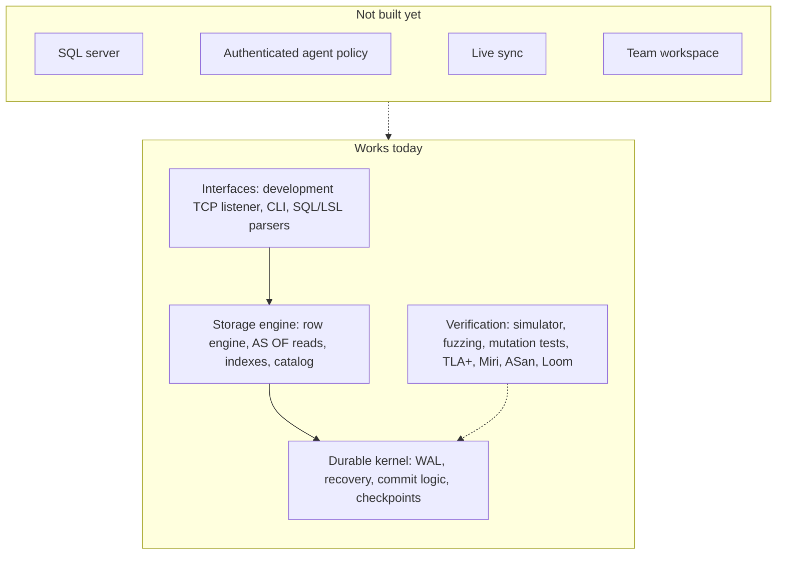

# Lattice · One database for your whole software team

[](https://github.com/moncifem/latticedb/actions/workflows/pr.yml) [](LICENSE) [](docs/gates/phase-2.md)

Your specs say one thing. Your code does another. Your docs find out last.

Lattice is an open-source Rust database being built to give software teams one shared history of
work items, docs, specs, designs and deployments—with agents working inside the same permissions.
The goal is to connect what the team knows, what it is building and what actually shipped.

**[Explore the architecture](docs/ARCHITECTURE.md) · [Follow the roadmap](https://github.com/users/moncifem/projects/1) · [Get involved](CONTRIBUTING.md)**

> **Pre-alpha.** The storage kernel and early row engine work today. A development TCP listener
> answers `SELECT 1`; storage-backed SQL execution and the connected team workspace are still ahead.
> The Phase 1 gate remains open; Phase 2 development
> is proceeding under a [documented waiver](docs/gates/phase-1-review.md). Use test data only.

## Why build another database?

- **Team context belongs together.** A requirement, its implementation and the deployment that shipped
  it should be linked data, rather than a trail across disconnected tools.
- **History should answer questions.** The design preserves changes so questions like “when did this
  feature start?” can have an answer with evidence.
- **Agents should be teammates with boundaries.** Scoped grants, auditable changes and reviewable
  proposals are part of the design. The core makes no model calls; model acceleration is optional.
- **Trust starts below the interface.** A deterministic simulator, crash recovery and tests that plant
  deliberate defects come before the product features.

These are the design goals. The [phase status](docs/gates) separates them from implemented behavior.

## What works today

| Built | What it does |
|---|---|
| Durable kernel | Checksummed write-ahead log, crash recovery, group commits, deduplication and turn fencing |
| Row engine | Snapshot reads, `AS OF`, write conflicts, a versioned catalog, persisted managed-index definitions/history, callback legacy mode and in-memory version vacuum; reads below the vacuum floor return an error |
| Development listener | PostgreSQL v3 simple/extended sessions over bounded TCP connections; loopback trust or configured SCRAM over TLS, with a `SELECT 1` placeholder handler |
| SQL front end | A bounded parser and AST for the declared subset; planning and execution remain pending |
| Statement controls | Actor-bound row transactions and filtered snapshot reads; cancellation, deadline and memory-budget primitives await executor integration |
| Schema tools | LSL parser, validation, formatting, compatibility checks and a typed-row codec |
| Verification tools | `lattice doctor`, a results ledger, unsigned scorecards, fault simulation, fuzz targets and benchmark gates |

The [accepted WAL capability guard](docs/rfc/0008-wal-capability-admission.md) has completed bounded
old-reader/crash checks and [hosted admission measurements](docs/evidence/wal-admission-40908208450.md).
The owner waived this guard's review wait and separately accepted
[managed-index recovery](docs/rfc/0005-catalog-managed-indexes.md). Default managed opens rebuild
physical-byte indexes from persisted definitions; callback opens remain legacy-only. Synchronous
build cost and full retained-state memory bounds are still unmeasured; see the
[bounded engine proof](docs/evidence/managed-index-40916386232.md).



Storage-backed SQL execution, PostgreSQL driver conformance, live sync, authenticated agent permissions and the connected workspace are still ahead.
Row policies currently come from a trusted host; authenticated listener identities are not yet bound to those evaluators.
See the [delivery plan](docs/spec/README.md) and [milestones](https://github.com/moncifem/latticedb/milestones).

## Try the foundations

Nightly archives for Linux x86_64, Linux arm64 and macOS arm64 are available on the
[releases page](https://github.com/moncifem/latticedb/releases/tag/nightly). Or inspect the container:

```bash
docker run --rm ghcr.io/moncifem/latticedb:nightly --version
```

To build from source, use the Rust version pinned in `rust-toolchain.toml`:

```bash
cargo xtask ci                               # the complete pull request gate
cargo xtask gate --phase 1                    # collect a pending review package
cargo xtask sim --seeds 1000                  # replay crashes across five fault profiles
cargo run -p lattice-cli -- doctor --dir path/to/data
cargo run -p lattice-cli -- lsl compat old.lsl new.lsl
```

To try the development listener from the current source tree:

```bash
cargo run -p latticed -- --listen 127.0.0.1:5432 --max-connections 32
```

Keep stdin open, then enter `shutdown` to stop cleanly; EOF also stops it. This placeholder uses
plaintext and trust authentication and does not open a database. See the
[listener guide](crates/latticed/README.md) for timeouts, configured TLS/SCRAM authentication and
externally provisioned verifier files. Published nightly
archives may predate these source changes.

<details>
<summary><strong>How the foundation is checked</strong></summary>

The simulator replays seeded crashes, torn writes, disk errors and bit rot. Twenty-one planted kernel
bugs prove its checks can fail; ten storage defects have specific witnesses with clean controls. The
row engine also has seeded history and fault-profile tests. Mutation
checks, independent format fixtures, TLA+ models, fuzzing, Miri and AddressSanitizer provide different
kinds of evidence. Long-run evidence and known gaps stay visible in the [gate records](docs/gates).

Nightly archives include checksums, SBOMs and build provenance. See [release verification](docs/releasing.md).

</details>

## Build it with us

This is early enough to influence the foundations. Review a [design decision](docs/adr), try an
[open work package](https://github.com/moncifem/latticedb/issues?q=is%3Aissue+is%3Aopen+label%3A%22type%3A+feature%22), challenge an
assumption in [Discussions](https://github.com/moncifem/latticedb/discussions), or contribute a test
that makes the database harder to break. Start with [CONTRIBUTING.md](CONTRIBUTING.md).

**Want to follow the build?** [Star Lattice](https://github.com/moncifem/latticedb/stargazers) to keep it
on your radar. Use **Watch → Custom → Releases** for new builds, or **All Activity** to follow the work
as it lands. Progress is tracked in the [public roadmap](https://github.com/users/moncifem/projects/1)
and [changelog](CHANGELOG.md).

Apache-2.0. See [LICENSE](LICENSE).
