# Lattice v2: one database for the whole dev team

*Working name. Revised design: knowledge graph, agent-driven intelligence (optional GLiNER2.5 and GLiNER2.5-Decide plugin, off by default), our own SQL engine, our own S3-compatible blob store, built-in OAuth/OIDC, our own schema language, and Jira + Confluence + BA + design + PM capabilities as extension packs on one small kernel.*

Everything below is a **proposal**. Items I could not verify are called out in section 19.

## 1. What Delta taught us (condensed)

Delta's core is **DeltaDB**, an append-only log of recorded changes (file edits, tree changes, messages, comments) with author and position, replicated live to every participant. Worktrees, forks, subagents, review, sharing and the plugin contract are all built on that log.

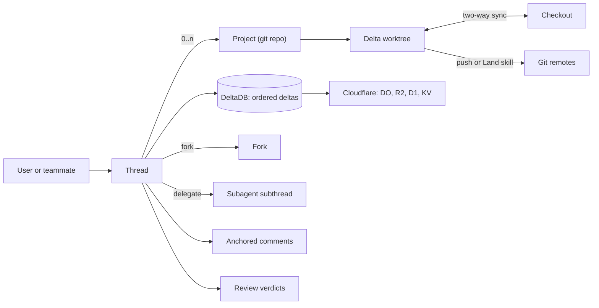

| Delta limit | Lattice v2 answer |
|---|---|
| Code, messages, comments only | Typed entities and facets; Jira, Confluence, specs, design, ops all as packs |
| Nothing detects stale docs | Claims vs observations in a knowledge graph, judged by agents (or an optional small model) |
| Closed, Cloudflare-bound | One Rust binary: own SQL engine, blob store, identity provider |
| Linear history, merge by asking the agent | Causal DAG, CRDT merge, conflicts as first-class objects |
| No permissions, no sandbox | ReBAC and ABAC compiled into the engine, approval gates, sandboxed runners |
| Delete is local only | Per-entity keys, crypto-shredding that cascades to derived data |
| No schema enforcement | Our own schema language with compile-time and in-engine enforcement |

## 2. Requirements and how they are met

| Requirement | Mechanism |
|---|---|
| Single DB, no external storage or calls | One process owns SQL, log, blobs, vectors, text index, graph, identity (models optional). The core opens **no outbound connections** (section 3) |
| High performance | Rust, io_uring, one shared WAL, columnar and CSR layouts, in-process inference |
| Extensible, not encased | Tiny kernel, everything else behind traits (interfaces), packs add types and behaviour |
| Schema enforcement like Pydantic/Zod | Lattice Schema Language (LSL), compiled, enforced in the engine (section 9) |
| Knowledge graph | Extraction through a work queue that agents serve by default; optional GLiNER2.5 plugin (off). Mentions, then resolved assertions (section 11) |
| Decision model | A judge slot at four levels, filled by agents by default; optional GLiNER2.5-Decide plugin (off). Always bounded and audited (section 12) |
| Drift detection | Claims vs observations, deterministic first, model second (section 13) |
| Search across text, meaning and time | Temporal hybrid search: relevance first, then time-aware aggregation over history (section 15.6) |
| Jira, Confluence, BA, PM, design | Packs on the kernel (section 14) |
| Own MinIO | Content-addressed S3-compatible store inside the engine (section 7) |
| OAuth built in | Built-in OIDC/OAuth 2.1 provider, Keycloak-class (section 8) |

## 3. Principles and SOLID mapping

1. **Small kernel, everything else a pack.** The kernel knows entities, facets, links, change sets, grants. It does not know what a "sprint" is.
2. **Composition over inheritance.** An entity is a bag of typed facets (like an ECS), not a class hierarchy.
3. **The log is truth, views are derived.** Indexes, graph, vectors, dashboards are projections.
4. **Inbound-only core.** Connectors, importers and notification delivery are separate processes or sandboxed plugins. The core never dials out.
5. **Agents and models advise, policy decides.** Neither ever authorizes, deletes or deploys.
6. **Every automated judgment is recorded, reversible and measurable.**
7. **Intelligence is a slot, not a dependency.** By default agents fill the slots through a work queue. The GLiNER models are an optional accelerator plugin, **off by default**.

| SOLID | Applied as |
|---|---|
| Single responsibility | One trait per concern: `StorageEngine`, `BlobStore`, `Extractor`, `Judge`, `Reconciler`, `PolicyEvaluator`, `IdentityProvider`, `SchemaValidator`, `Projection`, `Connector` |
| Open/closed | New kinds, facets, link types, workflows, extractors are added by packs, never by editing the kernel |
| Liskov | Any `Judge` (rule, agent, model, human) returns the same `Judgment` shape; any `Extractor` returns `Mention`s |
| Interface segregation | Narrow traits, for example `VectorIndex` has no graph methods; a pack declares only the capabilities it needs |
| Dependency inversion | The kernel depends on traits; implementations (ONNX vs candle, local vs replicated blobs) are wired at startup |

## 4. Technology decisions

| Decision | Choice | Why | Alternative |
|---|---|---|---|
| Code structure | Cargo workspace: `lattice-core`, `lattice-api`, `lattice-service`, `lattice-web`, plus optional plugins (section 5) | One-way dependencies; core embeddable alone; roles can be split into processes later | One monolithic crate |
| Language | **Rust** | No GC pauses, io_uring, memory safety for a database, in-process ONNX/candle, derive macros for the schema layer, mature CRDT crates | Go: faster to write, but GC jitter and cgo cost for inference |
| SQL engine | **Native Rust engine speaking the PostgreSQL wire protocol and dialect** | A Postgres fork keeps C, process-per-connection, and a storage layer built around heap pages, which fights our unified WAL, delta-native MVCC, graph and vector engines. Wire compatibility keeps every Postgres driver and BI tool working | Fork Postgres: faster to SQL maturity, slower to everything else. Reasonable if the team is C-fluent |
| Storage | Pluggable engines behind one WAL and one transaction manager | One commit can atomically write a delta, a blob reference, an edge, a vector and an index entry | Separate stores glued by outbox patterns |
| Blob store | Own S3-compatible store, engine-integrated | Blob references are transactional, so no orphans and no dangling attachments | MinIO sidecar (violates single DB goal) |
| Identity | Own OIDC/OAuth 2.1 provider, Keycloak-class features | Tokens map directly to principals and grants in the same engine | Embed Keycloak (JVM, separate store) |
| Intelligence | Agents through a work queue by default. Optional `lattice-intel` plugin (default off) runs GLiNER2.5 and GLiNER2.5-Decide in-process via ONNX | Keeps the core small and call-free; models are an accelerator you enable only if volume demands it | Core calling a hosted LLM (violates no-external-calls) |
| Schema | Own language (LSL) compiled by a Rust toolchain | One source of truth for DDL, validators, SDK types, extraction labels, migrations | Reuse JSON Schema or protobuf (no merge, PII or workflow semantics) |

## 5. Code layers and system architecture

**Yes, separate them, by crate boundary first and process boundary second.** One Cargo workspace with one-way dependencies gives the benefits (embeddable core, independently scalable API, independently released web UI, testable service loops) without giving up the single-binary default. A split into processes is a deployment option, not a code change.

### 5.1 The layers

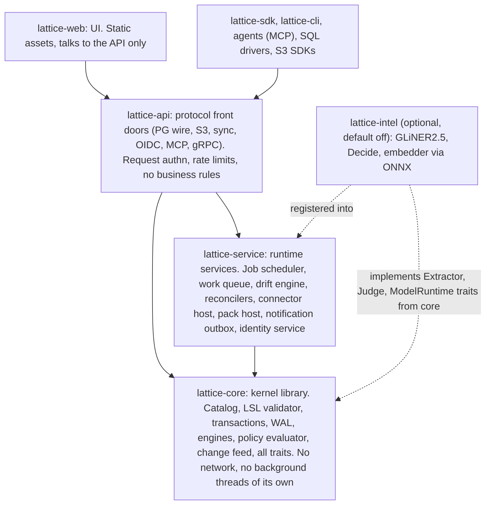

| Layer | Owns | Must not |
|---|---|---|
| `lattice-core` | Entities, facets, links, change sets, LSL validation, MVCC and WAL, all engines, policy evaluation, change feed, every trait | Open sockets, spawn its own loops, know any pack, load models |
| `lattice-api` | Wire protocols, request authentication, quotas, serialization | Contain business rules or reach into engines directly |
| `lattice-service` | Everything that runs in the background: schedulers, work queue, drift, reconcilers, connector and pack hosting, outbox, IdP logic | Bypass core transactions |
| `lattice-web` | Browser UI | Talk to anything except the API |
| `lattice-intel` (optional) | ONNX runtime, GLiNER2.5, Decide, embedder | Be required by anything else; if absent, agents serve the same slots |
| `lattice-sdk`, `lattice-cli` | Generated typed clients, admin and scripting tool | Hold schema knowledge not generated from LSL |
| Packs | LSL files, workflows, views, optional trait implementations | Edit the kernel |
| Sidecars | Webhook receivers, importers, email/chat delivery | Run inside the core |

### 5.2 Workspace layout

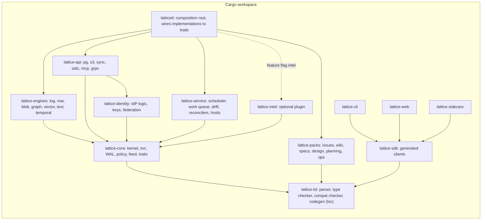

### 5.3 Runtime composition

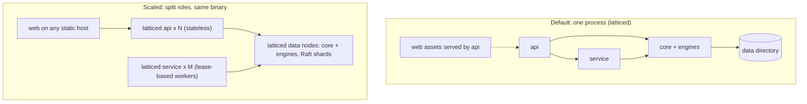

### 5.4 Component view

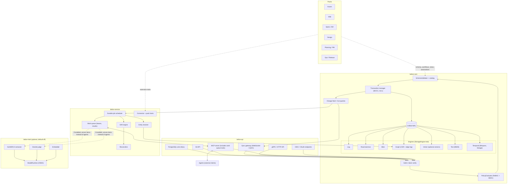

## 6. Storage engine internals

The main innovation over "Postgres plus extras" is **one WAL and one transaction manager shared by every engine**. A single commit can write a delta, attach a blob, add a graph edge, insert a vector and update the text index atomically.

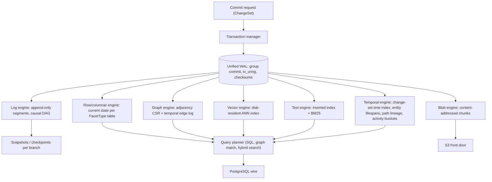

Engine behaviours tailored to this domain:

| Feature | Detail |
|---|---|
| Delta-native MVCC | A row version is a ChangeSet id, so `AS OF` time travel and branch snapshots are free |
| Copy-on-write branches | Forks, subagent workspaces and review copies are branch pointers, not copies |
| Facet tables | Each FacetType compiles to a typed physical table plus an overflow column, not a generic EAV table |
| Native CRDT columns | Rich text, ordered lists, sets and registers merge inside the engine |
| Change feed | Every commit emits typed events; live queries are incremental views over the feed |
| Row-level security | Policies compile into scan filters, no application-side filtering |
| Hybrid query | One SQL statement can combine relational filters, graph patterns, BM25, vector similarity and time constraints |
| Temporal index | Lifespans, path lineage and activity buckets are maintained in the same transaction as the change, so history questions are exact lookups, not log scans |

## 7. Blob store (our MinIO)

Performance targets are goals to benchmark, not measured results.

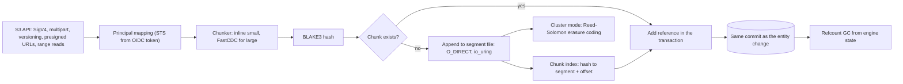

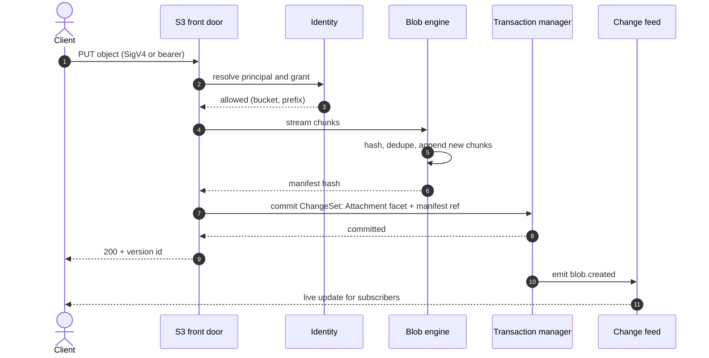

Why integrated beats a sidecar: references are transactional (no orphan objects, no attachment pointing at a missing object), dedupe works across all entities, crypto-shredding can destroy a key and render every chunk of an entity unreadable, and the S3 view of a bucket is just another projection of entity state.

## 8. Built-in identity (OAuth 2.1 / OIDC)

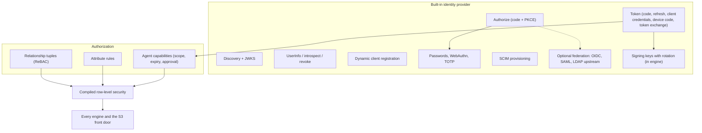

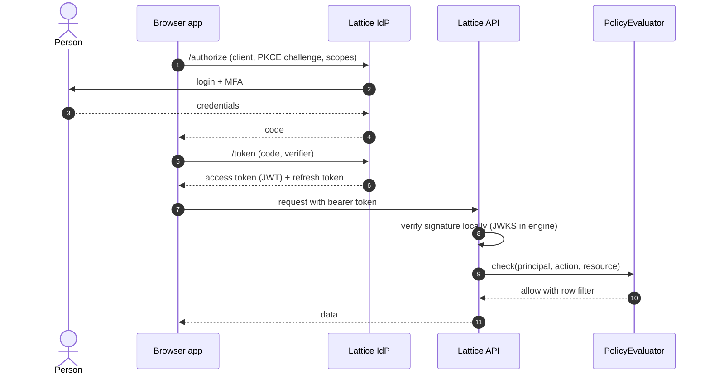

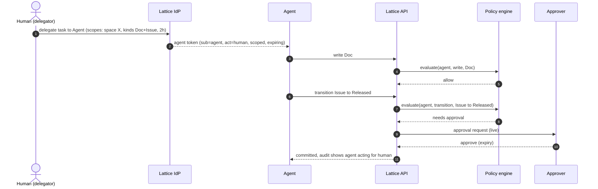

## 9. Schema language and enforcement (LSL)

We build a language, compiler and in-engine enforcement. Rust implementation, SDK codegen for any client language.

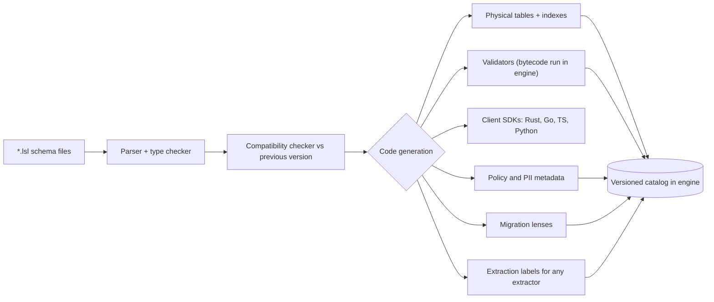

Proposed syntax (illustrative, not final):

```text
facet Estimable {
  points:     u16 in 0..=100          optional
  confidence: enum { low, medium, high } = medium
}

facet Describable { body: richtext  @merge(sequence)  @extract }

type Story = Titled + Describable + Assignable + Estimable + Workflowed<StoryFlow> {
  epic:        ref<Epic>   on_delete restrict
  acceptance:  list<text>  max 20
  @index(epic, state)
  @label("user story", "A requirement from a user's point of view")
}

link implements : Story -> Spec  (many_to_many, on_delete cascade_link)

migration Story v1 -> v2 {
  up   { acceptance = split_lines(acceptance_criteria) }
  down { acceptance_criteria = join_lines(acceptance) }
}
```

Five enforcement layers, each catching a different class of error:

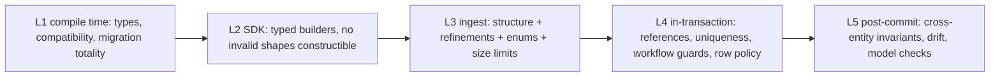

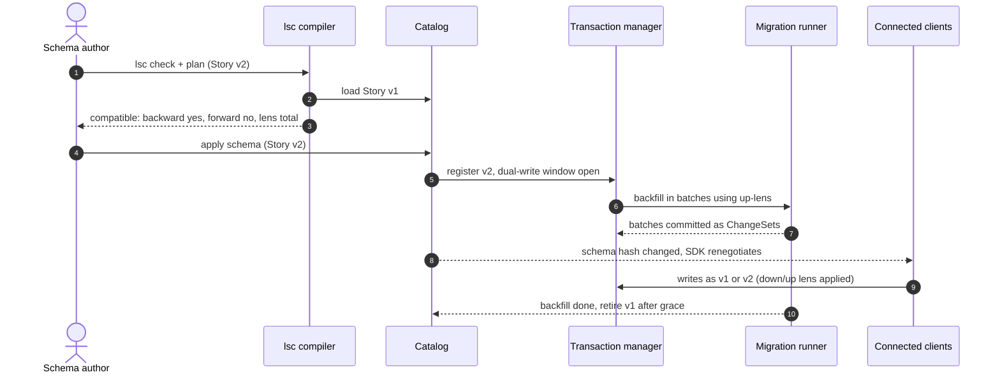

## 10. Domain model (UML)

### 10.1 Kernel: small and open for extension

Pack-defined things (Story, Page, Sprint, Deployment...) are **EntityTypes**, not kernel classes.

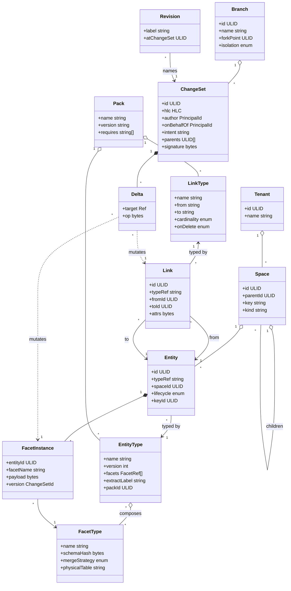

### 10.2 Extension interfaces (SOLID in one picture)

The kernel depends only on the interfaces in the middle column.

```mermaid
classDiagram
  class StorageEngine {
    <<interface>>
    +apply(batch) Result
    +snapshot(branch) Snapshot
    +recover(wal) Result
  }
  class BlobStore {
    <<interface>>
    +put(stream) ManifestRef
    +get(ref, range) Stream
    +release(ref)
  }
  class VectorIndex {
    <<interface>>
    +upsert(id, vector)
    +search(vector, k, filter) Hit[]
  }
  class TextIndex {
    <<interface>>
    +index(id, text)
    +search(query, filter) Hit[]
  }
  class GraphStore {
    <<interface>>
    +addEdge(edge)
    +match(pattern, asOf) Rows
  }
  class ModelRuntime {
    <<interface>>
    +load(artifact) ModelHandle
    +run(handle, input) Output
  }
  class Extractor {
    <<interface>>
    +extract(text, labels, hints) Mention[]
  }
  class Judge {
    <<interface>>
    +judge(question, evidence, labels) Judgment
  }
  class Reconciler {
    <<interface>>
    +onDrift(drift) Proposal
  }
  class Connector {
    <<interface>>
    +ingest(event) ChangeSet
  }
  class PolicyEvaluator {
    <<interface>>
    +check(principal, action, resource) Decision
  }
  class IdentityProvider {
    <<interface>>
    +authenticate(credential) Principal
    +issue(principal, scopes) Token
  }
  class SchemaValidator {
    <<interface>>
    +validate(facetType, payload) Violations
  }
  class Projection {
    <<interface>>
    +fold(event)
    +checkpoint() Cursor
  }
  class AutomationAction {
    <<interface>>
    +run(ctx) ChangeSet
  }
  class HistoryIndex {
    <<interface>>
    +lifespan(entity) Lifespan
    +lineage(pathPattern, filter) PathHistory[]
    +firstLast(entities, phases) Milestone[]
    +activity(scope, granularity) Bucket[]
  }
  class WorkQueue {
    <<interface>>
    +enqueue(item) WorkItemId
    +claim(kinds, lease) WorkItem
    +submit(id, result) Receipt
  }
  class Kernel

  Kernel ..> StorageEngine
  Kernel ..> PolicyEvaluator
  Kernel ..> SchemaValidator
  Kernel ..> Projection
  Kernel ..> Extractor
  Kernel ..> Judge
  Kernel ..> Reconciler
  Kernel ..> Connector
  Kernel ..> IdentityProvider
  Kernel ..> AutomationAction
  StorageEngine <|.. LogEngine
  StorageEngine <|.. RowEngine
  StorageEngine <|.. BlobEngine
  StorageEngine <|.. GraphEngine
  StorageEngine <|.. VectorEngine
  StorageEngine <|.. TextEngine
  StorageEngine <|.. TemporalEngine
  BlobStore <|.. BlobEngine
  VectorIndex <|.. VectorEngine
  TextIndex <|.. TextEngine
  HistoryIndex <|.. TemporalEngine
  GraphStore <|.. GraphEngine
  ModelRuntime <|.. OnnxRuntime
  ModelRuntime <|.. CandleRuntime
  Extractor <|.. Gliner2Extractor
  Extractor <|.. RuleExtractor
  Extractor <|.. AgentExtractor
  Judge <|.. DecideJudge
  Judge <|.. RuleJudge
  Judge <|.. HumanJudge
  Judge <|.. AgentJudge
  Gliner2Extractor ..> ModelRuntime
  DecideJudge ..> ModelRuntime
  AgentExtractor ..> WorkQueue
  AgentJudge ..> WorkQueue
  Kernel ..> WorkQueue
  note for ModelRuntime "Optional: loaded only when lattice-intel is enabled (default off)"
  note for AgentJudge "Default provider for judge slots"
  PolicyEvaluator <|.. RebacEvaluator
  IdentityProvider <|.. BuiltinOidc
  IdentityProvider <|.. FederatedOidc
  Reconciler <|.. DocReconciler
  Reconciler <|.. ConfigReconciler
  Connector <|.. WebhookConnector
  Connector <|.. GitConnector
```

### 10.3 Knowledge graph, claims, drift and judgments

Two ideas keep this extensible. **KG nodes are ordinary Entities** (a Service, a Person, a Term), so the graph and the product share one model. **Assertions carry a stance**: a document *claims*, a system *observes*. Drift is a claim contradicting an observation.

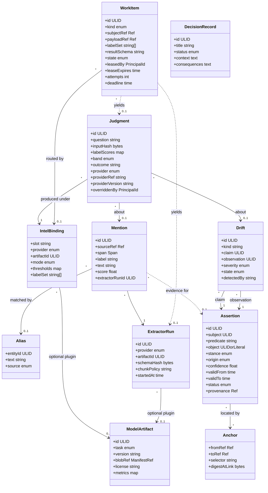

Naming note: a **Judgment** is a machine or human verdict on a small question. A **DecisionRecord** is a business or architecture decision (ADR). They are different things and never share a table.

### 10.4 Identity and access

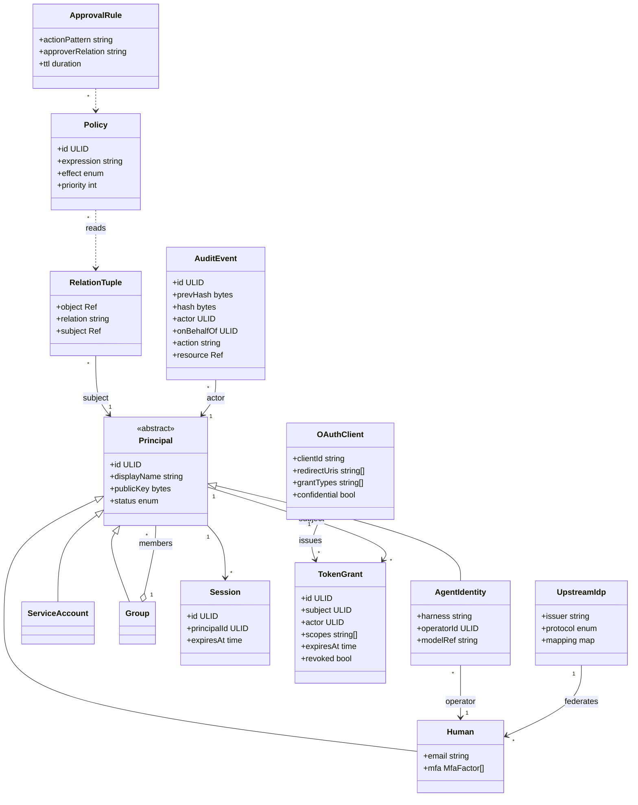

### 10.5 Packs (components, one kernel)

Every product capability is a pack made only of EntityTypes, LinkTypes, workflows, views, automations and optional trait implementations.

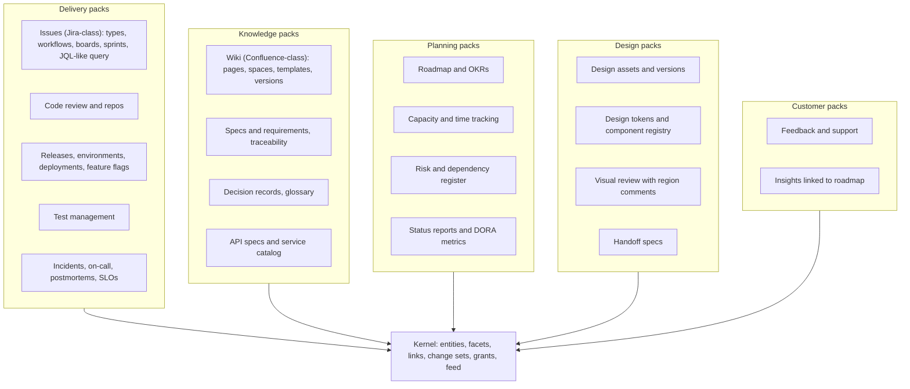

## 11. Knowledge graph

### 11.1 How the graph is built (agents by default)

Extraction is an **Extractor slot** with three providers:

| Provider | Default | What it does |
|---|---|---|
| `RuleExtractor` | on | Patterns for ids, links, versions, mentions of known aliases. Cheap and exact |
| `AgentExtractor` | **on** | Creates a `WorkItem`; an agent claims it, reads the chunk, and submits structured mentions and relations. The submission is validated against a result schema generated from LSL, so a sloppy agent cannot write malformed graph data |
| `Gliner2Extractor` | **off** | Optional plugin. Runs GLiNER2.5 in-process and fills the same slot with the same result shape |

Labels come from the **schema registry** (`@label` annotations), so the graph vocabulary is defined by the same schema files as the product.

```text
[intelligence]
enabled = false              # default: agents serve extraction and judging via the work queue
provider.extract = "agent"   # agent | rule | gliner2.5
provider.judge   = "agent"   # agent | rule | decide
provider.embed   = "none"    # none | client | embedder
[intelligence.models]
dir = "models/"              # only read when enabled = true
```

```mermaid
flowchart LR
  EV["Commit touches a text facet"] --> Q["Durable job scheduler"]
  Q --> CH["Chunker: sentence and structure aware, about 300 words"]
  CH --> RX["RuleExtractor (always on)"]
  CH --> P{"Extraction provider"}
  P -- "default" --> WI["WorkItem kind=extract with labels, hints, result schema"]
  WI --> AGX["Agent claims, extracts, submits"]
  P -- "plugin enabled" --> GL["GLiNER2.5 in-process"]
  AGX --> SV["Validate result against schema"]
  RX --> M["Mentions with spans and scores"]
  SV --> M
  GL --> M
  M --> R1{"Exact alias match?"}
  R1 -- yes --> LINK["Link mention to entity"]
  R1 -- no --> LEX["BM25 over entity names and summaries"]
  LEX --> VQ{"Vectors available?"}
  VQ -- yes --> ANN["ANN over entity embeddings"]
  VQ -- no --> RR["Graph-context rerank"]
  ANN --> RR
  RR --> D{"Judge slot: same entity?"}
  D -- accept --> LINK
  D -- review --> RQ["Review queue (human or agent)"]
  D -- reject --> NEW["Propose new entity"]
  LINK --> AS["Write Assertion: stance, confidence, provenance, valid time"]
  NEW --> RQ
  RQ --> AS
  AS --> GE[("Graph engine")]
  AS --> DR["Trigger drift checks"]
```

Embeddings need a model of their own (GLiNER does not produce them). By default the vector engine is **bring-your-own-vectors**: clients or agents may supply embeddings, otherwise search and entity resolution use BM25 plus graph context. An optional embedder in `lattice-intel` can fill that gap.

```mermaid
sequenceDiagram
  autonumber
  participant TX as Transaction manager
  participant JQ as Job scheduler
  participant WQ as Work queue
  participant AG as Agent client
  participant SV as SchemaValidator
  participant RS as Entity resolver
  participant GE as Graph engine
  actor RV as Reviewer

  TX->>JQ: page 42 version 17 changed
  JQ->>WQ: enqueue WorkItem(extract, labels, result schema)
  AG->>WQ: claim (kinds=extract, lease 5 min)
  WQ-->>AG: chunk + labels + known aliases nearby
  AG->>AG: read and reason over the text
  AG->>WQ: submit mentions and relations
  WQ->>SV: validate against result schema
  alt invalid
    SV-->>AG: violations, item returns to queue
  else valid
    SV-->>WQ: ok
    WQ->>RS: mentions
  end
  RS->>RS: exact alias match, then BM25 candidates
  RS->>WQ: enqueue WorkItem(judge) for ambiguous matches
  AG->>WQ: claim judge item
  AG->>WQ: submit Judgment (label, rationale, confidence)
  WQ->>RV: low-confidence items to review queue
  RV-->>WQ: confirm
  WQ->>TX: commit ChangeSet (mentions, assertions, judgments, provenance = agent id)
  Note over WQ,AG: with the plugin enabled, GLiNER2.5 and Decide serve these same items and submit the same shapes
```

Design notes: relation quality drops on long inputs for any provider, so chunk and pass document context as hints; re-extract when the label set or provider changes (`ExtractorRun` records both); never overwrite human-confirmed assertions on a re-run; if no agent is online, work items wait (with deadlines and priorities) while rule-based and deterministic stages keep working.

### 11.1b Work item lifecycle

```mermaid
stateDiagram-v2
  [*] --> Queued
  Queued --> Claimed: agent or plugin claims, lease starts
  Claimed --> Queued: lease expires or worker releases
  Claimed --> Submitted: result submitted
  Submitted --> Rejected: schema violations
  Rejected --> Queued: attempts remaining
  Rejected --> Failed: attempts exhausted
  Submitted --> NeedsReview: low confidence band
  Submitted --> Applied: valid and policy allows
  NeedsReview --> Applied: reviewer accepts
  NeedsReview --> Dismissed: reviewer rejects
  Queued --> Expired: deadline passed
  Applied --> [*]
  Failed --> [*]
  Dismissed --> [*]
  Expired --> [*]
```

### 11.2 Authority ladder for assertions

```mermaid
stateDiagram-v2
  [*] --> Candidate: extracted
  Candidate --> Confirmed: human or agent confirms
  Candidate --> Rejected: reviewer rejects
  Candidate --> Confirmed: judge band = accept and binding mode = auto
  Confirmed --> Promoted: becomes a typed Link (authoritative)
  Confirmed --> Superseded: newer assertion covers same subject and predicate
  Promoted --> Superseded
  Rejected --> [*]
  Superseded --> [*]
```

## 12. Judgment slots: agents by default, optional Decide model

A **judge slot** answers a small, bounded question ("same entity?", "does this change contradict that claim?", "which component?"). Four providers can fill a slot and all return the same `Judgment` shape:

| Provider | Default | Strength | Weakness |
|---|---|---|---|
| `RuleJudge` | on | Exact, free, explainable | Only covers what rules can express |
| `AgentJudge` | **on** | Can reason, handles nuance and numbers, no bundled weights | Slower, costs tokens, needs an agent online, self-reported confidence is poorly calibrated |
| `HumanJudge` | on | Final authority | Slow |
| `DecideJudge` (GLiNER2.5-Decide) | **off, optional plugin** | Millisecond CPU classification, cheap at high volume, scores against labels given at call time | Cannot reason or explain; needs bundled weights; vendor benchmarks are self-reported |

Recommendation: run agent-only first. Turn the plugin on only when judgment volume (for example classifying every edit) makes agent latency or cost painful, and keep the agent as the escalation path for the review band.

Where judges are allowed, by level:

```mermaid
flowchart TB
  subgraph L0["L0 Ingest triage"]
    A0["What kind of inbound item is this? Likely secret or PII? Language?"]
  end
  subgraph L1["L1 Knowledge-graph gating"]
    A1["Mention to entity: same or different? Relation valid in context?"]
  end
  subgraph L2["L2 Drift gating"]
    A2["Claim vs observation: consistent, contradicts, outdated, unrelated?"]
  end
  subgraph L3["L3 Work suggestions"]
    A3["Priority, component, type, duplicate-of, routing"]
  end
  subgraph L4["L4 Forbidden zone"]
    A4["Authorization, approvals, deletion, deployment, money, permissions"]
  end
  L0 --> L1 --> L2 --> L3
  L4 -. "never decided by an agent or model judge; may only show a risk signal" .- L3
```

| Level | Question | Default provider | With plugin | Output effect | Deterministic guard |
|---|---|---|---|---|---|
| L0 triage | Which pack or type is this inbound item? | Rules, then agent | Decide | Suggested type and space | Rules and detectors stay authoritative for secrets and PII; a judge can only add redaction |
| L1 KG gating | Same entity? Does the relation hold? | Agent | Decide for bulk, agent for review band | Accept, review or reject candidate assertions | Schema constraints (type compatibility, cardinality) filter first; confirmed facts never overwritten |
| L2 drift gating | Does this change make this claim false? | Agent | Decide for prose, agent for review band | Raise, downgrade or dismiss a Drift | Digest and typed comparators run first; judges only see prose |
| L3 suggestions | Priority, component, duplicate | Agent | Decide | Pre-filled fields the user accepts | Auto-apply only when the pack enables it |
| L4 | Not applicable | Never | Never | Display-only risk score on an approval request | Policy engine alone decides |

Rules that make the use correct, for any provider:

1. **Three bands per label**: auto-accept, review, auto-reject. Thresholds are calibrated per binding from recorded overrides, which matters most for agents whose self-reported confidence is unreliable.
2. **Cheapest check first.** Digest equality, schema constraints, graph reachability and typed comparators run before any judge.
3. **Every call writes a Judgment** with input hash, label scores, provider, provider version, band and outcome. Overrides are recorded and feed calibration.
4. **Reversible by construction.** Judges only produce Candidate assertions, suggestions and Drift states, never destructive writes.
5. **Rollout is gated by measurement** (shadow, assist, auto) and auto-demotes when score distributions shift or overrides rise. This applies to agent bindings too, with an agent trust level.
6. **Ambiguity escalates** to a person, or to a stronger agent, through the same work queue. The DB never calls an LLM itself.

```mermaid
stateDiagram-v2
  [*] --> Shadow: binding created
  Shadow --> Assist: precision at threshold above target on N judgments
  Assist --> Auto: override rate below target for a full window
  Auto --> Assist: score distribution drifts or override rate rises
  Assist --> Shadow: new provider version or label set
  Auto --> Shadow: new provider version or label set
  Shadow --> Disabled: owner disables
  Assist --> Disabled
  Auto --> Disabled
  Disabled --> Shadow: owner re-enables
```

```mermaid
sequenceDiagram
  autonumber
  participant CALL as Caller (resolver, drift engine, triage)
  participant J as Judge slot (trait)
  participant RJ as RuleJudge
  participant WQ as Work queue
  participant AJ as AgentJudge (agent client)
  participant DJ as DecideJudge (plugin, if enabled)
  participant TX as Transaction manager
  actor P as Person

  CALL->>J: judge(question, evidence, labels)
  J->>RJ: deterministic checks
  alt rule decides
    RJ-->>J: Judgment(provider=rule, band=accept)
  else undecided and plugin enabled for this slot
    J->>DJ: classify(question + evidence, labels)
    DJ-->>J: Judgment(provider=decide, band from calibrated thresholds)
  else undecided (default)
    J->>WQ: enqueue WorkItem(judge)
    AJ->>WQ: claim and submit verdict
    WQ-->>J: Judgment(provider=agent)
  end
  J->>TX: record Judgment
  alt band = accept and mode = auto
    J-->>CALL: apply
  else band = review or mode = assist
    J-->>P: suggestion in queue
    P-->>TX: accept or override (recorded)
  else band = reject
    J-->>CALL: discard
  end
```

## 13. Drift detection

### 13.1 Taxonomy

```mermaid
mindmap
  root((Drift))
    Knowledge
      Doc vs code
      Spec vs implementation
      Doc vs doc contradiction
      Glossary term vs usage
    Delivery
      Ticket status vs PR state
      Spec vs deployed behavior
      Release notes vs shipped commits
      Runbook vs infrastructure
    Planning
      Roadmap vs actual velocity
      Estimate vs actual
      Dependency changed under a plan
    Design
      Design token vs CSS value
      Component spec vs component
      Handoff vs build
    System
      Config vs environment
      Schema vs data
      Extractor confidence shift
```

### 13.2 Detection pipeline

Three stages from cheap and certain to expensive and fuzzy.

```mermaid
flowchart TB
  CH["Change committed (code, deploy, config, doc, ticket)"] --> S1["Stage 1: impact set via Anchors and graph traversal"]
  S1 --> S2{"Stage 2: deterministic compare"}
  S2 -- "digest unchanged" --> OK["No drift"]
  S2 -- "typed values differ (number, enum, version, URL)" --> DD["Drift: certain"]
  S2 -- "prose changed" --> S3["Stage 3: claim extraction and judgment (work items for agents, or optional models)"]
  S3 -- consistent --> OK
  S3 -- contradicts --> DD
  S3 -- outdated --> DM["Drift: probable"]
  S3 -- unrelated --> OK
  S3 -- "review band" --> DQ["Drift: needs review"]
  DD & DM & DQ --> REC["Reconciler proposes a fix on a branch"]
  REC --> NOTIFY["Notify owners live"]
```

```mermaid
sequenceDiagram
  autonumber
  participant CN as Connector (inbound)
  participant TX as Transaction manager
  participant GE as Graph engine
  participant DE as Drift engine
  participant EX as Extractor
  participant JD as Judge
  participant RC as Reconciler
  participant AG as Maintainer agent (external client)
  actor OWN as Doc owner

  CN->>TX: Deployment(prod) healthy, version 2.4, rate limit 100
  TX->>GE: observation assertions (stance=observes)
  TX->>DE: entity changed
  DE->>GE: who depends on this? (anchors + claims)
  GE-->>DE: Runbook page, API guide, Spec 12
  DE->>DE: typed compare: claim rate limit 60 vs observed 100
  DE->>TX: Drift(kind=doc_vs_deploy, severity=high, certain)
  DE->>EX: re-extract claims from API guide section 3 (prose changed)
  EX-->>DE: claim: "retries up to 3 times"
  DE->>JD: does observation contradict claim?
  JD-->>DE: Judgment(consistent)
  DE->>RC: onDrift(rate limit)
  RC->>TX: Proposal on branch fix/runbook-rate-limit
  TX-->>OWN: live notification with diff
  TX-->>AG: queue item (optional automatic fix)
  OWN->>TX: approve merge
  TX->>GE: new claim aligned, Drift resolved
```

```mermaid
stateDiagram-v2
  [*] --> Detected
  Detected --> Triaged: severity set (rule, agent or optional model)
  Triaged --> Proposed: reconciler drafts fix
  Triaged --> Dismissed: not a real drift (feeds calibration)
  Proposed --> Resolved: fix merged and claim re-verified
  Proposed --> Triaged: fix rejected
  Detected --> Dismissed
  Resolved --> Detected: regression
  Dismissed --> [*]
  Resolved --> [*]
```

## 14. Everything a modern dev team needs, as packs

The same kernel serves every role. A role can be a person or an agent; permissions come from grants, not role names.

```mermaid
flowchart LR
  subgraph PM["Project / product manager"]
    pm1["Roadmap, OKRs, milestones"]
    pm2["Sprint planning, capacity"]
    pm3["Risk and dependency register"]
    pm4["Auto status reports, DORA"]
  end
  subgraph BA["Business analyst"]
    ba1["Requirements and user stories"]
    ba2["Acceptance criteria"]
    ba3["Traceability: req to story to test to deploy"]
    ba4["Glossary and process models"]
    ba5["Impact analysis via graph"]
  end
  subgraph DS["Designer"]
    ds1["Assets with versions"]
    ds2["Design tokens, component registry"]
    ds3["Region-pinned review comments"]
    ds4["Design vs code drift"]
  end
  subgraph DV["Developer"]
    dv1["Issues, boards, JQL-like queries"]
    dv2["Code review, branches"]
    dv3["ADRs, runbooks, API specs"]
    dv4["Feature flags, releases"]
  end
  subgraph QAx["QA"]
    qa1["Test cases, plans, runs"]
    qa2["Coverage links to requirements"]
    qa3["Flaky test tracker"]
  end
  subgraph OPS["SRE / security"]
    op1["Service catalog, SLOs"]
    op2["Incidents, postmortems, on-call"]
    op3["Threat models, access reviews, audit"]
  end
  subgraph CX["Support / customer"]
    cx1["Feedback and tickets"]
    cx2["Insights linked to roadmap"]
  end
  CORE[("Lattice kernel + graph + drift")]
  PM & BA & DS & DV & QAx & OPS & CX --> CORE
```

Capabilities that are easy to forget, all of which fall out of the kernel:

| Area | Capability |
|---|---|
| Search | One hybrid query (BM25 + vectors + graph filters + time) across issues, pages, specs, code, assets, plus history questions such as "when did X start" |
| Notifications | Subscriptions on the change feed, delivered by an outbox (email/chat delivery needs an optional egress sidecar) |
| Automation | Trigger, condition, action rules implemented as `AutomationAction` plugins |
| Templates | Entity templates as ordinary entities |
| Import | Offline importer tools for Jira, Confluence, GitHub, Linear exports produce ChangeSets |
| Time travel | Any page, issue or plan can be viewed `AS OF` a time or revision |
| Traceability | Graph query from a requirement to its stories, tests, deployments and docs |
| Reporting | Saved views and materialized projections, no separate warehouse |
| Compliance | Hash-chained audit log, retention policies, data residency by tenant |
| Agents | MCP server, scoped tokens, approval gates, fenced turns |
| Whiteboards, diagrams | Entities with CRDT canvas facets |

### Cross-role workflow

```mermaid
sequenceDiagram
  autonumber
  actor BA as Business analyst (agent or person)
  actor PM as Project manager (agent or person)
  actor DS as Designer
  participant DB as Lattice
  participant DEV as Developer agent
  participant CN as Deploy connector
  participant DE as Drift engine

  BA->>DB: create Spec "Bulk export" with acceptance criteria
  DB->>DB: extract entities and claims, link to Service "reports"
  PM->>DB: create Epic and Stories linked to the Spec, plan into Sprint 14
  DS->>DB: attach design assets, define tokens
  DB-->>DEV: live feed: Story ready (spec, design, tokens in one context)
  DEV->>DB: branch, code changes, tests (traceable to acceptance criteria)
  DEV->>DB: transition Story to In Review (workflow guard: tests linked)
  PM->>DB: approve release
  CN->>DB: Deployment prod healthy
  DB->>DE: observation changed
  DE->>DB: Drift: user guide says limit 1000 rows, Spec now 5000
  DB-->>BA: proposal to update the guide
  BA->>DB: approve
  DB-->>PM: status report updated automatically
```

## 15. Core operation sequences

### 15.1 A write, end to end

```mermaid
sequenceDiagram
  autonumber
  participant C as Client
  participant AU as Authn
  participant PO as PolicyEvaluator
  participant SV as SchemaValidator
  participant TX as Transaction manager
  participant W as Unified WAL
  participant EN as Engines
  participant FD as Change feed
  participant JB as Job scheduler

  C->>AU: ChangeSet (signed) + token
  AU-->>C: principal resolved
  AU->>PO: check each delta
  PO-->>AU: allow, needs approval, or deny
  AU->>SV: validate payloads (schema hash)
  SV-->>AU: ok or violations
  AU->>TX: begin
  TX->>TX: assign HLC, link causal parents, check references and workflow guards
  TX->>W: append record (fsync via group commit)
  W-->>TX: durable
  TX->>EN: apply to row, log, graph, text, vector, blob refs
  TX-->>C: committed (changeSetId)
  TX->>FD: publish events
  TX->>JB: enqueue work items and drift checks
```

### 15.2 Hybrid search

```mermaid
sequenceDiagram
  autonumber
  actor U as User or agent
  participant Q as Query planner
  participant PO as Policy (row filter)
  participant TE as Text engine
  participant VE as Vector engine
  participant GE as Graph engine
  participant RK as Fusion ranker

  U->>Q: search "rate limit for exports" in Space X, related to Service reports
  Q->>PO: derive row filter
  PO-->>Q: filter expression
  par lexical
    Q->>TE: BM25 with filter
  and semantic
    Q->>VE: embed query then ANN with filter
  and graph
    Q->>GE: entities near Service reports
  end
  TE-->>RK: hits
  VE-->>RK: hits
  GE-->>RK: boost set
  RK-->>U: fused, ranked, permission-safe results
```

### 15.3 Agent plugin session (fenced turns, resumable)

```mermaid
sequenceDiagram
  autonumber
  participant AG as Agent harness
  participant PL as Lattice plugin
  participant GW as Sync gateway
  participant L as Log
  actor U2 as Teammate

  AG->>PL: session start (source, external-id)
  PL->>GW: thread.create (idempotent)
  GW-->>PL: threadId
  PL->>GW: watch(threadId, cursor)
  GW-->>PL: ready, items since cursor, live
  AG->>PL: messages and tool calls
  PL->>GW: append(records n..m, turn T1)
  GW->>L: write
  GW-->>PL: receipts recorded or duplicate
  U2->>GW: steer agent (takes turn)
  GW->>L: write, fence T1
  GW-->>PL: turn superseded
  PL->>AG: stop local turn
  AG->>PL: late output (turn T1)
  PL->>GW: append
  GW-->>PL: fenced
  GW-->>PL: teammate message
  PL->>AG: inject as context
```

### 15.4 Offline work and merge

```mermaid
sequenceDiagram
  autonumber
  actor A as Alice (offline)
  participant LA as Replica A
  participant S as Server
  participant LB as Replica B
  actor B as Bob

  A->>LA: edit page and issue (outbox)
  B->>LB: edit same page paragraph
  LB->>S: push
  S-->>LB: ack
  LA->>S: push outbox with version vector
  S->>S: CRDT merge (text, sets, registers)
  alt workflow state changed on both sides
    S->>S: server-arbitrated: guard check, Conflict entity created
    S-->>A: live notice
    S-->>B: live notice
  else clean
    S-->>LA: merged head
    S-->>LB: merged head
  end
```

### 15.4a Workflow arbitration rules

Workflow state is the one place where offline merge is not a CRDT merge. `lattice_core::workflow` is
a pure state machine: a request carries the state the client saw (`from`), the wanted state (`to`),
the actor and an HLC, and the arbiter answers `Accepted`, `Rejected(code)` or `Conflict(entity)`.

- A request id is single use; a duplicate returns the stored answer and changes nothing.
- Unknown states, transitions the workflow does not allow, and guard failures are rejected with a
  stable code (`not_allowed`, `guard_denied`, ...).
- `from` equal to the current state: accepted.
- `from` stale: another transition was accepted since the client looked, so the request becomes a
  `Conflict` listing every competing proposal (sorted by HLC and request id), the options
  (`Revert` or one `Choose` per target) and a canonical bounded encoding. The entity returns to the
  base state until `resolve` closes the conflict, so both arrival orders give the same state and
  the same conflict. Stale requests for a state already reached, or made before a resolution, are
  rejected with a code.
- No proposal is dropped silently: each one is accepted, rejected with a code, or in a conflict.

### 15.5 Purge with crypto-shredding that cascades to derived data

```mermaid
sequenceDiagram
  autonumber
  actor U as Owner
  participant GW as Gateway
  participant PO as Policy
  participant KS as Key store (in engine)
  participant TX as Transaction manager
  participant DV as Derived stores (vectors, text, graph, mentions)
  participant R as Replicas

  U->>GW: purge Entity E with history
  GW->>PO: authorize
  PO-->>GW: allowed
  GW->>TX: Tombstone(E)
  TX->>KS: destroy key(E)
  TX->>DV: delete vectors, index entries, mentions, assertions sourced only from E
  DV-->>TX: done
  TX->>R: tombstone + shred
  R-->>TX: acknowledged
  TX-->>U: report: shredded locally, replicas 2 of 2, derived data cleared
  Note over TX,KS: backups hold ciphertext only and cannot be decrypted
```

### 15.6 Temporal hybrid search (text + meaning + time)

Normal hybrid search answers "what matches?". History questions need a different shape: *"when did this feature start being built?"*, *"when did I create t.go?"*, *"what did the spec say in March?"*, *"who touched checkout last week?"*. Time is a **first-class dimension**, not just a filter, and many answers are **aggregates over history** (earliest, latest, lifespan) rather than a ranked list of documents.

Principle: **relevance finds the subject, time answers the question.** Phase one retrieves the relevant entities with text, semantics and graph proximity. Phase two reads their history from an index that is maintained transactionally, so the answer is an exact lookup with evidence, not a scan of the log.

| Intent | Example question | Result shape |
|---|---|---|
| `find` | "recent decisions about rate limiting" | Ranked entities, relevance times a recency decay |
| `created` | "when did I create t.go?" | Creation event per lineage: when, who, original path, later moves and deletions |
| `first_seen` / `last_seen` | "when was the export bug first mentioned?" | Earliest or latest event among relevant entities |
| `timeline` | "when did bulk export start being built?" | Milestones per phase (spec, ticket, code, deploy) with evidence |
| `lifespan` | "how long did the beta flag exist?" | Created, last changed, deleted, duration |
| `as_of` | "what did the spec say in March?" | Normal search over the snapshot at that time |
| `activity` | "when did work on checkout spike?" | Time-bucketed activity histogram by actor and kind |

```mermaid
flowchart TB
  Q["Structured temporal query: text, filters, time constraint, intent, scope"] --> PO["Policy row filter (history respects permissions)"]
  PO --> AS{"as_of set?"}
  AS -- yes --> SNAP["Read from snapshot at that time"]
  AS -- no --> CAND
  SNAP --> CAND["Candidate retrieval"]
  CAND --> BM["BM25 over text index, pruned by time segments"]
  CAND --> VC["Vector search if vectors exist"]
  CAND --> GP["Graph proximity to scope entities"]
  BM & VC & GP --> FUS["Rank fusion (RRF)"]
  FUS --> SW{"Intent"}
  SW -- find --> REC["Score = relevance x recency decay"]
  SW -- "created / first_seen / last_seen" --> CUT["Relevance cutoff, then order by time"]
  SW -- "timeline / lifespan" --> EXP["Expand cluster via links, anchors, assertions"]
  EXP --> TI["Temporal index: first and last change per phase"]
  SW -- activity --> HIST["Activity buckets"]
  CUT --> TI2["Temporal index: lifespan and path lineage lookups"]
  REC --> OUT["Results with evidence: change set, actor, excerpt, confidence"]
  TI --> OUT
  TI2 --> OUT
  HIST --> OUT
```

Natural-language understanding stays **outside the core**: an agent client turns the question into the structured query (through the MCP tool or SQL function below). The core never calls an LLM.

```mermaid
classDiagram
  class TemporalQuery {
    +text string
    +useSemantic bool
    +intent Intent
    +scope Ref[]
    +filters Filter[]
    +time TimeConstraint
    +expand ExpandRule
    +phases string[]
    +limit int
  }
  class Intent {
    <<enumeration>>
    FIND
    CREATED
    FIRST_SEEN
    LAST_SEEN
    TIMELINE
    LIFESPAN
    AS_OF
    ACTIVITY
  }
  class TimeConstraint {
    +after time
    +before time
    +asOf time
    +axis enum
    +recencyHalfLife duration
  }
  class ExpandRule {
    +linkTypes string[]
    +depth int
    +includeAnchors bool
    +includeAssertions bool
  }
  class Milestone {
    +phase string
    +at time
    +actor PrincipalId
    +changeSet ULID
    +confidence float
  }
  class Evidence {
    +changeSet ULID
    +entity ULID
    +excerpt string
  }
  class PathHistory {
    +entityId ULID
    +paths PathSpan[]
    +createdBy PrincipalId
    +createdAt time
    +deletedAt time
  }
  class Cluster {
    +seeds ULID[]
    +members ULID[]
    +explanation string
  }

  TemporalQuery --> Intent
  TemporalQuery --> TimeConstraint
  TemporalQuery --> ExpandRule
  TemporalQuery ..> Cluster : builds
  Cluster "1" --> "*" Milestone : yields
  Milestone "1" --> "1..*" Evidence
  PathHistory "1" --> "1" Evidence : creation proof
```

Phases are declared in the schema, so each pack says what "building" means for its types (illustrative):

```text
type Spec     @phase(spec)
type Story    @phase(ticket)
facet FileNode @phase(code)
type Deployment @phase(deploy)
```

```mermaid
sequenceDiagram
  autonumber
  actor U as User
  participant AG as Agent client
  participant PL as Query planner
  participant PO as Policy
  participant TX as Text + vector engines
  participant GE as Graph engine
  participant TI as Temporal index

  U->>AG: when did bulk export start being built?
  AG->>PL: temporal_search(text=bulk export, intent=timeline, expand=links 2 + anchors)
  PL->>PO: derive row filter
  PO-->>PL: filter
  PL->>TX: candidates for "bulk export"
  TX-->>PL: Spec 12, Epic 7, Story 31
  PL->>GE: expand seeds (links, anchors, assertions)
  GE-->>PL: cluster: 3 stories, 1 spec, 14 files, 2 deployments
  PL->>TI: first and last change per phase for the cluster
  TI-->>PL: spec 2026-03-02, ticket 2026-03-05, code 2026-03-19, deploy 2026-04-08
  PL-->>AG: milestones with change sets, actors and evidence, cluster listed
  AG-->>U: first code landed on 19 March (spec existed since 2 March), first deploy 8 April
```

```mermaid
sequenceDiagram
  autonumber
  actor U as User
  participant AG as Agent client
  participant PL as Query planner
  participant PO as Policy
  participant TI as Temporal index

  U->>AG: when did I create t.go?
  AG->>PL: path_history(glob=**/t.go, created_by=me, intent=created)
  PL->>PO: derive row filter, resolve "me" from the token
  PO-->>PL: principal + filter
  PL->>TI: path lineage lookup by name, including renamed files
  TI-->>PL: lineage A (created by me, then moved), lineage B (created by someone else)
  PL->>PL: keep lineages whose creator matches
  PL-->>AG: lineage A with creation change set, original path, later moves, deletion if any
  alt more than one candidate remains
    AG-->>U: list them with full paths and ask which one
  else exactly one
    AG-->>U: created on that date in that change set, later moved to the current path
  end
```

Illustrative SQL surface (not final):

```sql
-- when did this feature start being built?
SELECT phase, at, actor, change_set, evidence
FROM history_search(query => 'bulk export', intent => 'timeline',
                    expand => 'links:2,anchors', phases => ARRAY['spec','ticket','code','deploy']);

-- when did I create t.go?
SELECT path, created_at, created_by, moved_to, deleted_at
FROM path_history(glob => '**/t.go', created_by => current_principal());

-- what did the spec say in March?
SELECT * FROM search(query => 'rate limit', as_of => '2026-03-31') WHERE kind = 'Spec';
```

Things this design has to get right:

| Issue | Handling |
|---|---|
| Two clocks | Every change has **transaction time** (when Lattice recorded it) and **valid time** (when it really happened). Imported Jira and git history keeps the original dates as valid time, so "created" is not "imported" |
| Renames and moves | File and page identity is a stable id (move-aware tree CRDT), so lineage survives renames. Copies are a heuristic and are flagged as such |
| Delete and recreate | A path can have several lineages; all are returned, newest first |
| "Started building" is ambiguous | Phases are declared per type; the answer shows every phase and says which one it used |
| Permissions | The row filter applies before any aggregate, so "first" means first among what the caller may see |
| Purge | Crypto-shredding removes lifespan, lineage and activity rows for the purged entity along with its content |
| Clock skew | Ordering uses hybrid logical clocks; wall-clock is shown but never used to order |
| Git rewrites | Rebased or squashed history changes commit identity; authored dates are kept as valid time and the original ids as evidence |
| No vectors | The candidate phase falls back to BM25 plus graph proximity; temporal aggregation is unaffected |

## 16. State machines

### 16.1 Generic workflow instance (Workflowed facet)

Pack authors supply the states; the kernel enforces transitions, guards and audit.

```mermaid
stateDiagram-v2
  [*] --> Backlog
  Backlog --> Ready: refined, guard acceptance criteria present
  Ready --> InProgress: assigned
  InProgress --> InReview: guard change linked and tests linked
  InReview --> InProgress: changes requested
  InReview --> Done: approved
  Done --> Released: guard deployment observed healthy
  InProgress --> Blocked: blocker link added
  Blocked --> InProgress: blocker resolved
  Released --> [*]
```

### 16.2 Documents and specs

```mermaid
stateDiagram-v2
  [*] --> Draft
  Draft --> Fresh: claims verified against observations
  Fresh --> Drifting: open Drift on a claim
  Drifting --> Refreshing: reconciler assigns fix
  Refreshing --> InReview: proposal on branch
  InReview --> Fresh: approved and merged
  InReview --> Drifting: rejected
  Fresh --> Archived
  Drifting --> Archived
  Archived --> [*]
```

### 16.3 Deployment

```mermaid
stateDiagram-v2
  [*] --> Queued
  Queued --> Building
  Building --> Failed
  Building --> RollingOut
  RollingOut --> Healthy
  RollingOut --> Degraded
  Degraded --> RolledBack
  Degraded --> Healthy
  Healthy --> Superseded
  RolledBack --> [*]
  Failed --> [*]
  Superseded --> [*]
```

### 16.4 Branch lifecycle (forks, subagents, reviews)

```mermaid
stateDiagram-v2
  [*] --> Open
  Open --> Diverged: both sides advance
  Diverged --> Merging: merge requested
  Open --> Merging: fast-forward
  Merging --> Merged: CRDT clean
  Merging --> Conflicted: semantic conflict
  Conflicted --> Merging: resolved
  Merged --> Landed
  Open --> Abandoned
  Diverged --> Abandoned
  Landed --> [*]
  Abandoned --> [*]
```

### 16.5 Agent turn

```mermaid
stateDiagram-v2
  [*] --> Idle
  Idle --> Running: running (turnId)
  Running --> Idle: idle (same turnId)
  Running --> Superseded: another principal takes the turn
  Superseded --> Idle: local stop, late writes fenced
  Running --> AwaitingApproval: policy requires approval
  AwaitingApproval --> Running: approved
  AwaitingApproval --> Idle: denied
```

### 16.6 Pack lifecycle

```mermaid
stateDiagram-v2
  [*] --> Proposed
  Proposed --> Checked: lsc compatibility and capability review
  Checked --> Installed: dual-write window and backfill
  Installed --> Active
  Active --> Upgrading: new version
  Upgrading --> Active
  Active --> Deprecated
  Deprecated --> Removed: no entities depend on it
  Removed --> [*]
```

## 17. Physical schema (ER)

### 17.1 Kernel

```mermaid
erDiagram
  TENANT ||--o{ SPACE : contains
  SPACE ||--o{ SPACE : "parent of"
  SPACE ||--o{ ENTITY : holds
  ENTITY }o--|| ENTITY_TYPE : "typed by"
  ENTITY_TYPE }o--o{ FACET_TYPE : composes
  ENTITY ||--o{ FACET_INSTANCE : has
  FACET_INSTANCE }o--|| FACET_TYPE : "instance of"
  LINK_TYPE ||--o{ LINK : types
  ENTITY ||--o{ LINK : "from"
  ENTITY ||--o{ LINK : "to"
  CHANGESET ||--o{ DELTA : contains
  CHANGESET ||--o{ CHANGESET_PARENT : "causal edge"
  BRANCH ||--o{ CHANGESET : carries
  BRANCH ||--o{ CHECKPOINT : snapshots
  REVISION }o--|| CHANGESET : names
  PACK ||--o{ ENTITY_TYPE : defines
  PACK ||--o{ LINK_TYPE : defines
  ENTITY ||--o| ENTITY_KEY : "encrypted with"

  TENANT {
    ulid id PK
    string name
    string region
  }
  SPACE {
    ulid id PK
    ulid tenant_id FK
    ulid parent_id FK
    string key UK
    string kind
  }
  ENTITY_TYPE {
    string name PK
    int version
    ulid pack_id FK
    string extract_label
  }
  FACET_TYPE {
    string name PK
    bytes schema_hash
    string merge_strategy
    string physical_table
  }
  ENTITY {
    ulid id PK
    string type_ref FK
    ulid space_id FK
    string lifecycle
    ulid key_id FK
  }
  FACET_INSTANCE {
    ulid entity_id FK
    string facet_name FK
    bytes payload
    ulid version_changeset
  }
  LINK_TYPE {
    string name PK
    string from_type
    string to_type
    string cardinality
    string on_delete
  }
  LINK {
    ulid id PK
    string type_ref FK
    ulid from_id FK
    ulid to_id FK
    bytes attrs
  }
  CHANGESET {
    ulid id PK
    ulid branch_id FK
    string hlc
    ulid author_id
    ulid on_behalf_of
    string intent
    bytes signature
  }
  CHANGESET_PARENT {
    ulid changeset_id FK
    ulid parent_id FK
  }
  DELTA {
    ulid changeset_id FK
    int ordinal
    string target_kind
    ulid target_id
    bytes op
  }
  BRANCH {
    ulid id PK
    string name
    ulid fork_point
    string isolation
  }
  CHECKPOINT {
    ulid id PK
    ulid branch_id FK
    string hlc
    bytes state_ref
  }
  REVISION {
    ulid id PK
    string label
    ulid changeset_id FK
  }
  PACK {
    ulid id PK
    string name
    string version
    string requires
  }
  ENTITY_KEY {
    ulid entity_id PK
    bytes wrapped_key
    time shredded_at
  }
```

### 17.2 Knowledge graph, drift and intelligence

```mermaid
erDiagram
  ENTITY ||--o{ ALIAS : "known as"
  ENTITY ||--o| EMBEDDING : "represented by"
  EXTRACTOR_RUN ||--o{ MENTION : produced
  MENTION }o--o| ENTITY : "resolved to"
  ASSERTION }o--|| ENTITY : subject
  ASSERTION }o--o| ENTITY : "object entity"
  MENTION ||--o{ ASSERTION : "evidence for"
  ANCHOR }o--o{ ASSERTION : locates
  DRIFT }o--|| ASSERTION : claim
  DRIFT }o--|| ASSERTION : observation
  JUDGMENT }o--|| INTEL_BINDING : "produced under"
  INTEL_BINDING }o--|| MODEL_ARTIFACT : uses
  EXTRACTOR_RUN }o--|| MODEL_ARTIFACT : uses
  JUDGMENT }o--o| MENTION : about
  JUDGMENT }o--o| DRIFT : about
  WORK_ITEM }o--o| INTEL_BINDING : "routed by"
  WORK_ITEM }o--o| JUDGMENT : yields
  WORK_ITEM }o--o| EXTRACTOR_RUN : yields

  WORK_ITEM {
    ulid id PK
    string kind
    string subject_ref
    string payload_ref
    string label_set
    string result_schema
    string state
    ulid leased_by
    time lease_expires
    int attempts
    time deadline
  }
  ALIAS {
    ulid entity_id FK
    string text
    string source
  }
  EMBEDDING {
    ulid entity_id PK
    string model_ref
    int dims
    bytes vector
  }
  EXTRACTOR_RUN {
    ulid id PK
    string provider
    ulid artifact_id FK
    bytes schema_hash
    string chunk_policy
    time started_at
  }
  MENTION {
    ulid id PK
    ulid run_id FK
    string source_ref
    int span_start
    int span_end
    string label
    float score
    ulid entity_id FK
  }
  ASSERTION {
    ulid id PK
    ulid subject_id FK
    string predicate
    ulid object_id FK
    string object_literal
    string stance
    string origin
    float confidence
    time valid_from
    time valid_to
    string status
  }
  ANCHOR {
    ulid id PK
    string from_ref
    string to_ref
    string selector
    bytes digest_at_link
  }
  DRIFT {
    ulid id PK
    string kind
    ulid claim_id FK
    ulid observation_id FK
    string severity
    string state
  }
  JUDGMENT {
    ulid id PK
    ulid binding_id FK
    bytes input_hash
    string label_scores
    string band
    string outcome
    string provider
    string provider_version
    ulid overridden_by
  }
  INTEL_BINDING {
    string slot PK
    string provider
    ulid artifact_id FK
    string mode
    string thresholds
    string label_set
  }
  MODEL_ARTIFACT {
    ulid id PK
    string task
    string version
    string manifest_ref
    string license
  }
```

### 17.3 Blob store

```mermaid
erDiagram
  BUCKET ||--o{ OBJECT : holds
  OBJECT ||--o{ OBJECT_VERSION : versions
  OBJECT_VERSION }o--|| MANIFEST : points_to
  MANIFEST ||--o{ MANIFEST_CHUNK : lists
  MANIFEST_CHUNK }o--|| CHUNK : references
  CHUNK }o--|| SEGMENT : stored_in
  ENTITY ||--o{ ATTACHMENT : has
  ATTACHMENT }o--|| MANIFEST : uses
  MULTIPART_UPLOAD ||--o{ PART : collects

  BUCKET {
    string name PK
    ulid space_id FK
    string versioning
    string policy
  }
  OBJECT {
    ulid id PK
    string bucket FK
    string key
  }
  OBJECT_VERSION {
    ulid id PK
    ulid object_id FK
    string manifest_hash FK
    time created_at
    bool delete_marker
  }
  MANIFEST {
    string hash PK
    int size
    string content_type
  }
  MANIFEST_CHUNK {
    string manifest_hash FK
    int ordinal
    string chunk_hash FK
  }
  CHUNK {
    string hash PK
    int size
    int refcount
    ulid segment_id FK
    int offset
  }
  SEGMENT {
    ulid id PK
    string state
    int erasure_group
  }
  ATTACHMENT {
    ulid entity_id FK
    string manifest_hash FK
    string name
  }
  MULTIPART_UPLOAD {
    ulid id PK
    string bucket
    string key
  }
  PART {
    ulid upload_id FK
    int number
    string chunk_hash
  }
```

### 17.4 Identity and access

```mermaid
erDiagram
  PRINCIPAL ||--o| HUMAN_PROFILE : "if human"
  PRINCIPAL ||--o| AGENT_PROFILE : "if agent"
  PRINCIPAL ||--o{ GROUP_MEMBER : "member of"
  PRINCIPAL ||--o{ SESSION : opens
  PRINCIPAL ||--o{ TOKEN_GRANT : "subject of"
  OAUTH_CLIENT ||--o{ TOKEN_GRANT : issues
  PRINCIPAL ||--o{ RELATION_TUPLE : "subject in"
  POLICY ||--o{ APPROVAL_RULE : constrains
  UPSTREAM_IDP ||--o{ FEDERATED_IDENTITY : maps
  PRINCIPAL ||--o{ FEDERATED_IDENTITY : links
  PRINCIPAL ||--o{ AUDIT_EVENT : acts
  PRINCIPAL ||--o{ MFA_FACTOR : registers
  SIGNING_KEY ||--o{ TOKEN_GRANT : signs

  PRINCIPAL {
    ulid id PK
    string kind
    string display_name
    bytes public_key
    string status
  }
  HUMAN_PROFILE {
    ulid principal_id PK
    string email UK
    string locale
  }
  AGENT_PROFILE {
    ulid principal_id PK
    string harness
    ulid operator_id FK
    string model_ref
  }
  GROUP_MEMBER {
    ulid group_id FK
    ulid member_id FK
  }
  SESSION {
    ulid id PK
    ulid principal_id FK
    time expires_at
  }
  TOKEN_GRANT {
    ulid id PK
    ulid subject_id FK
    ulid actor_id FK
    ulid client_id FK
    string scopes
    time expires_at
    bool revoked
  }
  OAUTH_CLIENT {
    string client_id PK
    string redirect_uris
    string grant_types
    bool confidential
  }
  RELATION_TUPLE {
    string object_ref
    string relation
    string subject_ref
  }
  POLICY {
    ulid id PK
    string expression
    string effect
    int priority
  }
  APPROVAL_RULE {
    ulid id PK
    ulid policy_id FK
    string action_pattern
    string approver_relation
    int ttl_seconds
  }
  UPSTREAM_IDP {
    ulid id PK
    string issuer
    string protocol
  }
  FEDERATED_IDENTITY {
    ulid idp_id FK
    string external_subject
    ulid principal_id FK
  }
  MFA_FACTOR {
    ulid id PK
    ulid principal_id FK
    string type
  }
  SIGNING_KEY {
    string kid PK
    string alg
    time rotates_at
  }
  AUDIT_EVENT {
    ulid id PK
    bytes prev_hash
    bytes hash
    ulid actor_id
    ulid on_behalf_of
    string action
    string resource_ref
  }
```

### 17.5 Temporal index

```mermaid
erDiagram
  ENTITY ||--|| ENTITY_LIFESPAN : "summarized by"
  ENTITY ||--o{ PATH_LINEAGE : "has paths"
  CHANGESET ||--o{ PATH_LINEAGE : "starts or ends"
  CHANGESET ||--o{ ACTIVITY_BUCKET : "counted in"
  TIME_SEGMENT }o--|| ENGINE_SEGMENT : "prunes"

  ENTITY_LIFESPAN {
    ulid entity_id PK
    ulid created_changeset FK
    time created_tx
    time created_valid
    ulid created_by
    ulid last_changeset FK
    time last_tx
    time deleted_tx
    ulid deleted_by
  }
  PATH_LINEAGE {
    ulid id PK
    ulid entity_id FK
    string path
    string op
    ulid from_changeset FK
    ulid to_changeset FK
    time from_valid
    time to_valid
  }
  ACTIVITY_BUCKET {
    string scope_ref
    time bucket_start
    string granularity
    string phase
    ulid actor_id
    int change_count
  }
  TIME_SEGMENT {
    ulid id PK
    string engine
    string min_hlc
    string max_hlc
  }
  ENGINE_SEGMENT {
    ulid id PK
    string kind
  }
  CHANGESET {
    ulid id PK
    string hlc
  }
  ENTITY {
    ulid id PK
  }
```

## 18. Deployment topologies and roadmap

```mermaid
flowchart TB
  subgraph Solo["Solo / embedded"]
    S1["latticed library in your app"] --> S2[("one data directory")]
  end
  subgraph Team["Team node"]
    T1["latticed (single binary: SQL, S3, OIDC, models)"] --> T2[("NVMe data dir: WAL, segments, indexes, model weights")]
  end
  subgraph Cluster["Cluster"]
    C1["latticed node A"] <-->|"Raft per shard"| C2["latticed node B"]
    C2 <--> C3["latticed node C"]
    C1 --- C4[("local NVMe + erasure-coded blob segments")]
  end
  X["Clients: SQL drivers, S3 SDKs, browsers, agents (MCP)"] --> S1
  X --> T1
  X --> C1
  EG["Optional sidecars: webhook receivers, importers, email/chat delivery"] -. "push in, drain outbox" .-> T1
```

```mermaid
flowchart LR
  M0["M0 Spikes: WAL prototype, S3 chunk store, LSL parser"] --> M1["M1 Log + row engine, LSL v0, SQL over PG wire"]
  M1 --> M2["M2 Sync gateway, change feed, CRDT text, SDKs"]
  M2 --> M3["M3 Identity: OIDC, tokens, ReBAC, audit chain"]
  M3 --> M4["M4 Blob engine and S3 API"]
  M4 --> M5["M5 Issues + Wiki packs (Jira/Confluence class)"]
  M5 --> M6["M6 Text, vector and temporal engines, hybrid and temporal search"]
  M6 --> M7["M7 Graph engine, work queue, agent-driven extraction, entity resolution"]
  M7 --> M8["M8 Judgments, bindings, shadow-assist-auto"]
  M8 --> M9["M9 Drift engine, reconcilers, connectors"]
  M9 --> M10["M10 Spec, design, planning, ops packs"]
  M10 --> M11["M11 Cluster mode, erasure coding, federation"]
  M11 --> M12["M12 Optional lattice-intel plugin: ONNX GLiNER2.5, Decide, embedder"]
```

## 19. Risks, unverified items and open questions

**Verified by search (relevant only if the optional plugin is built):** GLiNER2.5 exists (Fastino, joint entity and relation extraction, default checkpoint `fastino/gliner2.5-base-v1`). GLiNER2.5-Decide exists (label-scoring classifier and router, DeBERTa encoder, 340M base reported under Apache 2.0, larger siblings available). Sources: [GLiNER2.5 model card](https://huggingface.co/fastino/gliner2.5-base-v1), [GLiNER2.5-Decide card](https://huggingface.co/fastino/gliner2.5-decide), [Decide release coverage](https://datanorth.ai/news/fastino-releases-gliner2-5-decide), [GLiNER2 paper](https://arxiv.org/abs/2507.18546).

**Core design is now independent of those models.** With the plugin off, nothing in the core, API or service layers needs weights, ONNX or a GPU.

**Not verified, spiked only when the plugin is scheduled (M12):**

| Item | Why it matters |
|---|---|
| ONNX export and Rust inference parity for GLiNER2.5 and Decide | The models ship for the Python `gliner2` package |
| Weight licenses for every variant we would bundle | Decide 340M is reported Apache 2.0; check each checkpoint |
| Vendor benchmark numbers for Decide | Self-reported on an internal suite and inconsistent across sources; benchmark on our own labelled data |
| Relation recall on long inputs | Reported to degrade past roughly 400 words; chunking needs measurement |
| Decide cannot reason | Numeric and logical contradictions stay with deterministic comparators; fuzzy ones escalate to an agent or person |

**Risks of the agent-by-default approach:**

1. **No agent online means no extraction or judging.** Items queue with deadlines; rule-based and deterministic drift checks continue. Surface queue age in dashboards.
2. **Agent cost and latency.** Extracting on every edit is expensive. Mitigate by debouncing, extracting only changed chunks, and enabling the plugin when volume justifies it.
3. **Agent confidence is poorly calibrated.** Calibrate from overrides, keep new bindings in shadow mode, and validate every submission against LSL result schemas.
4. **Untrusted agent output.** Agent submissions are data, never instructions, and go through the same policy and schema gates as any write.
5. **Embeddings.** Without an embedder, semantic search is bring-your-own-vectors or absent; BM25 plus graph context is the fallback.

**General design risks:**

1. **Scope.** SQL engine, blob store, IdP, schema language and two product packs is a multi-year build. The roadmap orders it so each milestone is usable alone.
2. **Native engine vs Postgres fork.** Recommended native with wire compatibility; revisit if SQL-dialect coverage becomes the bottleneck.
3. **"No external calls" has honest exceptions** that live outside the core: webhook receivers, importers, email and chat delivery, upstream identity federation. Each is optional and isolated.
4. **Security surface of a built-in IdP** is large; plan for independent review.
5. **Layer discipline.** The one-way dependency rule needs CI enforcement (for example `cargo deny` and a dependency-graph test), or the layers will erode.
6. **Performance and durability targets** are not promised; they need benchmark suites and crash testing.

Open questions: SQL dialect scope for v1 (full Postgres vs a documented subset), graph query language (SQL graph-pattern syntax vs a Cypher subset), CRDT library build-or-adopt, whether cluster mode ships in v1, and whether `lattice-identity` should be its own deployable for organizations that want to run the IdP separately.
