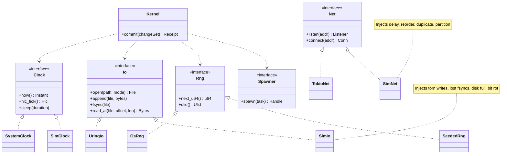
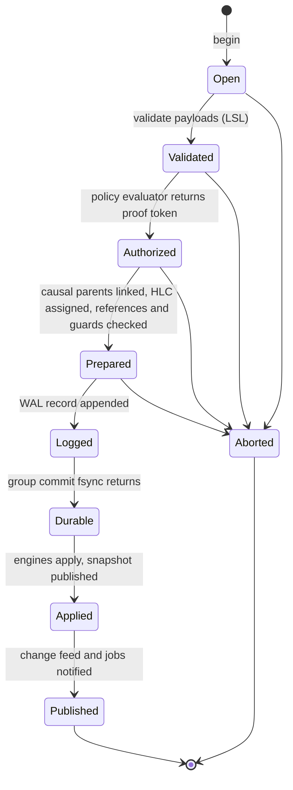
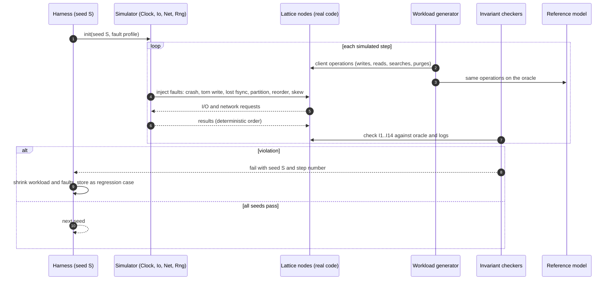
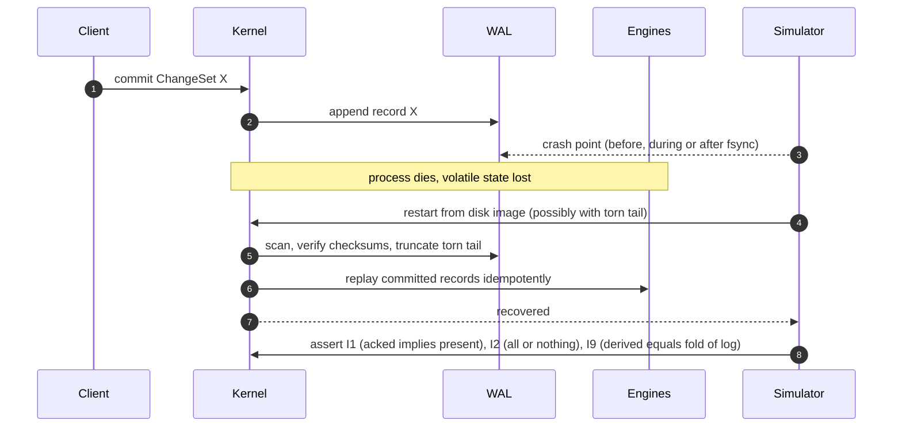
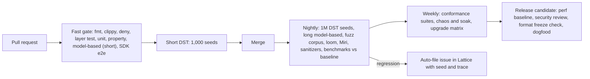
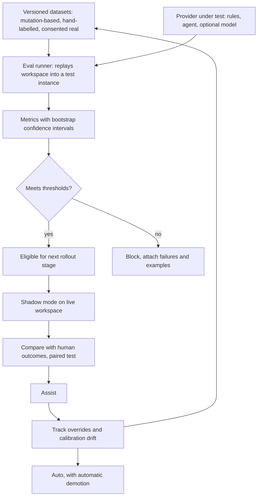
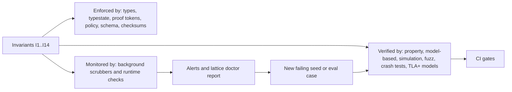
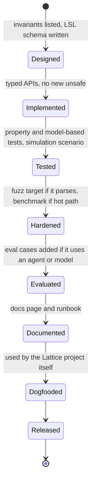

# Lattice engineering: Rust patterns, tests, evals and validation

*How we make a database correct, not just fast. This is a design for the build, to be confirmed by spikes. Crate names and tool choices below are the ones I would try first; verify each at spike time.*

## 1. What "works correctly" means

For a database, correctness is a **list of invariants** that must hold under crashes, concurrency, retries and hostile input. Everything else in this document exists to enforce, test or monitor one of these.

| Id | Invariant |
|---|---|
| I1 | **Durability**: an acknowledged commit survives power loss |
| I2 | **Atomicity across engines**: a ChangeSet is fully visible in log, rows, graph, text, vector and blob refs, or not at all |
| I3 | **Snapshot isolation**: a reader sees one consistent snapshot, never a half-applied commit |
| I4 | **Causal order**: hybrid logical clocks never go backwards and a change set never precedes its parents |
| I5 | **Convergence**: replicas that have seen the same deltas hold the same state, in any delivery order |
| I6 | **Idempotency**: resubmitting the same client ULID returns `duplicate` and writes nothing |
| I7 | **No policy bypass**: no read or write path, including S3, search, history and feeds, escapes the policy row filter |
| I8 | **Schema soundness**: no facet payload violating its LSL type is ever stored |
| I9 | **Derived equals fold(log)**: every index, graph edge, vector entry, lifespan and path lineage can be rebuilt from the log and matches |
| I10 | **Shredding**: once an entity key is destroyed, no content of that entity is readable, including derived data |
| I11 | **Blob integrity**: no orphan chunks, no dangling references, hash matches content |
| I12 | **Fencing**: a superseded turn can never write |
| I13 | **Audit chain**: the hash chain verifies end to end |
| I14 | **Time answers are exact**: a lifespan or lineage answer equals what a scan of the log would produce |

## 2. Rust patterns we adopt

### 2.1 Pattern table

| Pattern | Where | What it prevents |
|---|---|---|
| **Newtype IDs with phantom types** (`Id<Entity>`, `Id<ChangeSet>`) | Everywhere | Passing the wrong id to the wrong API |
| **Typestate** for transactions and change sets | `lattice-core` txn | Committing before validate, authorize or WAL append; compile error instead of runtime bug |
| **Proof tokens** (`Authorized<Action>` only constructible by the policy evaluator) | Every storage and API write path | Forgetting a policy check (I7) |
| **Parse, don't validate** (`Validated<Payload>`) | Ingest | Invalid payloads travelling inside the system (I8) |
| **State enums that consume `self`** | WorkItem, Drift, Branch, Deployment | Illegal state transitions |
| **Ports and adapters**: traits for `Clock`, `Io`, `Net`, `Rng`, `StorageEngine` | All crates | Hidden nondeterminism, untestable code |
| **`#[non_exhaustive]` on wire and on-disk enums** | Protocol and format crates | Breaking changes when adding variants |
| **Per-crate error enums with `thiserror`**, no `anyhow` in core | Core and engines | Opaque errors; unclear retry rules |
| **Error taxonomy**: `Retryable`, `Rejected`, `Fatal`, `InvariantViolation` | Core | Retrying what must not be retried; continuing after corruption |
| **Fail-stop on corruption** | WAL and page layer | Serving wrong data after a checksum failure |
| **`Secret<T>` with `zeroize`, constant-time compares (`subtle`)** | Identity, keys, tokens | Secrets in logs or timing leaks |
| **Explicit, versioned binary formats** (not `serde` on Rust structs) | WAL, pages, segments, wire | Silent format drift between releases |
| **Bounded channels and backpressure** | Pipelines and queues | Unbounded memory growth |
| **Structured concurrency** (task scopes, cancellation tokens) | Service layer | Leaked tasks, shutdown races |
| **Zero-copy buffers** (`bytes::Bytes`), per-transaction arenas | Hot paths | Allocation churn |
| **`unsafe` quarantined in one crate** (`lattice-sys`), `#![forbid(unsafe_code)]` elsewhere | Whole workspace | Undefined behaviour spreading |
| **Capability-based WASM plugins** (wasmtime component model, fuel and memory limits) | Pack code | Third-party code touching the host |
| **Redacting wrappers and `tracing` spans carrying txn ids** | Logging and metrics | PII in logs, untraceable bugs |

### 2.2 Seams that make everything testable

Every source of nondeterminism is a trait. Production uses real implementations, tests use simulated ones that can inject faults. This one decision is what makes deterministic simulation possible later, so it must exist from the first commit.



To keep it honest, ban the escape hatches with lint configuration in the core crates:

```text
# clippy.toml (core, engines, service)
disallowed-methods = [
  "std::time::Instant::now", "std::time::SystemTime::now",
  "std::thread::spawn", "tokio::spawn", "std::fs::File::open",
  "rand::thread_rng",
]
disallowed-types = ["std::collections::HashMap", "std::collections::HashSet"]  # random iteration order
```

### 2.3 Typestate transaction

The compiler enforces the commit protocol.



Sketch of the API shape (illustrative):

```rust
let txn: Txn<Open> = kernel.begin(principal);
let txn: Txn<Validated> = txn.validate(&schema, change_set)?;      // I8
let txn: Txn<Authorized> = txn.authorize(&policy).await?;          // I7
let txn: Txn<Prepared> = txn.prepare()?;                           // I4
let txn: Txn<Durable> = txn.log().await?.sync().await?;            // I1
let receipt: Receipt = txn.apply()?.publish();                     // I2, I3
// txn.apply() on Txn<Open> does not compile.
```

### 2.4 Concurrency and I/O model

- **Commit pipeline**: many writers submit, one ordered pipeline assigns order, appends to the WAL and group-commits. Readers use MVCC snapshots and never block writers.
- **Engines**: thread-per-core with `io_uring` behind the `Io` trait. **Control plane** (api, service, web): `tokio`. This split is a hypothesis; decide with a benchmark spike, not by taste.
- Every `async fn` documents **cancellation safety**. No lock is held across an `.await`.
- Lock-free or atomic code is small, isolated, and tested with `loom`.

### 2.5 On-disk and wire formats

- Hand-specified little-endian layouts with a format version and checksum (CRC32C or xxh3) in every record header.
- A **format freeze corpus**: golden files from every released version, read by every later version in CI.
- Unknown newer versions are refused, never guessed.

### 2.6 Workspace hygiene

`cargo deny` (licenses, advisories, banned crates), a dependency-graph test that fails if a lower layer imports a higher one, `cargo-semver-checks` on public crates, `cargo geiger` or equivalent to track `unsafe`, `rustfmt`, and `clippy` with `unwrap_used`, `expect_used`, `indexing_slicing` denied in core.

## 3. Test strategy

### 3.1 Layers

| Layer | Tools | Proves | Runs |
|---|---|---|---|
| L0 static | clippy, deny, semver-checks, forbid-unsafe, layer test | Rules and boundaries | Every PR |
| L1 unit, doctests | built-in | Local logic | Every PR |
| L2 property tests | `proptest` | Laws: CRDT merge is commutative, associative, idempotent; HLC monotonic; chunker round trips; LSL type checker and compatibility checker; migration lenses round trip | Every PR |
| L3 model-based | `proptest` state machines | Each engine equals a trivial in-memory oracle over random operation sequences | Every PR (short), nightly (long) |
| L4 deterministic simulation | custom harness over the seams, `madsim` or `turmoil` for networking | I1 to I14 under crashes, faults and reordering, replayable by seed | Nightly, millions of seeds |
| L5 crash consistency | fault-injecting filesystem, power-loss emulation | WAL recovery is correct and idempotent on real storage | Nightly |
| L6 concurrency | `loom`, `shuttle`, Miri, sanitizers | No data races or UB in the small unsafe and lock-free parts | Nightly |
| L7 fuzzing | `cargo-fuzz`, structure-aware | Parsers never panic or corrupt: LSL, PG wire, S3 requests, WAL, pages, JWT, CRDT ops | Continuous |
| L8 conformance | `sqllogictest`, driver matrix, Ceph `s3-tests`, MinIO `mint`, OpenID conformance suite | We match Postgres, S3 and OIDC where we claim to | Weekly and release |
| L9 integration and e2e | in-process `latticed`, SDK tests, Playwright against the dashboard | Layers work together; contracts generated from LSL | Every PR |
| L10 performance | `criterion` microbenchmarks, workload benchmarks | No regressions; p50, p99, p999 tracked | Nightly, gated |
| L11 chaos and soak | Jepsen-style checks (Elle for transaction histories), long cluster runs | Behaviour under partitions and node loss | Weekly |
| L12 upgrade | Old data dir to new binary, and back | Format and migration compatibility | Release |

### 3.2 Deterministic simulation (the core bet)

The whole engine runs single-threaded and deterministic inside a simulator. A seed fully determines every fault and every schedule, so any failure replays exactly.



Crash recovery is checked explicitly at every fsync boundary:



### 3.3 What each engine is tested against

| Engine | Oracle or reference | Special tests |
|---|---|---|
| Log | In-memory vector of change sets | Torn tail, duplicate delivery, causal order |
| Row/columnar | Simple map per facet table | Snapshot isolation anomalies (write skew, lost update) |
| Blob | Hash map of content | Dedupe stability, chunk-boundary properties, GC after random deletes, erasure-code loss of any allowed shards |
| Graph | Naive edge list | Temporal queries `AS OF`, CSR rebuild equals incremental |
| Vector | Brute-force nearest neighbours | Recall at k against exact, filter correctness |
| Text | Naive scan | BM25 ranking equivalence on small corpora |
| Temporal | Scan of the log | I14: indexed answer equals scan answer |
| Policy | Reference evaluator written separately and simply | I7: differential test over random relation tuples |
| CRDT | Sequential specification | Convergence under all delivery orders |

### 3.4 Pull-request gate versus nightly



## 4. Evals for the intelligent parts

Tests assert exact behaviour. **Evals** measure quality of probabilistic components (agent extraction and judging, entity resolution, drift detection, ranking, and the optional models) on versioned datasets. They gate releases with thresholds and confidence intervals, not with equality.

### 4.1 What we measure

| Capability | Metrics | Notes |
|---|---|---|
| Extraction | Precision, recall, F1 per label; exact vs overlapping span; schema-valid rate of submissions; latency; cost | Schema-valid rate is deterministic and gates hard |
| Entity resolution | Pairwise precision and recall, B-cubed, **false-merge rate** weighted above false-split | A wrong merge corrupts the graph; a missed merge only costs a review |
| Judgments | Accuracy per label, calibration (ECE, reliability plot), precision at the auto threshold, review rate, override rate, risk-coverage curve | Calibration decides where the auto band starts |
| Drift detection | Recall on injected drift, false positives per 1,000 changes, time to detect, severity accuracy, proposal acceptance rate | Noise budget is a product requirement |
| Hybrid search | nDCG@10, MRR, recall@k | Query sets per role: PM, BA, designer, developer |
| Temporal search | Exact-match accuracy of dates, actors and evidence | Mostly deterministic once the cluster is right |
| Answers to read-only questions | Groundedness: every citation exists, is permitted, and contains the supporting text | Checked automatically, no LLM needed |
| Work queue | Queue age p95, completion rate, schema rejection rate | Operational SLOs |

### 4.2 Datasets and labels

- **Mutation-based ground truth**: take a consistent workspace snapshot, then apply known mutations (change a number in a deployment, rename a service, contradict a spec sentence, move a file). The expected drift is known by construction, so labels cost nothing and scale.
- **Hand-labelled sets** for extraction and resolution, small but high quality, split into train, dev and locked test sets.
- **Real workspace samples** only with consent and redaction.
- Datasets are stored and versioned in Lattice itself, with a refresh cadence and contamination checks.



### 4.3 Method rules

1. **Compare providers on the same data**: agent vs rules vs optional GLiNER2.5 and Decide, paired comparison with bootstrap intervals, never on vendor numbers.
2. **LLM-as-judge only for subjective quality**, calibrated against a human-labelled subset, never the sole gate.
3. **Frozen regression suites in CI**: a prompt, label set, model or schema change that drops a metric beyond its tolerance fails the build.
4. **Security evals**: documents containing injected instructions must not cause policy escalation; a read-only agent that attempts writes must produce zero writes. These test our policy and schema gates, not the agent.
5. **Overrides are data**: every human override feeds the next calibration and dataset refresh.

## 5. Validation: how we know it is right

Verification asks "did we build it correctly?", validation asks "did we build the right thing?". We trace each invariant to where it is **enforced**, **verified** and **monitored in production**.



| Invariant | Enforced by | Verified by | Monitored in production by |
|---|---|---|---|
| I1 durability | WAL, group commit fsync, fail-stop | Simulation with lost fsync, crash tests | fsync latency and error alarms |
| I2 cross-engine atomicity | Single WAL and transaction manager | Simulation crash at every boundary | Scrubber comparing engine heads to the log |
| I3 snapshot isolation | MVCC | Anomaly property tests, Elle histories | Long-running read checker |
| I4 causal order | HLC, parent links | Property tests, TLA+ model | Clock skew alarm |
| I5 convergence | CRDT types | Property laws, TLA+ model, simulation with reordering | Replica digest comparison |
| I6 idempotency | Ids and dedupe table | Property tests with retries | Duplicate-rate metric |
| I7 no policy bypass | Proof-token types | Differential tests vs reference evaluator, fuzz | Sampled shadow evaluation of served rows |
| I8 schema soundness | `Validated<T>` at ingest and in transaction | Fuzz, property tests, codegen snapshots | Periodic re-validation of stored payloads |
| I9 derived equals fold(log) | Projection trait contract | Model-based tests | **Scrubber** that rebuilds an index and diffs it |
| I10 shredding | Per-entity keys | Simulation with replicas and backups | Shred audit report |
| I11 blob integrity | Refcounts in the same transaction, content hashing | Model-based GC tests | Blob audit job |
| I12 fencing | Turn ids in the commit path | Simulation of takeover races | Fenced-write counter |
| I13 audit chain | Hash chain | Property tests | Chain verification job |
| I14 time answers exact | Temporal index maintained transactionally | Compare with log scan | Sampled scan-vs-index comparison |

**Formal methods where they pay**: TLA+ models for the commit protocol, Raft sharding, CRDT convergence and turn fencing, checked with TLC, plus trace validation against simulator output; `Kani` for small critical functions such as chunk offset arithmetic and HLC; Miri for the `unsafe` crate.

### 5.1 Definition of done for a feature



## 6. First thirty days

1. **Seams first**: `Clock`, `Io`, `Net`, `Rng`, `Spawner` traits plus real and simulated implementations, and the lint configuration that bans escape hatches.
2. **Simulation harness** running an empty kernel under injected faults, before any storage engine exists.
3. **WAL and log engine** with checksums, torn-tail recovery, a model-based oracle and crash simulation.
4. **LSL parser and type checker** with property tests and a fuzz target.
5. **CRDT laws** (text and set) as property tests before building features on them.
6. **Runtime spike**: tokio versus thread-per-core `io_uring` on a commit and read benchmark, then freeze the decision.
7. **Dogfood loop**: move Lattice's own backlog into the first working build as early as possible.

## 7. Risks and honest limits

- **Simulation discipline**: one stray `std::time::Instant::now()` or `tokio::spawn` breaks determinism. The lint bans and a CI check that runs the same seed twice and compares traces are the defence.
- **Simulated time is not real time**: performance and kernel behaviour still need real-hardware tests (L5, L10, L11).
- **TLA+ models drift from code** unless trace validation is kept alive.
- **Conformance claims are expensive**: say "Postgres wire compatible with a documented subset" and test exactly that subset.
- **Evals can mislead**: mutation-based labels flatter detection of easy drift; keep real, consented samples and track override rates in production.
- **Crate choices are hypotheses** (`madsim` vs `turmoil`, `proptest` state machines, `io_uring` runtime, wasmtime component model); pick in the spikes.


## Fast test builds without lower coverage

`cargo test` uses an `opt-level = 1` test profile for workspace code as well as dependencies.
Debug assertions and integer overflow checks remain enabled. Property-test case counts, simulated
seed budgets, planted-bug detection and nightly volume are unchanged. The release profile used by
nightly simulations and benchmarks is independent.

When CI slows down, compare setup/compile time with per-test timings before adding tools or runners.
The previous successful Ubuntu gate spent 96.81 seconds in `clean_build` and 152.14 seconds in
`planted_bugs` (run 40782222040); its formatting and Clippy steps took only a few seconds.

On the same development machine, the unchanged default-case test groups took 42.84 to 6.32 seconds
(`clean_build`) and 92.38 to 13.14 seconds (`planted_bugs`) after optimizing workspace test code.
These local results predict a reduction in CI runtime; runner timings must be measured separately.
