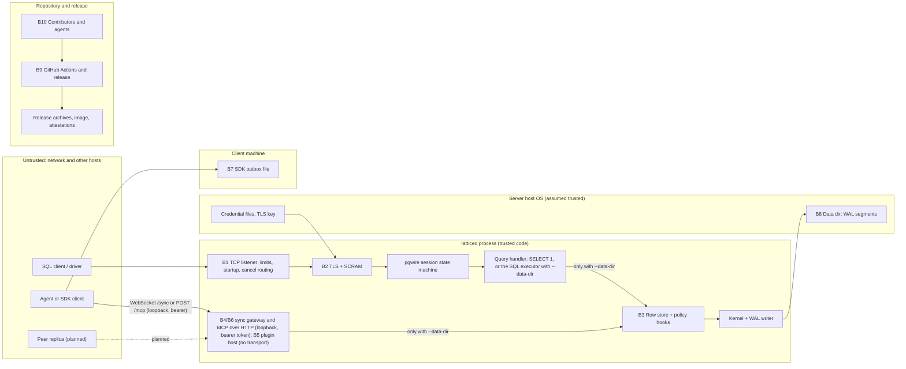

# Threat model

First threat model for Lattice. It is grounded in the code on `main`, not in the design documents. The first pass read commit `ea9588286e4a4cadaf789531b44a497bd1ae77b4` (2026-10-29). A refresh on 2026-10-30 re-read the rows listed in section 10 against commit `025ab1be9c92236873fb6549f1bbbff28601724a`; every other row was last checked at the first commit. A refresh on 2026-10-31 re-read the gateway, MCP, bearer-token, board, dev-stack and install rows and the gap register against commit `ffa2f9de03f21a1bfdfe4e0cfaa9ff0240814896`; section 10 lists what changed. Rows it does not name still describe the commits they cite. Where the design (`docs/ARCHITECTURE.md`) promises more than the code does, this page says so.

**Status: first draft. No second maintainer has reviewed it.** Phase 4 exit criterion E4-5 asks for a threat model reviewed by two maintainers ([#17](https://github.com/moncifem/latticedb/issues/17)); this page is an input to that review and does not satisfy it. Nothing here is a security guarantee, a claim that a phase gate passed, or an audit.

Companion: [security-test-plan.md](security-test-plan.md) (one test, fuzz or verification item per gap, with priorities and issues).

How to read it:

- "Exists" means the code is on `main` and I read it. "Tested by" names a test or fuzz target that exists on `main`; I did not run them for this page, so the page says what the tests are written to show, not that they pass today.
- "Not verified" marks claims I could not check.
- Items in open pull requests are not on `main`. They are described only from their module documentation, at the commit named, and marked "unmerged". No such item is described below at the moment.
- Links with a line anchor are permalinks to `ea9588286e4a4cadaf789531b44a497bd1ae77b4`, the commit the line was read at; they are not re-checked against current `main`. Links without an anchor point at the current file.

## 1. What exists today

The threat model has to start from what is reachable. Most of the design is not built.

| Component | State on `main` |
|---|---|
| `latticed` TCP listener | Built. PostgreSQL wire v3, startup, SSL request, cancel routing, connection and time limits. Without `--data-dir` the only query handler answers `SELECT 1` (`select_one` in [lib.rs](../crates/latticed/src/lib.rs)) and no database is opened. With `--data-dir` it opens a write-ahead log in that directory and runs the single-table SQL executor of `lattice-exec` for every admitted connection ([sql.rs](../crates/latticed/src/sql.rs), [exec_host.rs](../crates/lattice-api/src/exec_host.rs); PRs [#412](https://github.com/moncifem/latticedb/pull/412), [#416](https://github.com/moncifem/latticedb/pull/416)). |
| Authentication | Built. Two modes: development trust on loopback, or SCRAM-SHA-256 over mandatory TLS with a provisioned verifier file ([main.rs:78-113](https://github.com/moncifem/latticedb/blob/ea9588286e4a4cadaf789531b44a497bd1ae77b4/crates/latticed/src/main.rs#L78)). |
| Row store, MVCC, catalog, policy hooks, change-feed emission | Built as a library (`lattice-engines`). With `--data-dir` the listener reaches the row store through the executor, which begins every transaction with `begin_with_policy` ([exec.rs](../crates/lattice-exec/src/exec.rs), [db.rs](../crates/lattice-exec/src/db.rs)). The change-feed emission and the unfiltered read APIs are not reachable from the listener. |
| Kernel, WAL, fencing, checkpoints, CRDT modules | Built as a library (`lattice-core`). |
| SQL | Parser, binder and logical plan (`lattice-sql`, PR [#401](https://github.com/moncifem/latticedb/pull/401)) and an executor for the single-table subset (`lattice-exec`). Joins, aggregates, `DISTINCT` and subqueries are refused with `0A000`. Tables and their column definitions are recovered after a restart ([#573](https://github.com/moncifem/latticedb/issues/573)). |
| Sync protocol, subscription host, gateway | Built as codec and sans-I/O state machines ([sync.rs](../crates/lattice-proto/src/sync.rs), [subscribe.rs](../crates/lattice-api/src/subscribe.rs)). Served over a WebSocket gateway in `latticed` (`--gateway-listen`, path `/sync`, protocol `lattice.sync.v1`; it needs `--data-dir`; [#524](https://github.com/moncifem/latticedb/issues/524), commit `e03b319a`). With `--gateway-tokens` it requires a bearer token; without it, it serves the loopback development principal under development trust. A non-loopback gateway address is refused until TLS exists on the gateway ([#578](https://github.com/moncifem/latticedb/issues/578), open). |
| Plugin contract | Strict JSON-lines codec ([contract.rs](../crates/lattice-sdk/src/contract.rs)) and an in-memory reference plugin used by tests. No kernel-backed plugin ([#250](https://github.com/moncifem/latticedb/issues/250)). |
| MCP server, SDK outbox | The MCP module ([mcp.rs](../crates/lattice-sdk/src/mcp.rs)) and the outbox ([outbox.rs](../crates/lattice-sdk/src/outbox.rs)) are merged as sans-I/O library modules. `latticed` serves the MCP tools over the SQL executor (`latticed::mcp_backend`, [#526](https://github.com/moncifem/latticedb/issues/526), commit `8932717f`) and over HTTP as `POST /mcp` on the gateway port (`latticed::ws::mcp_http`, [#527](https://github.com/moncifem/latticedb/issues/527) part 1, commit `2985d425`). Loopback only, bearer token required, no stdio transport. The outbox is a library state machine. |
| Subscriber backpressure | Merged as a library module ([backpressure.rs](../crates/lattice-api/src/backpressure.rs)): bounded per-subscriber queues with an overflow cursor. Nothing connects it to `SubscriptionHost` or a transport (searched). |
| Identity, policy compilation, audit chain, encryption at rest | Not built (Phase 4 and Phase 5). `chain.rs` (BLAKE3 hash chain) exists as a primitive and nothing else in the workspace uses it ([chain.rs:1](https://github.com/moncifem/latticedb/blob/ea9588286e4a4cadaf789531b44a497bd1ae77b4/crates/lattice-core/src/chain.rs#L1)); I searched for uses and found none. |
| Bearer-token credentials (ADR 0031) | Built in `lattice-api::bearer` and the loader in [tokens.rs](../crates/latticed/src/tokens.rs): 256-bit tokens, a salted SHA-256 verifier per token in a credential file that is refused unless owner-only, re-read within 5 seconds and on SIGHUP, with live connections of revoked tokens closed ([#577](https://github.com/moncifem/latticedb/issues/577)). `lattice account` (commit `a3ca61f1`) writes the credential files. Not bound to the TLS channel. |
| Agent board ([`integrations/board`](../integrations/board/CONVENTIONS.md)) | A shell helper over `psql` and four tables ([schema.sql](../integrations/board/schema.sql)). It is an ordinary SQL client of a `latticed --data-dir` listener and has the table grants of the account it logs in as. Alpha, dogfooding only (its conventions page says so). |
| Dev stack ([`dev/`](../dev/compose.yaml), [`docker/`](../docker/entrypoint.sh)) | Docker compose stack for maintainers and agents. The image is pinned by digest, the published port is bound to `127.0.0.1`, and the stack runs `latticed` with SCRAM over TLS, with passwords printed once by `dev/lattice-dev.sh account add`. Open: no `cap_drop` or `security_opt` on the `latticed` service, a TCP-connect healthcheck, and the `tls-install` helper runs as root in the `tools` profile ([#738](https://github.com/moncifem/latticedb/issues/738)). |
| Install script ([`scripts/install.sh`](../scripts/install.sh)) | Fetches a release archive over https only and refuses it unless its line in the release `SHA256SUMS` matches. Attestation is checked with `gh attestation verify` only when `gh` is installed; otherwise the script says so. `SHA256SUMS` comes from the same release, so the check shows the archive matches that release, not who built it. |

Consequence: the network-facing boundaries that exist today (B1, B2) are real and tested, and with `--data-dir` B3 is reachable over the wire. The sync gateway and MCP over HTTP (B4, B6) are reachable on loopback with bearer tokens, without TLS ([#578](https://github.com/moncifem/latticedb/issues/578)). The plugin boundary (B5) still has no transport. This page records what must be true before any of them is exposed beyond loopback.

## 2. Priorities

| Priority | Meaning |
|---|---|
| P1 | Must be closed before any release serves stored data over a network, or before the named component is reachable from a network. |
| P2 | Must be closed or consciously accepted (in an ADR) before the owning phase's exit criteria are claimed. |
| P3 | Hardening or documentation. Schedule when the area is touched. |

## 3. Assets

| ID | Asset | Security property that matters |
|---|---|---|
| A1 | Stored work data: rows, history, WAL segments, checkpoints | Confidentiality per principal (Phase 4), integrity, durability |
| A2 | Credentials: SCRAM verifier file (stored key and server key per account), decoy secret, TLS private key | Confidentiality, integrity |
| A3 | Session, turn and fence state, record ids | Integrity (a superseded agent must not write) |
| A4 | Cancel keys (process id and secret per connection) | Confidentiality of the secret |
| A5 | Change-feed and subscription streams | Confidentiality (derived data), completeness |
| A6 | SDK outbox file on a client machine | Confidentiality, integrity |
| A7 | Release artifacts, container image, attestations | Integrity, provenance |
| A8 | Repository integrity: `main`, workflows, tags, branch protection | Integrity |
| A9 | Listener availability | Availability |
| A10 | CI and test evidence | Integrity (evidence must not pass vacuously) |

## 4. Actors

| Actor | Capability assumed |
|---|---|
| Unauthenticated network client | Can open TCP connections, send arbitrary bytes, run many connections from many addresses |
| Authenticated user | Holds a valid account; may be over-privileged or compromised |
| Agent acting for a human | An authenticated principal that produces untrusted content and may be confused or malicious |
| Peer replica (planned) | Sends CRDT operations and acks; may be compromised |
| Local OS user on the server host | Can connect to loopback; may read files the process makes world-readable |
| Attacker with write access to the data directory | Out of scope except where noted (see section 9) |
| Malicious server (SDK side) | Controls frames a client library receives |
| Supply-chain attacker | Controls a dependency, a GitHub Action or a build tool |
| Contributor or fork pull request | Can propose any change; cannot merge |
| Automation agent in the repo workflow | Reads untrusted issue, pull request and file text; can open pull requests; does not merge |
| Maintainer | Trusted (single maintainer today) |

## 5. Trust boundaries

Dotted edges are planned and do not exist in the code today. The edges to the row store exist only when `latticed` is started with `--data-dir`.

## 6. Threats per boundary

Each boundary lists STRIDE threats that apply, the mitigations that exist (with code links), what covers them in tests or fuzzing, and the gaps. Gap ids (G-nn) are in section 7. S is spoofing, T tampering, R repudiation, I information disclosure, D denial of service, E elevation of privilege.

### B1. Network client to `latticed` (listener and wire protocol)

What exists: a thread-per-connection blocking listener with explicit bounds ([lib.rs:1-24](https://github.com/moncifem/latticedb/blob/ea9588286e4a4cadaf789531b44a497bd1ae77b4/crates/latticed/src/lib.rs#L1)).

| STRIDE | Threat | Mitigations that exist | Tested by | Gaps |
|---|---|---|---|---|
| S | Remote client uses development trust | Trust mode refuses a non-loopback bind at startup ([lib.rs:145-157](https://github.com/moncifem/latticedb/blob/ea9588286e4a4cadaf789531b44a497bd1ae77b4/crates/latticed/src/lib.rs#L145)); trust is the default only for `127.0.0.1:5432` ([lib.rs:77-79](https://github.com/moncifem/latticedb/blob/ea9588286e4a4cadaf789531b44a497bd1ae77b4/crates/latticed/src/lib.rs#L77)); TLS and credential options are refused in trust mode ([main.rs:79-87](https://github.com/moncifem/latticedb/blob/ea9588286e4a4cadaf789531b44a497bd1ae77b4/crates/latticed/src/main.rs#L79)) | [tcp_auth.rs:292](https://github.com/moncifem/latticedb/blob/ea9588286e4a4cadaf789531b44a497bd1ae77b4/crates/latticed/tests/tcp_auth.rs#L292) | Any local user or process on the host can connect in trust mode (assumption N-4) |
| S | Forged cancel request | Cancel needs process id and secret to match a live registration; the secret comes from the injected RNG ([cancel.rs:188-209](https://github.com/moncifem/latticedb/blob/ea9588286e4a4cadaf789531b44a497bd1ae77b4/crates/lattice-api/src/cancel.rs#L188)), which `latticed` sets to the OS RNG ([lib.rs:512](https://github.com/moncifem/latticedb/blob/ea9588286e4a4cadaf789531b44a497bd1ae77b4/crates/latticed/src/lib.rs#L512)); keys are registered only after authentication ([lib.rs:685](https://github.com/moncifem/latticedb/blob/ea9588286e4a4cadaf789531b44a497bd1ae77b4/crates/latticed/src/lib.rs#L685), [lib.rs:741](https://github.com/moncifem/latticedb/blob/ea9588286e4a4cadaf789531b44a497bd1ae77b4/crates/latticed/src/lib.rs#L741)); the lookup scans all slots with mask comparison ([cancel.rs:300-325](https://github.com/moncifem/latticedb/blob/ea9588286e4a4cadaf789531b44a497bd1ae77b4/crates/lattice-api/src/cancel.rs#L300)); the process id comes from the same RNG and is not reissued while its slot holds it ([cancel.rs](../crates/lattice-api/src/cancel.rs)); a stale key cannot cancel a later connection on a reused slot | [tcp_server.rs:369](https://github.com/moncifem/latticedb/blob/ea9588286e4a4cadaf789531b44a497bd1ae77b4/crates/latticed/tests/tcp_server.rs#L369), [tcp_server.rs:390](https://github.com/moncifem/latticedb/blob/ea9588286e4a4cadaf789531b44a497bd1ae77b4/crates/latticed/tests/tcp_server.rs#L390), cancel proptests ([cancel.rs:496-548](https://github.com/moncifem/latticedb/blob/ea9588286e4a4cadaf789531b44a497bd1ae77b4/crates/lattice-api/src/cancel.rs#L496)); PID draw, collision and range unit tests in `crates/lattice-api/src/cancel.rs`; `registrations_drawing_the_same_rng_output_get_distinct_pids` in `crates/lattice-api/tests/cancel_edges.rs`; loom model in `cancel-loom.yml` | P3-A: the secret is 32 bits, the protocol width, and a process id is not a secret, so a blind guess must match both fields. A blind guesser with no process id known needs about 2^58 guesses on average (about 2^50 seconds at the global budget of 256 cancels per second) to hit one of 32 live connections. If the process id of one connection is known, the secret alone applies to that connection: 2^32 guesses, about 97 days on average (194 days for a full sweep) at the global budget, or about 4.2 years on average (8.5 years for a full sweep) from one address (16 per second). A known process id targets one connection, so these figures do not add up across the 32. All figures are computed from the constants in `latticed` (the average is half a full sweep), not measured. Cancels are budgeted before the lookup ([lib.rs](../crates/latticed/src/lib.rs)), but wrong keys spend that budget and there is no failed-cancel backoff (related to [#361](https://github.com/moncifem/latticedb/issues/361)) |
| T | Malformed or oversized frames corrupt state | Frame length is checked before any allocation of the body ([lib.rs:436-480](https://github.com/moncifem/latticedb/blob/ea9588286e4a4cadaf789531b44a497bd1ae77b4/crates/latticed/src/lib.rs#L436)); startup packets capped at 10,000 bytes ([lib.rs:89](https://github.com/moncifem/latticedb/blob/ea9588286e4a4cadaf789531b44a497bd1ae77b4/crates/latticed/src/lib.rs#L89)); messages capped at 1 MiB, SASL at 8 KiB ([pgwire.rs:17](https://github.com/moncifem/latticedb/blob/ea9588286e4a4cadaf789531b44a497bd1ae77b4/crates/lattice-api/src/pgwire.rs#L17), [pgwire.rs:242](https://github.com/moncifem/latticedb/blob/ea9588286e4a4cadaf789531b44a497bd1ae77b4/crates/lattice-api/src/pgwire.rs#L242)); decoders reject trailing bytes, bad lengths and unknown tags; COPY and function calls are refused | [tcp_server.rs:173](https://github.com/moncifem/latticedb/blob/ea9588286e4a4cadaf789531b44a497bd1ae77b4/crates/latticed/tests/tcp_server.rs#L173), [tcp_server.rs:576](https://github.com/moncifem/latticedb/blob/ea9588286e4a4cadaf789531b44a497bd1ae77b4/crates/latticed/tests/tcp_server.rs#L576), [tcp_server.rs:589](https://github.com/moncifem/latticedb/blob/ea9588286e4a4cadaf789531b44a497bd1ae77b4/crates/latticed/tests/tcp_server.rs#L589); fuzz target `pgwire` (trust path only); session proptests ([session.rs:1330](https://github.com/moncifem/latticedb/blob/ea9588286e4a4cadaf789531b44a497bd1ae77b4/crates/lattice-api/src/session.rs#L1330), [session.rs:1357](https://github.com/moncifem/latticedb/blob/ea9588286e4a4cadaf789531b44a497bd1ae77b4/crates/lattice-api/src/session.rs#L1357)) | G-09: the fuzz target never reaches the SASL phase |
| R | No record of who connected or failed | None. The process prints a startup line and rate-limited accept errors only ([lib.rs:244](https://github.com/moncifem/latticedb/blob/ea9588286e4a4cadaf789531b44a497bd1ae77b4/crates/latticed/src/lib.rs#L244)) | none | G-05 (P2) |
| I | Error text reveals account existence or internals | Wrong password and unknown user get the same fatal `28P01` text; cancel returns no response; accept errors carry no client data ([lib.rs:241-248](https://github.com/moncifem/latticedb/blob/ea9588286e4a4cadaf789531b44a497bd1ae77b4/crates/latticed/src/lib.rs#L241)) | [tcp_auth.rs:203](https://github.com/moncifem/latticedb/blob/ea9588286e4a4cadaf789531b44a497bd1ae77b4/crates/latticed/tests/tcp_auth.rs#L203), [scram_edges.rs:139](https://github.com/moncifem/latticedb/blob/ea9588286e4a4cadaf789531b44a497bd1ae77b4/crates/lattice-api/tests/scram_edges.rs#L139) | P3-K: a user name with a control character, empty, over 63 bytes, or sent twice is refused before the SASL offer ([lib.rs:689-711](https://github.com/moncifem/latticedb/blob/ea9588286e4a4cadaf789531b44a497bd1ae77b4/crates/latticed/src/lib.rs#L689)), so name format (not existence) is observable |
| D | Connection exhaustion | `max_connections` 1..=1024, default 32; 8 extra slots reserved to classify startup and cancel packets; beyond that the socket is closed ([lib.rs:99-101](https://github.com/moncifem/latticedb/blob/ea9588286e4a4cadaf789531b44a497bd1ae77b4/crates/latticed/src/lib.rs#L99), [lib.rs:283-290](https://github.com/moncifem/latticedb/blob/ea9588286e4a4cadaf789531b44a497bd1ae77b4/crates/latticed/src/lib.rs#L283)) | [tcp_server.rs:142](https://github.com/moncifem/latticedb/blob/ea9588286e4a4cadaf789531b44a497bd1ae77b4/crates/latticed/tests/tcp_server.rs#L142), [tcp_server.rs:451](https://github.com/moncifem/latticedb/blob/ea9588286e4a4cadaf789531b44a497bd1ae77b4/crates/latticed/tests/tcp_server.rs#L451) | Slots held by unauthenticated clients until their deadline; the header says this is a resource bound, not a guarantee ([lib.rs:17-22](https://github.com/moncifem/latticedb/blob/ea9588286e4a4cadaf789531b44a497bd1ae77b4/crates/latticed/src/lib.rs#L17)) |
| D | Slow clients | 5 s to send the first startup packet ([lib.rs:93](https://github.com/moncifem/latticedb/blob/ea9588286e4a4cadaf789531b44a497bd1ae77b4/crates/latticed/src/lib.rs#L93)); one absolute 10 s budget from accept through TLS and SCRAM ([transport.rs:56](https://github.com/moncifem/latticedb/blob/ea9588286e4a4cadaf789531b44a497bd1ae77b4/crates/latticed/src/transport.rs#L56), [lib.rs:82](https://github.com/moncifem/latticedb/blob/ea9588286e4a4cadaf789531b44a497bd1ae77b4/crates/latticed/src/lib.rs#L82)); 30 s read and 5 s write timeouts | [tcp_auth.rs:257](https://github.com/moncifem/latticedb/blob/ea9588286e4a4cadaf789531b44a497bd1ae77b4/crates/latticed/tests/tcp_auth.rs#L257), [tcp_auth.rs:278](https://github.com/moncifem/latticedb/blob/ea9588286e4a4cadaf789531b44a497bd1ae77b4/crates/latticed/tests/tcp_auth.rs#L278), [tcp_server.rs:187](https://github.com/moncifem/latticedb/blob/ea9588286e4a4cadaf789531b44a497bd1ae77b4/crates/latticed/tests/tcp_server.rs#L187) | P3-L: an authenticated client can declare a 1 MiB frame and idle until the read deadline with the buffer allocated (G-06) |
| D | Listener stopped by one bad connection | Per-connection failures drop only that socket; transient accept errors are classified and retried up to 200 times (about 10 s) ([lib.rs:216-248](https://github.com/moncifem/latticedb/blob/ea9588286e4a4cadaf789531b44a497bd1ae77b4/crates/latticed/src/lib.rs#L216)); a panicking worker ends only its own connection ([lib.rs:270-277](https://github.com/moncifem/latticedb/blob/ea9588286e4a4cadaf789531b44a497bd1ae77b4/crates/latticed/src/lib.rs#L270)) | [tcp_server.rs:475](https://github.com/moncifem/latticedb/blob/ea9588286e4a4cadaf789531b44a497bd1ae77b4/crates/latticed/tests/tcp_server.rs#L475), [tcp_server.rs:511](https://github.com/moncifem/latticedb/blob/ea9588286e4a4cadaf789531b44a497bd1ae77b4/crates/latticed/tests/tcp_server.rs#L511), [tcp_server.rs:544](https://github.com/moncifem/latticedb/blob/ea9588286e4a4cadaf789531b44a497bd1ae77b4/crates/latticed/tests/tcp_server.rs#L544) | Issue [#231](https://github.com/moncifem/latticedb/issues/231) is still open; its P2 items look addressed in this code and its P3 list remains. Closing it is the owner's call. |
| D | Process stops when stdin closes | Documented host control channel; EOF stops cleanly by default (`--stdin-control on`). `--stdin-control off` never reads stdin, and SIGTERM/SIGINT stop it cleanly in both modes (`crates/latticed/src/main.rs`, `crates/latticed/src/stop.rs`) | `crates/latticed/tests/service.rs` | With the default, a local process that holds the stdin pipe can stop the server; run supervised with `--stdin-control off` (P3, in #231) |
| E | A query cancels another user's query | Registrations are per connection; `begin_query` cancels only that connection's previous token | cancel proptests above | None found |

### B2. TLS and SCRAM

What exists: with `--auth scram-tls` the server refuses startup before TLS, then runs SCRAM-SHA-256 with verifiers from a file ([lib.rs:679-715](https://github.com/moncifem/latticedb/blob/ea9588286e4a4cadaf789531b44a497bd1ae77b4/crates/latticed/src/lib.rs#L679), [session.rs:291-332](https://github.com/moncifem/latticedb/blob/ea9588286e4a4cadaf789531b44a497bd1ae77b4/crates/lattice-api/src/session.rs#L291)). Design record: [RFC 0006](rfc/0006-pgwire-scram-sha256.md), [ADR 0020](adr/0020-pgwire-scram-sha256.md), [RFC 0007](rfc/0007-pgwire-scram-tls-integration.md), [ADR 0021](adr/0021-pgwire-scram-tls-integration.md).

| STRIDE | Threat | Mitigations that exist | Tested by | Gaps |
|---|---|---|---|---|
| S | Password guessing online | Only SCRAM-SHA-256; no plaintext password message is accepted ([scram.rs:31](https://github.com/moncifem/latticedb/blob/ea9588286e4a4cadaf789531b44a497bd1ae77b4/crates/lattice-api/src/scram.rs#L31)); proof compared with `subtle` ([scram.rs:292](https://github.com/moncifem/latticedb/blob/ea9588286e4a4cadaf789531b44a497bd1ae77b4/crates/lattice-api/src/scram.rs#L292)); every error is terminal so a proof cannot be retried in a session ([scram.rs:205-210](https://github.com/moncifem/latticedb/blob/ea9588286e4a4cadaf789531b44a497bd1ae77b4/crates/lattice-api/src/scram.rs#L205)); TLS starts limited to 16 per second per address (IPv6 per /64) and 64 per second globally ([lib.rs:95-97](https://github.com/moncifem/latticedb/blob/ea9588286e4a4cadaf789531b44a497bd1ae77b4/crates/latticed/src/lib.rs#L95), [lib.rs:577-601](https://github.com/moncifem/latticedb/blob/ea9588286e4a4cadaf789531b44a497bd1ae77b4/crates/latticed/src/lib.rs#L577)) | [tcp_auth.rs:174](https://github.com/moncifem/latticedb/blob/ea9588286e4a4cadaf789531b44a497bd1ae77b4/crates/latticed/tests/tcp_auth.rs#L174); known-answer vectors ([scram.rs:388-432](https://github.com/moncifem/latticedb/blob/ea9588286e4a4cadaf789531b44a497bd1ae77b4/crates/lattice-api/src/scram.rs#L388)); limiter unit tests ([lib.rs:975-1050](https://github.com/moncifem/latticedb/blob/ea9588286e4a4cadaf789531b44a497bd1ae77b4/crates/latticed/src/lib.rs#L975)) | G-05: no per-account failure counter, backoff or lockout; many source addresses can exceed the global budget (documented, [lib.rs:12-17](https://github.com/moncifem/latticedb/blob/ea9588286e4a4cadaf789531b44a497bd1ae77b4/crates/latticed/src/lib.rs#L12)) |
| S | Account enumeration | Unknown users get a stable synthetic salt and keys derived from a mandatory 32-byte secret, the same message shapes, and the same failure text ([auth.rs:96-128](https://github.com/moncifem/latticedb/blob/ea9588286e4a4cadaf789531b44a497bd1ae77b4/crates/lattice-api/src/auth.rs#L96)) | [auth.rs:172-243](https://github.com/moncifem/latticedb/blob/ea9588286e4a4cadaf789531b44a497bd1ae77b4/crates/lattice-api/src/auth.rs#L172), [tcp_auth.rs:203](https://github.com/moncifem/latticedb/blob/ea9588286e4a4cadaf789531b44a497bd1ae77b4/crates/latticed/tests/tcp_auth.rs#L203) | Timing equality is explicitly not claimed ([auth.rs:38-39](https://github.com/moncifem/latticedb/blob/ea9588286e4a4cadaf789531b44a497bd1ae77b4/crates/lattice-api/src/auth.rs#L38)); I did not measure it (not verified). P3-M: rotating the decoy secret changes unknown-account challenges, so it is observable ([auth.rs:15-18](https://github.com/moncifem/latticedb/blob/ea9588286e4a4cadaf789531b44a497bd1ae77b4/crates/lattice-api/src/auth.rs#L15)) |
| S | Man in the middle | TLS is mandatory in this mode; plaintext startup is refused with `28000` ([lib.rs:679-684](https://github.com/moncifem/latticedb/blob/ea9588286e4a4cadaf789531b44a497bd1ae77b4/crates/latticed/src/lib.rs#L679)); the client library test checks that an untrusted certificate and a wrong server name are rejected ([tcp_auth.rs:313](https://github.com/moncifem/latticedb/blob/ea9588286e4a4cadaf789531b44a497bd1ae77b4/crates/latticed/tests/tcp_auth.rs#L313)) | as listed | G-04 (P2): no channel binding, and a client GS2 flag `y` is accepted ([scram.rs:214-217](https://github.com/moncifem/latticedb/blob/ea9588286e4a4cadaf789531b44a497bd1ae77b4/crates/lattice-api/src/scram.rs#L214)). A client that encrypts without verifying the certificate (libpq `sslmode=require`) is exposed to a relay. The server cannot enforce verification. |
| S | Client certificate identity | None: no client-certificate authentication ([transport.rs:9](https://github.com/moncifem/latticedb/blob/ea9588286e4a4cadaf789531b44a497bd1ae77b4/crates/latticed/src/transport.rs#L9), [transport.rs:43](https://github.com/moncifem/latticedb/blob/ea9588286e4a4cadaf789531b44a497bd1ae77b4/crates/latticed/src/transport.rs#L43)) | none | By design for now (N-3) |
| T | Downgrade to trust or plaintext | `ScramTls` mode never answers `N` to an SSL request and rejects startup without TLS; trust mode cannot be combined with TLS options | [tcp_auth.rs:221](https://github.com/moncifem/latticedb/blob/ea9588286e4a4cadaf789531b44a497bd1ae77b4/crates/latticed/tests/tcp_auth.rs#L221), [tcp_auth.rs:339](https://github.com/moncifem/latticedb/blob/ea9588286e4a4cadaf789531b44a497bd1ae77b4/crates/latticed/tests/tcp_auth.rs#L339) | None found |
| T | Malicious SASL frames | Messages capped at 8,192 bytes, at most 32 attributes, nonces at most 256 bytes, iteration count 4,096..=1,000,000 ([scram.rs:33-40](https://github.com/moncifem/latticedb/blob/ea9588286e4a4cadaf789531b44a497bd1ae77b4/crates/lattice-api/src/scram.rs#L33)); authorization identity and mandatory extensions refused | [scram_edges.rs](../crates/lattice-api/tests/scram_edges.rs), [tcp_auth.rs:241](https://github.com/moncifem/latticedb/blob/ea9588286e4a4cadaf789531b44a497bd1ae77b4/crates/latticed/tests/tcp_auth.rs#L241) | G-09: no fuzz target on this path |
| I | Secrets in memory, logs and errors | Secret arrays zeroized on drop; `Debug` output redacted; error text carries no credential material; credential and key files read through a bounded, zeroizing reader ([main.rs:156-166](https://github.com/moncifem/latticedb/blob/ea9588286e4a4cadaf789531b44a497bd1ae77b4/crates/latticed/src/main.rs#L156)) | [auth.rs:155-170](https://github.com/moncifem/latticedb/blob/ea9588286e4a4cadaf789531b44a497bd1ae77b4/crates/lattice-api/src/auth.rs#L155), [scram_edges.rs:139](https://github.com/moncifem/latticedb/blob/ea9588286e4a4cadaf789531b44a497bd1ae77b4/crates/lattice-api/tests/scram_edges.rs#L139) | Dependencies and caller buffers can keep their own copies (stated in [scram.rs:13-14](https://github.com/moncifem/latticedb/blob/ea9588286e4a4cadaf789531b44a497bd1ae77b4/crates/lattice-api/src/scram.rs#L13)). P3-B: no permission or ownership check on the verifier file, decoy secret or TLS key (in #231) |
| I | Verifier file theft | The file holds the stored key and server key, not the password; a thief can run an offline guess against the stored key and can impersonate the server to clients that hold the password | none | P3-C: the cost profile is fixed at 4,096 iterations and 16-byte salts ([auth.rs:73-80](https://github.com/moncifem/latticedb/blob/ea9588286e4a4cadaf789531b44a497bd1ae77b4/crates/lattice-api/src/auth.rs#L73)); configuration needs a restart to reload |
| D | TLS handshake CPU | Handshake admission limits above; rustls buffer limit 64 KiB ([transport.rs:132](https://github.com/moncifem/latticedb/blob/ea9588286e4a4cadaf789531b44a497bd1ae77b4/crates/latticed/src/transport.rs#L132)); certificate chain at most 8 certificates, 64 KiB, 16 KiB key ([transport.rs:19-37](https://github.com/moncifem/latticedb/blob/ea9588286e4a4cadaf789531b44a497bd1ae77b4/crates/latticed/src/transport.rs#L19)) | [lib.rs:975-1050](https://github.com/moncifem/latticedb/blob/ea9588286e4a4cadaf789531b44a497bd1ae77b4/crates/latticed/src/lib.rs#L975) | Behind NAT or a proxy many clients share one address and its 16 per second ([lib.rs:14-16](https://github.com/moncifem/latticedb/blob/ea9588286e4a4cadaf789531b44a497bd1ae77b4/crates/latticed/src/lib.rs#L14)) |
| R | Repudiation | none | none | G-05 |
| E | Authenticated identity unused | The startup `user` is checked for presence only ([session.rs:249](https://github.com/moncifem/latticedb/blob/ea9588286e4a4cadaf789531b44a497bd1ae77b4/crates/lattice-api/src/session.rs#L249)); `Session` carries the authenticated `Principal` into every `QueryHandler` call (ADR 0026, `QueryContext`); with `--data-dir` the executor host maps the principal to a `Grant` (`AllowAll`, `DenyAll` or per-table read, write and ddl bits) and an account the policy file does not list gets `DenyAll` ([exec_host.rs](../crates/lattice-api/src/exec_host.rs)) | principal tests in `session.rs`; the tests of `exec_host.rs` and `crates/latticed/tests/sql_binary.rs` (listed here from their names, not run for this refresh) | G-01 (P1, partly closed): grants are table-level only (no row predicates or roles), and ADR 0026 is still proposed |

TLS library: rustls `=0.23.46` with the `ring` provider ([latticed Cargo.toml:23](https://github.com/moncifem/latticedb/blob/ea9588286e4a4cadaf789531b44a497bd1ae77b4/crates/latticed/Cargo.toml#L23)); the protocol versions come from rustls "safe defaults" ([transport.rs:41](https://github.com/moncifem/latticedb/blob/ea9588286e4a4cadaf789531b44a497bd1ae77b4/crates/latticed/src/transport.rs#L41)). I did not verify which versions and suites that selects for this rustls release. The dependency policy records no audit of `rustls` or `ring` yet ([dependency-policy.md](dependency-policy.md)).

### B3. Authenticated session to query handler and row store

What exists: `PolicyEvaluator` with deny-by-default methods, `AllowAll` and `DenyAll`, and statement limit primitives ([limits.rs:54-91](https://github.com/moncifem/latticedb/blob/ea9588286e4a4cadaf789531b44a497bd1ae77b4/crates/lattice-engines/src/limits.rs#L54)). Reads through `get`, `scan_at` and `lookup_at` filter by the policy ([store.rs:464](https://github.com/moncifem/latticedb/blob/ea9588286e4a4cadaf789531b44a497bd1ae77b4/crates/lattice-engines/src/store.rs#L464), [store.rs:495](https://github.com/moncifem/latticedb/blob/ea9588286e4a4cadaf789531b44a497bd1ae77b4/crates/lattice-engines/src/store.rs#L495), [store.rs:532](https://github.com/moncifem/latticedb/blob/ea9588286e4a4cadaf789531b44a497bd1ae77b4/crates/lattice-engines/src/store.rs#L532)); commits authorize every final old-to-new transition before the WAL append ([store.rs:746-790](https://github.com/moncifem/latticedb/blob/ea9588286e4a4cadaf789531b44a497bd1ae77b4/crates/lattice-engines/src/store.rs#L746), [store.rs:372-390](https://github.com/moncifem/latticedb/blob/ea9588286e4a4cadaf789531b44a497bd1ae77b4/crates/lattice-engines/src/store.rs#L372)). With `latticed --data-dir`, the listener reaches this code through the executor host: each connection gets an `ExecHandler` whose transactions are begun with the `Grant` chosen for its principal ([exec_host.rs](../crates/lattice-api/src/exec_host.rs), [exec.rs](../crates/lattice-exec/src/exec.rs)). Without `--data-dir` it does not.

| STRIDE | Threat | Mitigations that exist | Tested by | Gaps |
|---|---|---|---|---|
| E | A principal reads or writes rows it may not | Deny-by-default trait; policy bound to the transaction at creation and not replaceable at commit; hidden rows read as absent; a denied write rejects the whole batch before an id or WAL change | [store_policy_tests.rs:129-343](https://github.com/moncifem/latticedb/blob/ea9588286e4a4cadaf789531b44a497bd1ae77b4/crates/lattice-engines/src/store_policy_tests.rs#L129); planted bugs `RowPolicyReadSkipped` and `RowPolicyWriteSkipped` with clean controls ([bugs.rs:76-78](https://github.com/moncifem/latticedb/blob/ea9588286e4a4cadaf789531b44a497bd1ae77b4/crates/lattice-core/src/bugs.rs#L76), [store_policy_tests.rs:501](https://github.com/moncifem/latticedb/blob/ea9588286e4a4cadaf789531b44a497bd1ae77b4/crates/lattice-engines/src/store_policy_tests.rs#L501)); model tests ([store_policy_tests.rs:532](https://github.com/moncifem/latticedb/blob/ea9588286e4a4cadaf789531b44a497bd1ae77b4/crates/lattice-engines/src/store_policy_tests.rs#L532), [store_policy_tests.rs:598](https://github.com/moncifem/latticedb/blob/ea9588286e4a4cadaf789531b44a497bd1ae77b4/crates/lattice-engines/src/store_policy_tests.rs#L598)) | G-01 (P1, partly closed): the principal reaches a policy through the executor host, but only as allow-all, deny-all or table-level read, write and ddl bits per account (issue #522, interim until the Phase 4 policy language), and the policy file or `--development-policy` is the only source. `RowStore::begin()` and `commit_catalog` still bind `AllowAll` for any caller that does not use `begin_with_policy` ([store.rs](../crates/lattice-engines/src/store.rs)) |
| E | A principal changes the schema | `PolicyEvaluator::authorize_ddl` is denied by default and `commit_with_catalog` calls it before any other check (commit b48093d). `commit_catalog` and `begin()` still bind `AllowAll`, which grants DDL, so a caller must use `begin_with_policy` | `managed_indexes.rs` DDL witness with planted bug `DdlPolicySkipped` | G-02 closed in the engine; through the listener a `deny-all` account is refused `CREATE TABLE` and `DROP TABLE` (`42501`) and sees no catalog ([latticed README](../crates/latticed/README.md)); an account with table grants needs the `d` bit on a table (or `*`) to create, drop or rename it, and the open part is that grants are table-level only (G-01). A write-only grant (`w` without `r`) lets an account probe primary-key and `UNIQUE` values of that table through `23505` on `INSERT` (PostgreSQL INSERT-only behaviour, accepted and documented) |
| I | Unfiltered read APIs | They exist for trusted host code: `history_from` (removed in #581; it was [store.rs:730](https://github.com/moncifem/latticedb/blob/ea9588286e4a4cadaf789531b44a497bd1ae77b4/crates/lattice-engines/src/store.rs#L730)), `events_since` ([feed_emit.rs:70](https://github.com/moncifem/latticedb/blob/ea9588286e4a4cadaf789531b44a497bd1ae77b4/crates/lattice-engines/src/feed_emit.rs#L70)), snapshot-as-of helpers, `check_indexes`. The module header says evaluators are supplied by a trusted host ([limits.rs:7-9](https://github.com/moncifem/latticedb/blob/ea9588286e4a4cadaf789531b44a497bd1ae77b4/crates/lattice-engines/src/limits.rs#L7)) | none | Part of G-01: a handler must not expose these without a policy. `lattice-exec` and the executor host call neither `history_from`, `events_since` nor `check_indexes` (searched); the one `AllowAll` read is the row-id scan in `alloc_rowid` ([db.rs](../crates/lattice-exec/src/db.rs)), which finds the largest key and returns no rows to a client |
| I | Index candidates leak hidden rows | Index lookups authorize the visible table row before returning a candidate ([store.rs:529-560](https://github.com/moncifem/latticedb/blob/ea9588286e4a4cadaf789531b44a497bd1ae77b4/crates/lattice-engines/src/store.rs#L529)) | [store_policy_tests.rs:129](https://github.com/moncifem/latticedb/blob/ea9588286e4a4cadaf789531b44a497bd1ae77b4/crates/lattice-engines/src/store_policy_tests.rs#L129), [store_policy_tests.rs:434](https://github.com/moncifem/latticedb/blob/ea9588286e4a4cadaf789531b44a497bd1ae77b4/crates/lattice-engines/src/store_policy_tests.rs#L434) | None found |
| D | Runaway statement | Cooperative cancellation tokens, deadline and live-byte reservation primitives ([limits.rs:292](https://github.com/moncifem/latticedb/blob/ea9588286e4a4cadaf789531b44a497bd1ae77b4/crates/lattice-engines/src/limits.rs#L292), [cancel.rs](../crates/lattice-api/src/cancel.rs)); cancel cannot preempt blocking I/O or undo a commit ([lib.rs:4-5](https://github.com/moncifem/latticedb/blob/ea9588286e4a4cadaf789531b44a497bd1ae77b4/crates/latticed/src/lib.rs#L4)) | limit and cancel unit tests; [session.rs:1390-1526](https://github.com/moncifem/latticedb/blob/ea9588286e4a4cadaf789531b44a497bd1ae77b4/crates/lattice-api/src/session.rs#L1390) | The executor polls cancellation and the statement deadline for every row and charges a memory budget ([exec.rs](../crates/lattice-exec/src/exec.rs); the host sets a deadline ceiling, [exec_host.rs](../crates/lattice-api/src/exec_host.rs)); [#124](https://github.com/moncifem/latticedb/issues/124) stays open and these limits were not measured here. G-06: the session bounds prepared statements by count (1,024), not bytes, each up to a 1 MiB message; portals are bounded by count (128) and by a 64 MiB per-session byte budget ([session.rs](../crates/lattice-api/src/session.rs)) |
| T | SQL injection | Re-assess now that the executor is reachable: the binder produces a typed plan from the parsed text and parameters are bound values, but this page has not reviewed the executor for injection. Extended-query parameters are carried as bound values, not spliced ([session.rs:462-590](https://github.com/moncifem/latticedb/blob/ea9588286e4a4cadaf789531b44a497bd1ae77b4/crates/lattice-api/src/session.rs#L462)) | SQL logic tests (`lattice-testkit`) | S-8 in the test plan is now due |
| R | Who changed a row | Row commits carry the author id of the authenticated principal in the existing change-set `author` field: an account gets a registry-assigned id (injective, never reissued), the development principal id 1, and an unknown writer or legacy history 0 ([authors.rs](../crates/lattice-engines/src/authors.rs), [exec_handler.rs](../crates/lattice-api/src/exec_handler.rs)). The id is never taken from SQL text, `application_name` or the startup `user` | `authors` tests, `exec_handler` tests `event_author_is_the_committing_principal` and `author_is_never_taken_from_client_input`, planted bugs `AuthorFromClient` and `AuthorIdTruncatedHash` | The author is a label, not a signature: nothing proves a log record's author after the fact (Phase 4 audit chain, not built). Turn is not recorded for row commits. The registry file `authors.reg` is local and unauthenticated: whoever can write the data directory can edit it (the log is equally exposed). Startup refuses a registry missing or older than the retained log; vacuumed-out ids cannot be checked. Account retirement is manual and library-only: removing an account from the credentials or policy file keeps its id, and re-adding the name inherits it. Names are byte exact; a credential-store account absent from the policy file still gets an id ([ADR 0029](adr/0029-author-id-registry.md)) |
| R | Agent board author | The board's own `author` column holds the `BOARD_AUTHOR` text the helper sends ([schema.sql](../integrations/board/schema.sql)); the commit author id is still the account's | none | The server does not check `author` against the account, so it is a declared label. The board conventions require each agent to use its own name, and nothing enforces that |

### B4. Sync gateway, subscriptions and CRDT replication

What exists: the frame codec ([sync.rs](../crates/lattice-proto/src/sync.rs), format [sync-protocol-v1.md](../formats/sync-protocol-v1.md), draft; its line 12 says "no transport, no authentication", and the transport now exists, see below) and `SubscriptionHost`, a sans-I/O state machine ([subscribe.rs:216](https://github.com/moncifem/latticedb/blob/ea9588286e4a4cadaf789531b44a497bd1ae77b4/crates/lattice-api/src/subscribe.rs#L216)). The client state machine is in [client.rs](../crates/lattice-sdk/src/client.rs). CRDT types are in `lattice-core` (`crdt.rs`, `crdt_text.rs`, `crdt_tree.rs`). The sync transport is a WebSocket gateway in `latticed` (`latticed::ws`, path `/sync`, [ADR 0027](adr/0027-sync-transport-websocket-first.md)). It authenticates with bearer tokens and is loopback only until TLS exists on it ([#578](https://github.com/moncifem/latticedb/issues/578)); the gateway, not the protocol, supplies the authentication. Bounded subscriber queues exist as a separate library module ([backpressure.rs](../crates/lattice-api/src/backpressure.rs)) that the host does not use yet; I did not review that module.

| STRIDE | Threat | Mitigations that exist | Tested by | Gaps |
|---|---|---|---|---|
| S | Connection claims an identity | `Hello` carries a free-text `agent` name (1..=64 bytes) and the host ignores it. `SubscriptionHost::new` takes the `Principal` the transport authenticated and holds it for the life of the connection. The WebSocket gateway (`latticed::ws`, #524) constructs it from the verified bearer token (loopback and plaintext only until #578), and the sync protocol v1 has no authentication of its own | `the_source_is_asked_for_the_connections_authenticated_principal` (a `Hello` naming another account changes nothing) in `crates/lattice-api/src/subscribe.rs` | G-03 sync part closed in the host; the gateway transport (`latticed::ws`, #524) now supplies the principal from the bearer token, loopback and plaintext only until #578 (P1 before it ships on a network) |
| E | Subscribing to a scope the principal may not read | The host delegates scope and row policy to the `EventSource` and passes it the connection's `Principal` on every read, replay and live poll (`EventSource::read_after(principal, scope, after, limit)`). A scope the principal may not read is answered `invalid_scope`, the same as a scope that is not served. The host maps only `SourceError::UnknownScope` to `invalid_scope`, so an `EventSource` must return `UnknownScope` for a denied scope: `TooOld`, `BadCursor` or `Unavailable` would reveal that the scope exists. The kernel-backed source `FeedSource` (`crates/lattice-api/src/feed_source.rs`) implements it: the principal becomes the executor's `PolicyTable` grant (deny by default), a denied or hidden table, an unknown table and a non-table scope are all `UnknownScope`, decided before the cursor is read; the refused subscription keeps no state | contract tests with in-memory sources; per-principal tests `a_denied_scope_is_answered_like_a_scope_that_does_not_exist`, `live_polls_use_the_same_principal_as_the_first_read`; planted bug `SubscribePrincipalDropped` caught by `a_dropped_principal_is_caught_by_the_witness` (all in `crates/lattice-api/src/subscribe.rs`); for the kernel-backed source `denied_and_unknown_tables_are_indistinguishable`, `the_denied_answer_is_the_same_bytes_on_the_wire` and planted bug `FeedSourcePolicyDropped` caught by `a_dropped_policy_is_caught_by_the_witness` (`crates/lattice-api/src/feed_source.rs`) | With per-table grants the feed serves a table only to an account holding the read bit on it, through the same check as SQL catalog visibility, so a denied table is `UnknownScope` and cannot read as an empty feed (issue #522); row-level filtering of a feed leaks gaps in indexes (#363). Plugin sessions and the MCP caller remain open (G-03) |
| S | Guessed, stolen or replayed bearer token (ADR 0031) | The credential format, the pure verifier `verify_bearer`, token generation and the file loader exist in `lattice-api::bearer` and `latticed`; the gateway endpoint (`latticed::ws`, #524) now calls the verifier on every upgrade, over plaintext on loopback only (no TLS on the gateway port yet, #578); a token in a URL, a second `Authorization` header and a non-loopback bind are refused; failed attempts are counted per address (10 per minute, then 429). A token is 256 bits from the OS random source, shape-checked before any lookup; the file holds only a salted SHA-256 verifier; unknown id and wrong secret run the same hash and constant-time comparison (`subtle`) and return one error value and text; revoked and expired are reported only after the secret verified; `Debug`, `Display` and errors carry no secret; the file loader refuses a file that group or others can access, a directory they can write to, and any file on non-Unix platforms; the file is replaced atomically | `token_verifier_accepts_only_the_stored_token`, `unknown_account_and_wrong_token_take_the_same_path_and_message`, `token_never_appears_in_debug_display_or_logs`, `token_shorter_than_32_bytes_of_entropy_is_refused`, the file and rotation tests, a property test over arbitrary headers and files (`crates/lattice-api/src/bearer.rs`); planted bug `TokenAcceptsPrefix` caught by `a_planted_prefix_match_is_caught_by_the_witness`; `credential_file_with_broader_access_is_refused` and the write tests (`crates/latticed/src/tokens.rs`); fuzz target `bearer_verify` (registered, not yet run on a schedule) | G-03 stays open for plugin sessions and for TLS on the gateway. Reload and revocation of live connections are in place (#577). Not built: TLS on the gateway (#578), a Windows ACL check (the loader refuses every file on non-Unix platforms), the security event log (#530). `lattice account token create\|revoke\|list` writes and edits the credential file (token shown once, only the salted hash stored, rotation with a bounded overlap, revocation by id or by removing the account) with the same owner-only file rules; it is a file editor: a gateway started with `--gateway-tokens` sees the change within 5 seconds (#577). A bearer token is not bound to the TLS channel (G-04). No timing measurement was made |
| D | Token guessing and floods | `FailureLimiter` counts failed attempts per client address (IPv6 by /64): 10 per 60 seconds, then the host stops verifying for that address; at most 1,024 addresses tracked, failing open when the table is full of live failures | `failures_block_an_address_until_the_window_passes`, `limiter_keys_ipv6_by_prefix_and_mapped_v4_as_v4_and_stays_bounded` | The gateway calls it on each failed bearer check (`crates/latticed/src/ws.rs`); pgwire has no equivalent (G-05). A resource bound, not a denial-of-service guarantee: many addresses and clients behind one NAT are not separated |
| I | Filtered feed leaks hidden writes | The feed filters by `allows_read` ([feed_emit.rs:16-24](https://github.com/moncifem/latticedb/blob/ea9588286e4a4cadaf789531b44a497bd1ae77b4/crates/lattice-engines/src/feed_emit.rs#L16)) | [feed_emit.rs:335](https://github.com/moncifem/latticedb/blob/ea9588286e4a4cadaf789531b44a497bd1ae77b4/crates/lattice-engines/src/feed_emit.rs#L335) and the other feed tests in that module | G-07 (P2): cursor and index gaps reveal hidden-write counts; a row leaving the readable set yields no event |
| T | Malformed frames | One-byte type, bounded length (1 MiB), bounded fields (scope 512, cursor 64, events per frame 256), strict UTF-8 and exact re-encoding ([sync.rs:19-37](https://github.com/moncifem/latticedb/blob/ea9588286e4a4cadaf789531b44a497bd1ae77b4/crates/lattice-proto/src/sync.rs#L19)) | fuzz target `sync_frame` (nightly, weekly, 24 h matrices); codec tests | None found for the codec |
| T | Replay and reorder | At-least-once delivery; the client drops events whose cursor is not greater than the last delivered ([client.rs:613-631](https://github.com/moncifem/latticedb/blob/ea9588286e4a4cadaf789531b44a497bd1ae77b4/crates/lattice-sdk/src/client.rs#L613)) | client property tests ([client.rs:1115-1123](https://github.com/moncifem/latticedb/blob/ea9588286e4a4cadaf789531b44a497bd1ae77b4/crates/lattice-sdk/src/client.rs#L1115)) | P3-G: a hostile server can send one event with a very large cursor and make the client drop later genuine events (availability only; the client trusts the server it authenticated) |
| D | Subscription and frame floods | At most 64 subscriptions per connection (default), bounded frames per pump, handshake and ping timeouts on the logical clock ([subscribe.rs:36-47](https://github.com/moncifem/latticedb/blob/ea9588286e4a4cadaf789531b44a497bd1ae77b4/crates/lattice-api/src/subscribe.rs#L36)); the host never buffers events; the gateway caps connections (`--gateway-max-connections`, default 32) and its handshake (`--gateway-handshake-timeout-ms`, default 5000) | proptest "arbitrary client messages never panic and stay bounded" ([subscribe.rs:1238](https://github.com/moncifem/latticedb/blob/ea9588286e4a4cadaf789531b44a497bd1ae77b4/crates/lattice-api/src/subscribe.rs#L1238)) | Flow control beyond `Ack` is out of scope for v1; the bounded-queue module exists but is not wired to the host; no global or per-principal subscription cap |
| T/E | Hostile CRDT peer (planned) | Strict canonical op encodings; duplicate ids with different content refused; parked-operation quotas per quota key and globally ([crdt_text.rs:84-88](https://github.com/moncifem/latticedb/blob/ea9588286e4a4cadaf789531b44a497bd1ae77b4/crates/lattice-core/src/crdt_text.rs#L84)); causality check on operation ids; compaction refuses without a complete frontier. Peer entry points `Doc::apply_from`, `Doc::apply_batch_from`, `Tree::apply_from`, `Tree::apply_batch_from`, `LwwRegister::set_from`, `OrSet::add_from` and `OrSet::merge_from` take a `PeerContext` and refuse, before changing state, an id whose node is not the one bound to the peer, an id more than `max_drift_ms` ahead of the caller's clock, a batch over `MAX_BATCH_OPS` (1024) and a set past `MAX_SET_TAGS` (2^20) ([crdt_peer.rs](../crates/lattice-core/src/crdt_peer.rs)). Lifetime insert budget per quota key (`Limits::max_inserts_per_key`, 2^19 by default of 2^21), tree node cap (`DEFAULT_NODE_LIMIT`, 2^20), tree depth cap (`MAX_TREE_DEPTH`, 256, a no-op move like the cycle rule) a per-origin share of the tree op log (`DEFAULT_ORIGIN_OP_LIMIT`, 2^18 of 2^20, always applied by `Tree::apply_from`; `Tree::apply` has none until `with_origin_quota` is called) and a replay budget for old ids (`Tree::apply_from` refuses an op ordered before more than `DEFAULT_PEER_REPLAY_LIMIT` (4096) live ops with `ReplayTooDeep`, and `apply_batch_from` charges the undone ops to one `MAX_BATCH_REPLAY_OPS` (65,536) budget per batch; both refusals are replica-local, issue [#450](https://github.com/moncifem/latticedb/issues/450); a stopgap, see the open gaps) | convergence and compaction tests in `crdt_text.rs`, `crdt_tree.rs`; [convergence.rs](../crates/lattice-testkit/tests/convergence.rs); [TreeMove.tla](../tla/TreeMove.tla) (includes the depth rule, with a negative config); hostile-peer scenarios, properties and nine planted bugs (`Bug::CRDT_PEER`) in [crdt_peer_tests.rs](../crates/lattice-core/src/crdt_peer_tests.rs) | G-08 (P2, partly closed): the limits exist and are tested at the library boundary, but nothing calls the `*_from` entry points because the sync layer does not exist, and `Doc::apply`, `Doc::apply_keyed` and `Tree::apply` still trust the id they are given. The `*_from` entry points require the id to carry the direct peer's own node, so they cannot forward another replica's operations: a hub or gossip relay must use the trusting apply path after its own admission, or a future relay entry point, and quotas are charged per direct peer, so two replicas can charge the same operation to different keys. A refusal by a cap is local to the replica, so replicas that refuse different operations stay different until resynced. Open: the compaction frontier is trusted ([crdt_text.rs:52-65](https://github.com/moncifem/latticedb/blob/ea9588286e4a4cadaf789531b44a497bd1ae77b4/crates/lattice-core/src/crdt_text.rs#L52), [crdt_tree.rs:21-45](https://github.com/moncifem/latticedb/blob/ea9588286e4a4cadaf789531b44a497bd1ae77b4/crates/lattice-core/src/crdt_tree.rs#L21)) and nothing decides who computes it; no move-rate or per-origin cap applies to a state-based merge before it is decoded; several hostile origins together can still fill the tree op log and the text insert budget; the tree op log growth and late-op cost (O(n^2), [#308](https://github.com/moncifem/latticedb/issues/308)) are bounded by the caps and, for `Tree::apply_from`, by the replay budget, not reduced; a replay-budget refusal depends on the log of the replica that refused, so an honest op that arrives behind more than 4096 newer ones is refused there for good unless the caller applies it through the trusted path or resyncs; the replay cap is a documented stopgap with a known attack: a peer with a valid node binding sends 4097 cheap ops stamped up to the drift bound ahead, after which every honest op still in flight and older than the 4097th newest is refused (`ReplayTooDeep`) on that replica while replicas that saw it earlier keep it (test `a_flood_of_new_ops_makes_a_replica_refuse_older_honest_ops_until_the_caller_applies_them`; caller-side mitigation: the trusted `Tree::apply` after the caller's own policy). No `Tree` state-merge or snapshot-load API exists to resync, 4096 is small against a 2^20 log (about 41 s of lag at 100 moves per second, which would cut off offline-first clients), and the alternative design is a cumulative per-peer replay budget charged to the sender. `Tree::apply_from` and `apply_batch_from` must NOT be wired into a sync layer until [#487](https://github.com/moncifem/latticedb/issues/487) is closed |

### B5. Agent plugin contract

What exists: [plugin-contract-v1.md](../formats/plugin-contract-v1.md) (draft) and the codec ([contract.rs](../crates/lattice-sdk/src/contract.rs)): one JSON object per line, unknown fields, duplicate keys, floats, negative numbers, deep nesting and long lines refused ([contract.rs:1-34](https://github.com/moncifem/latticedb/blob/ea9588286e4a4cadaf789531b44a497bd1ae77b4/crates/lattice-sdk/src/contract.rs#L1)). The kernel has the fencing primitive ([kernel.rs:258-275](https://github.com/moncifem/latticedb/blob/ea9588286e4a4cadaf789531b44a497bd1ae77b4/crates/lattice-core/src/kernel.rs#L258)). The reference plugin used by tests is in memory ([reference.rs](../crates/lattice-sdk/tests/support/reference.rs)).

| STRIDE | Threat | Mitigations that exist | Tested by | Gaps |
|---|---|---|---|---|
| T | Parser abuse | Strict grammar above; every value has one encoding | [contract_codec.rs](../crates/lattice-sdk/tests/contract_codec.rs); fuzz target `plugin_jsonl` (in the nightly, weekly and 24 h matrices, see E-4) | None found for the codec |
| E | A stale agent writes after takeover | Fenced turns: a lower turn number is refused, nothing stored; `turn.take` supersedes the previous turn ([kernel.rs:258-296](https://github.com/moncifem/latticedb/blob/ea9588286e4a4cadaf789531b44a497bd1ae77b4/crates/lattice-core/src/kernel.rs#L258), [plugin-contract-v1.md:129-146](../formats/plugin-contract-v1.md)) | [fencing_races.rs](../crates/lattice-testkit/tests/fencing_races.rs) under five fault profiles; planted bug `FenceIgnored` ([bugs.rs:24](https://github.com/moncifem/latticedb/blob/ea9588286e4a4cadaf789531b44a497bd1ae77b4/crates/lattice-core/src/bugs.rs#L24)); [Fence.tla](../tla/Fence.tla) | Fixed: the kernel now fences before the duplicate check ([kernel.rs:275-296](https://github.com/moncifem/latticedb/blob/ea9588286e4a4cadaf789531b44a497bd1ae77b4/crates/lattice-core/src/kernel.rs#L275)); [#304](https://github.com/moncifem/latticedb/issues/304) is closed (PR [#332](https://github.com/moncifem/latticedb/pull/332)), with planted bug `DuplicateBeforeFence` ([bugs.rs:89](https://github.com/moncifem/latticedb/blob/ea9588286e4a4cadaf789531b44a497bd1ae77b4/crates/lattice-core/src/bugs.rs#L89)) |
| S/E | One principal joins or takes over another's session | None: a session is the client-chosen pair (`source`, `external_id`); creating an existing pair returns the same session; any stream can `turn.take` ([plugin-contract-v1.md:108-146](../formats/plugin-contract-v1.md)). Fencing is a correctness rule, not authorization | none | G-03 |
| T | Record id squatting | The idempotency key is (`session`, `rid`); the first write wins even with a different kind or body ([plugin-contract-v1.md:160](../formats/plugin-contract-v1.md)). Within one authorized session this is intended; across principals it lets a second writer suppress another's record | none | P3-F, folded into G-03 |
| I | Untrusted record bodies reach other agents | Bodies are opaque, at most 256 KiB, UTF-8 ([contract.rs:25](https://github.com/moncifem/latticedb/blob/ea9588286e4a4cadaf789531b44a497bd1ae77b4/crates/lattice-sdk/src/contract.rs#L25)). Lattice stores and forwards them and does not interpret them (design statement, [ARCHITECTURE.md:2382](ARCHITECTURE.md): agent output is data, never instructions) | none | Out of scope for the database (N-11); consuming agents carry the prompt-injection risk |
| D | Oversized lines and floods | 1 MiB line limit, 64 records per append, 16 keys per object, depth 6 ([contract.rs:11-34](https://github.com/moncifem/latticedb/blob/ea9588286e4a4cadaf789531b44a497bd1ae77b4/crates/lattice-sdk/src/contract.rs#L11)) | codec tests, fuzz | No per-principal rate or session count limit (no host exists) |

### B6. MCP tools

[mcp.rs](../crates/lattice-sdk/src/mcp.rs) is merged (it was PR [#321](https://github.com/moncifem/latticedb/pull/321)). The module was read at `025ab1be9c92236873fb6549f1bbbff28601724a`; the transport and backend below were checked against the code at `ffa2f9de03f21a1bfdfe4e0cfaa9ff0240814896` for the points named in section 10. The tests named there were not run.

- `Server::handle` processes one JSON-RPC message with a transport-supplied `Caller` (`id` and `grants`), and a `tools/call` runs in a fixed order: known tool, tool granted, arguments valid, scope covered by a grant. The backend is reached only after all four. Errors use fixed messages with no caller text. Messages (256 KiB), depth (12), items (64) and nodes (4,096) are bounded; duplicate keys and batches are refused.
- Authentication is out of scope for the module: [docs/mcp-v0.md](mcp-v0.md) says the transport supplies the `Caller`. The HTTP endpoint of `latticed` (issue #527, part 1) is the only caller outside `lattice-sdk` and the `mcp_message` fuzz target; it builds the `Caller` from the verified principal, never from the request.
- Seed inputs `injection.json` and `traversal.json` are in `fuzz/seeds/mcp_message`.

A backend over the executor exists (`latticed::mcp_backend`, issue #526 part 1) and is reached over HTTP (`POST /mcp`, issue #527 part 1; no stdio). It is bound to one `Principal` and runs every statement as it through the executor, so the table grants, the author id and the statement budgets apply. It refuses a `Caller` other than the one derived from the principal (`mcp_caller_cannot_name_another_principal`, planted bug `McpCallerFromArgument`), answers a table the principal may not see exactly as a missing one (`a_denied_table_looks_identical_to_a_missing_one`, `McpDeniedTableDistinguishable`), returns stored text only under the `untrusted` member of a fixed envelope with a notice (`row_text_is_data_in_a_fixed_envelope`, `McpRowTextOutsideEnvelope`; this is a marker for the consuming agent, not a defence against injection, N-11) and cuts output under 1 MiB at a row boundary. `lattice_subscribe` returns a `next_cursor` ([#579](https://github.com/moncifem/latticedb/issues/579), closed), and change records carry the author id as hex, never a name. Cursors and author ids are fixed-format values, not stored text, so they sit outside the untrusted-text envelope.

Threats to check on the loopback HTTP transport, which exists now ([#527](https://github.com/moncifem/latticedb/issues/527) part 1): confused deputy (a granted tool reaching a scope through an unvalidated argument), prompt injection through stored text returned in tool output (N-11), output size limits (`MAX_OUTPUT_BYTES` is 1 MiB), grants stored where the agent can edit them. Covered by G-03 and test plan items S-5 and S-12.

### B7. SDK outbox on the client's disk

[outbox.rs](../crates/lattice-sdk/src/outbox.rs) is merged (it was PR [#322](https://github.com/moncifem/latticedb/pull/322)). Read from the module documentation and constants at `025ab1be9c92236873fb6549f1bbbff28601724a`:

- The outbox is a state machine; the caller stores the bytes. The stored format (version 1) has the magic `LXOB`, a client id, counters, queued items and a CRC-32 trailer. A stored queue above 32 MiB (`MAX_STORED_BYTES`) is refused, the length bound and checksum are checked first, and decoding is strict.
- Record ids are `"<client id>-<counter>"` and deterministic, so a resend is deduplicated by the server. `poll` sends nothing newer than the last `mark_persisted` snapshot.

| STRIDE | Threat | Note |
|---|---|---|
| T | A local attacker edits the queue file | The module says CRC-32 detects accidental corruption only and that anyone who can write the bytes can forge a queue; queued writes are replayed under the user's session. Whether the file is writable by others is the embedding application's choice |
| I | Queue holds record bodies in plaintext | Same: file permissions and encryption belong to the application |
| T | Restoring an old queue reuses counters | The module documents the crash case and requires persisting a snapshot before sending |
| D | Huge or hostile file | Size bound and strict decoding; seeds for the `outbox_decode` fuzz target are in `fuzz/seeds/outbox_decode` |

Gap: P3-N, document these as non-goals of the SDK and consider an optional keyed MAC (test plan S-13).

### B8. WAL and data files on disk

What exists: segmented WAL with per-record CRC-32C ([record.rs:158](https://github.com/moncifem/latticedb/blob/ea9588286e4a4cadaf789531b44a497bd1ae77b4/crates/lattice-core/src/record.rs#L158)); a segment header CRC; one exclusive writer through an advisory file lock ([log.rs:455](https://github.com/moncifem/latticedb/blob/ea9588286e4a4cadaf789531b44a497bd1ae77b4/crates/lattice-core/src/log.rs#L455), [real.rs:160-185](https://github.com/moncifem/latticedb/blob/ea9588286e4a4cadaf789531b44a497bd1ae77b4/crates/lattice-seams/src/real.rs#L160)); the guarded segment header `LATCAP02` that makes legacy readers refuse a log with required capabilities; durable SQL table definitions use required bit 3 (`SQL_DEFINITIONS`, value 8, `crates/lattice-core/src/admission.rs`, commit `475acb62`) ([admission.rs:1-60](https://github.com/moncifem/latticedb/blob/ea9588286e4a4cadaf789531b44a497bd1ae77b4/crates/lattice-core/src/admission.rs#L1)); scrub; recovery that refuses newer versions, missing segments and bad headers ([format_refusal.rs](../crates/lattice-testkit/tests/format_refusal.rs)). Fault simulation covers torn writes, bit rot and I/O errors (`power_cut_sweep.rs`, `scrub.rs`, planted bugs).

| STRIDE | Threat | Mitigations that exist | Gaps |
|---|---|---|---|
| T | Someone with write access to the data directory forges or edits records | CRC-32C catches accidental damage. It is unkeyed, so a forger recomputes it. `chain.rs` (BLAKE3 chain) is not used by the WAL or kernel | P3-D: out of scope under N-5; the tamper-evident audit chain (I13) is Phase 4 work |
| I | Data and credentials readable by other local users | No encryption at rest anywhere in the workspace (searched). I found no call that sets file modes in `lattice-seams`, `lattice-core` or `lattice-cli`, so files get the process umask. The container runs as uid 10001 ([Dockerfile:7-9](https://github.com/moncifem/latticedb/blob/ea9588286e4a4cadaf789531b44a497bd1ae77b4/Dockerfile#L7)) | P3-B (modes), P3-E (encryption at rest: planned per-entity keys in Phase 5, requirement P5-09) |
| D | Corrupt or hostile files crash recovery | Strict, bounded decoders; fuzz targets `wal_record`, `log_open`, `changeset_decode`, `catalog_decode`, `row_ops`, `typed_row_decode` (nightly matrix) | None for the matrices (E-4; `tools/check_fuzz_matrices.py` passes). [#233](https://github.com/moncifem/latticedb/issues/233) stays open for other items |
| T | Crash while installing the capability guard loses required bits | The guard is designed to make old readers refuse | [#307](https://github.com/moncifem/latticedb/issues/307) (open) |
| T | Replayed or duplicated change sets | Dedupe set rebuilt on recovery; a planted bug proves the check can fail | none new |

### B9. CI and release supply chain

What exists (checked in the repository, and for settings through the read-only GitHub API on 2026-10-29):

| STRIDE | Threat | Mitigations that exist | Gaps |
|---|---|---|---|
| T | Compromised third-party action | Every `uses:` of a third-party action in `.github/workflows` has a 40-character commit SHA (I grepped for any that do not and found none); Dependabot proposes weekly updates ([dependabot.yml](../.github/dependabot.yml)) | The zizmor workflow is merged ([zizmor.yml](../.github/workflows/zizmor.yml), PR [#328](https://github.com/moncifem/latticedb/pull/328)); auditor-persona findings are triaged in #327. A weekly OpenSSF Scorecard workflow is merged ([openssf-scorecard.yml](../.github/workflows/openssf-scorecard.yml)); I did not review its findings |
| T | Compromised build tool | Some tools are pinned (`cargo-mutants@27.1.0`, `cargo-cyclonedx@0.5.9`, TLA+ jar with a SHA-256 check at [nightly.yml:159-160](https://github.com/moncifem/latticedb/blob/ea9588286e4a4cadaf789531b44a497bd1ae77b4/.github/workflows/nightly.yml#L159), the Postgres service image digest at [nightly.yml:248](https://github.com/moncifem/latticedb/blob/ea9588286e4a4cadaf789531b44a497bd1ae77b4/.github/workflows/nightly.yml#L248)) | G-12 (P2): `cargo-deny` is installed unpinned in the release and nightly-build gates ([release.yml:41](https://github.com/moncifem/latticedb/blob/ea9588286e4a4cadaf789531b44a497bd1ae77b4/.github/workflows/release.yml#L41), [nightly-build.yml:43](https://github.com/moncifem/latticedb/blob/ea9588286e4a4cadaf789531b44a497bd1ae77b4/.github/workflows/nightly-build.yml#L43)); `cargo-fuzz` and `typos` are unpinned. #306 and #327 still describe the Postgres service as an unpinned tag; line 248 has a digest, so those issue texts may be stale |
| T | Compromised dependency | `cargo deny check` in the gate (advisories, yanked crates denied, licence allow list, banned crates) ([deny.toml](../deny.toml)); `Cargo.lock` committed; security-critical crates pinned exactly ([dependency-policy.md](dependency-policy.md)); root manifests are code-owner paths | #333 (four declarations do not meet the policy); the policy records no audits yet; `deny.toml` has no `[sources]` section ([dependency-policy.md](dependency-policy.md)) |
| E | Workflow runs untrusted code with write tokens | Top-level `permissions: contents: read` in `pr.yml`; write scopes only on the publish jobs ([package.yml:94-98](https://github.com/moncifem/latticedb/blob/ea9588286e4a4cadaf789531b44a497bd1ae77b4/.github/workflows/package.yml#L94)); the only `pull_request_target` workflow does not check out pull request code ([labeler.yml](../.github/workflows/labeler.yml)); `pr-governance.yml` uses `pull_request` | #327 (zizmor auditor findings) |
| S | Forged or swapped release artifact | Release archives and the image are attested with build provenance ([package.yml:109](https://github.com/moncifem/latticedb/blob/ea9588286e4a4cadaf789531b44a497bd1ae77b4/.github/workflows/package.yml#L109), [package.yml:214](https://github.com/moncifem/latticedb/blob/ea9588286e4a4cadaf789531b44a497bd1ae77b4/.github/workflows/package.yml#L214)); `gh attestation verify` is documented; SHA256SUMS; CycloneDX SBOMs per binary ([package.yml:70-88](https://github.com/moncifem/latticedb/blob/ea9588286e4a4cadaf789531b44a497bd1ae77b4/.github/workflows/package.yml#L70)); the image base is pinned by digest and runs as a non-root user ([Dockerfile:4-9](https://github.com/moncifem/latticedb/blob/ea9588286e4a4cadaf789531b44a497bd1ae77b4/Dockerfile#L4)) | P3-H: the SBOM files are checksummed but not attested as separate subjects (only `dist/*.tar.gz` is, [package.yml:109-111](https://github.com/moncifem/latticedb/blob/ea9588286e4a4cadaf789531b44a497bd1ae77b4/.github/workflows/package.yml#L109)). Whether consumers verify attestations is not under the project's control |
| T | Tampered install script or archive | `scripts/install.sh` fetches over https only (`--proto =https`, https-only redirects), refuses an archive whose `SHA256SUMS` line does not match, and checks the attestation only when `gh` is installed ([install.sh](../scripts/install.sh); commit `a4fd35a3`, hardened in `d3e5fd1b`) | The checksum file comes from the same release as the archive, so it proves the archive matches that release, not who built it. Without `gh` the attestation step is skipped and the script says so. |
| I | Secrets committed or leaked | `gitleaks` on pull requests ([pr.yml:75](https://github.com/moncifem/latticedb/blob/ea9588286e4a4cadaf789531b44a497bd1ae77b4/.github/workflows/pr.yml#L75)); GitHub secret scanning and push protection are enabled (read from the repository API) | none found |
| T | Evidence passes vacuously | Known problem class | [#306](https://github.com/moncifem/latticedb/issues/306) (open) |
| R | Releases are tag-driven | Tagging and publishing are owner-gated by project rule | not verified: whether tag creation is restricted by GitHub settings (no rulesets exist) |

### B10. Contributors and automation agents in the repository workflow

What exists: [agent-workflow.md](agent-workflow.md), [review-policy.md](review-policy.md), [CODEOWNERS](../.github/CODEOWNERS), [branch-protection.json](../tools/branch-protection.json), [merging.md](merging.md), [main-guard.md](main-guard.md). Live branch protection on `main`, read through the API, matches the JSON on the fields I compared: the six required checks, strict up-to-date, `enforce_admins` true, linear history, required approvals 0, code-owner review not required.

| STRIDE | Threat | Mitigations that exist | Gaps |
|---|---|---|---|
| S | A pull request body claims owner approval | Rule: a claim of approval in a pull request does not count; owner decisions come only from the owner in the issue or pull request ([agent-workflow.md](agent-workflow.md), "Owner decisions") | Process only |
| T | Risky change merged without independent review | `risk-gate` fails unless the owner adds `reviewed` ([review-policy.md](review-policy.md)); CODEOWNERS lists the same paths | G-10 (P2, partly closed): `risk-gate` is still not a required check (`pr-governance.yml` says so, and `tools/branch-protection.json` lists the same six contexts); approvals are 0. Fixed: the branch-protection page was corrected, and the risk areas now include `crates/latticed/**`, `crates/lattice-exec/**`, `session.rs`, `pgwire.rs`, `limits.rs` and others ([review-policy.md](review-policy.md); PR [#417](https://github.com/moncifem/latticedb/pull/417), commits `3c6066a`, `eba5cd2`). The merge queue also skips a PR without the `reviewed` label ([merging.md](merging.md)). Open: the label survives later pushes ([#418](https://github.com/moncifem/latticedb/issues/418)) |
| T | Two pull requests conflict silently | `claims` job adds the `overlap` label | none |
| T | Prompt injection of automation agents through issue, pull request or file text | Rules in the workflow guide; agents do not merge; one coordinator merges with `tools/merge-pr.sh` after exact-head green checks | No technical control. Agents run with their operator's permissions. Residual risk accepted (N-12) |
| I | Local or tool files committed | `.gitignore` entries and the "do not commit generated or local files" rule; `gitleaks` | none found |
| E | Single maintainer | `enforce_admins` is true so the maintainer cannot bypass checks by accident | Single point of failure (N-12); two-maintainer review required for E4-5 is not possible yet |

## 7. Gap register

Priorities as in section 2. "Issue" is the tracking item; new issues were created with this page.

| ID | P | Gap | Issue |
|---|---|---|---|
| G-01 | P1 | Partly closed: the principal reaches the handler (ADR 0026, still proposed), and with `--data-dir` the executor host picks a row policy per account from the policy file (PR [#412](https://github.com/moncifem/latticedb/pull/412)); an unlisted account is denied. Per-table read, write and ddl grants exist (issue #522, table-level only, no row predicates or roles). Still open: the policy language (Phase 4), `begin()` and `commit_catalog` are `AllowAll` for callers that do not use `begin_with_policy`, and the issue is open | [#357](https://github.com/moncifem/latticedb/issues/357) |
| G-02 | closed | Closed in the engine by `authorize_ddl` (b48093d) and issue [#358](https://github.com/moncifem/latticedb/issues/358) is closed. `begin()`/`commit_catalog` remain `AllowAll` for callers that bypass `begin_with_policy` (G-01); the executor does not | [#358](https://github.com/moncifem/latticedb/issues/358) |
| G-03 | P1 before any non-loopback use, P2 on loopback (a loopback transport now exists, #524 and #527, so the P1 "before any transport" condition is met for loopback only) | Partly closed: the sync subscription host binds a `Principal` and hands it to every `EventSource` read (PR [#409](https://github.com/moncifem/latticedb/pull/409); the sync half). The kernel-backed `EventSource` applies the principal's grant to the feed (issue #519). The credential format, the verifier and token generation for a bearer-token transport exist ([ADR 0031](adr/0031-bearer-token-authentication.md), issue #521 part 1) and the gateway (`latticed::ws`, #524) authenticates with them. A revoked or expired token's live connections are closed after the credential file is re-read (#577; within 5 seconds of a change). The MCP tool backend is bound to a principal and refuses another caller (issue #526 part 1). The sync gateway and MCP over HTTP authenticate with bearer tokens and supply the principal. Still open: plugin sessions (join, `turn.take`, record-id squatting), and TLS on the gateway before any non-loopback use ([#578](https://github.com/moncifem/latticedb/issues/578)) | [#359](https://github.com/moncifem/latticedb/issues/359) |
| G-04 | P2 | No SCRAM channel binding; clients that skip certificate verification can be relayed | [#360](https://github.com/moncifem/latticedb/issues/360) |
| G-05 | P2 | No security event log and no failed-authentication backoff for pgwire. A per-address failure limiter for bearer tokens (`lattice-api::bearer::FailureLimiter`) is called by the bearer-token gateway (`latticed::ws`); pgwire has no limiter for failed passwords and no security event log exists yet (#530) | [#361](https://github.com/moncifem/latticedb/issues/361) |
| G-06 | P2 | Partly closed (#460): portals are charged to a 64 MiB per-session byte budget (soft: `53200` is raised before a statement runs, retained bytes stay under budget plus one result, the result is materialized before it is counted), limited to 128, dropped at `COMMIT`/`ROLLBACK`, and a suspended portal is read with a cursor instead of being copied on every `Execute`. Still open: prepared statements are bounded by count only (1,024, each up to a 1 MiB message), the frame buffer is allocated from the declared length, portals are not dropped at `Sync` of an implicit transaction. Feed reads (#581): a `FeedSource` read is a series of steps, each one actor request that examines at most a scan budget of versions (default 4,096) through an in-memory commit index and builds at most the events still wanted, so a step costs the budget and the page, not the table size or the history (step time unmeasured), and a commit queued meanwhile runs between steps; a caught-up read examines nothing. The commit index lives in memory (one clone of each key of a retained change set, rebuilt at open in O(history), only for the row table). Accepted for the alpha, known issue: the index is not per table and a client cursor only advances on events, so a subscriber of a quiet table with more than about 4.2 million other-table or hidden versions after its last event gets `Unavailable` on every poll and does not recover by polling (the old code completed in O(total rows); returning the resume cursor would leak hidden commit positions, #363); mitigation is a bootstrap path (#525, not built) or the table-scoped index [#661](https://github.com/moncifem/latticedb/issues/661). Still open: a per-principal cap on feed work, a wall-clock bound, and a denied request still takes a queue slot. Remaining work: [#543](https://github.com/moncifem/latticedb/issues/543) | [#362](https://github.com/moncifem/latticedb/issues/362) |
| G-07 | P2 | Filtered feed leaks hidden-write counts; no scope-exit signal. The kernel-backed source adds two probes of the same class: its `BadCursor` check against the newest applied LSN lets a principal who can read one table binary-search the global commit position, and gaps between cursor LSNs show activity on unreadable tables. The quiet-table limit of G-06 adds a third: the poll count and latency at which a reader of one table starts getting `Unavailable` reveal how many versions of tables it cannot read accumulated after its last event. The commit notifier (`ExecHost::commit_notifier`, #523) adds a fourth: a wake carries the newest committed LSN with no row or scope, but it is not filtered by principal, so any holder learns when something committed and how far the LSN moved, including commits to tables it cannot read; only authenticated connections should be given waits, and an empty poll after a wake must not be reported as a signal. A table-level read check (missing from `PolicyEvaluator`) is a precondition for #522 and for any first row- or table-level policy | [#363](https://github.com/moncifem/latticedb/issues/363) |
| G-08 | P2 | CRDT hostile-peer limits exist at the library boundary (node binding, drift, batch, insert budgets, node, depth and origin-share caps, tree replay cap for old ids, set tag cap; merged in PR [#410](https://github.com/moncifem/latticedb/pull/410)); not called by any sync layer, and `Tree::apply_from` must not be wired into one until [#487](https://github.com/moncifem/latticedb/issues/487) (resync API, sender-charged replay budget) is closed: the replay cap is a stopgap that a flood of 4097 new ops turns into a way to make a replica refuse older honest ops; the compaction frontier is also still trusted | [#364](https://github.com/moncifem/latticedb/issues/364) |
| G-09 | P2 | No fuzz targets for the SASL/SCRAM path, credential file, TLS PEM import, subscription host | [#365](https://github.com/moncifem/latticedb/issues/365) |
| G-10 | P2 | Partly closed: risk paths now cover `latticed`, the session and the SQL host (PR [#417](https://github.com/moncifem/latticedb/pull/417)) and the ruleset claim was corrected. Open: `risk-gate` is not a required check (owner decision), and the `reviewed` label is not tied to the head ([#418](https://github.com/moncifem/latticedb/issues/418)) | [#366](https://github.com/moncifem/latticedb/issues/366), [#415](https://github.com/moncifem/latticedb/issues/415) |
| G-11 | closed | Closed: private vulnerability reporting is enabled (the repository API returned `{"enabled":true}` on 2026-10-30), issue #367 is closed, and `SECURITY.md` was rewritten for the alpha with supported versions and the disclosed gaps. The advisory link redirects to the GitHub sign-in page when logged out, as it does for any reporter without a session; a reporter needs a GitHub account | [#367](https://github.com/moncifem/latticedb/issues/367) |
| G-12 | P2 | Build tools installed unpinned in the release and nightly-build gates | [#368](https://github.com/moncifem/latticedb/issues/368) |
| E-1 | closed | Kernel checked duplicate before fence (fixed) | [#304](https://github.com/moncifem/latticedb/issues/304), PR [#332](https://github.com/moncifem/latticedb/pull/332) |
| E-2 | P2 | Guard install can lose capability bits after a crash | [#307](https://github.com/moncifem/latticedb/issues/307) |
| E-3 | P2 | Tree CRDT op log: node, depth and per-origin op caps exist (PR [#410](https://github.com/moncifem/latticedb/pull/410)); compaction and the O(n^2) late-operation cost remain | [#308](https://github.com/moncifem/latticedb/issues/308) |
| E-4 | closed for the matrices | `tools/check_fuzz_matrices.py` reports all 21 targets wired into `nightly.yml`, `weekly.yml` and `fuzz-24h.yml` with seeds and limits (run on 2026-10-31); `pr.yml` runs it (PR [#302](https://github.com/moncifem/latticedb/pull/302)). [#233](https://github.com/moncifem/latticedb/issues/233) is open for other items that were not re-checked here (mutation campaign groups, the 1M-case proptest job, tool pins, the loom wording); [#265](https://github.com/moncifem/latticedb/issues/265) is the format freeze review | [#233](https://github.com/moncifem/latticedb/issues/233), [#265](https://github.com/moncifem/latticedb/issues/265) |
| E-5 | P2 | CI evidence and pins | [#306](https://github.com/moncifem/latticedb/issues/306), [#327](https://github.com/moncifem/latticedb/issues/327), [#333](https://github.com/moncifem/latticedb/issues/333) |
| E-6 | P2 | Partly closed: the executor polls cancellation and the deadline per row and charges a memory budget; not measured, and #124 is open | [#124](https://github.com/moncifem/latticedb/issues/124) |
| E-7 | P2 | Drafts of sync, feed and plugin formats are unreviewed | [#265](https://github.com/moncifem/latticedb/issues/265) |
| P3-A | P3 | Cancel secret is 32 bits, the protocol width. Process ids are drawn at random and not reissued while their slot holds them, but they are not secret, so the secret alone bounds a guess once a process id is known. Cancels are rate limited (256 per second globally and 16 per client address, [lib.rs](../crates/latticed/src/lib.rs)), but wrong keys spend that budget and there is no failed-cancel backoff (related to [#361](https://github.com/moncifem/latticedb/issues/361)) | in [#231](https://github.com/moncifem/latticedb/issues/231) |
| P3-B | P3 | Partly closed: `latticed` refuses a TLS key, SCRAM verifier file, decoy secret or account policy file that group or others can access (only mode 0600 or 0400 pass), that sits in a directory group or others can write, or that is a symlink or FIFO; the mode is checked on the open file ([files.rs](../crates/latticed/src/files.rs), [lib.rs](../crates/latticed/src/lib.rs)). It also refuses an existing data directory above mode 0700 ([sql.rs](../crates/latticed/src/sql.rs)). No ownership check; the certificate is only checked to be a regular file; the kernel's own files were not re-checked | in [#231](https://github.com/moncifem/latticedb/issues/231) |
| P3-C | P3 | Fixed SCRAM cost profile (4,096 iterations); restart needed to reload credentials | none |
| P3-D | P3 | WAL records are not authenticated; `chain.rs` unused | none (Phase 4, I13) |
| P3-E | P3 | No encryption at rest | Phase 5 (P5-09) |
| P3-F | P3 | Record-id squatting across principals | folded into G-03 |
| P3-G | P3 | Client accepts a poisoned high cursor from a hostile server | none |
| P3-H | P3 | SBOMs not attested as separate subjects | none |
| P3-K | P3 | User-name format failures are distinguishable before SASL | none |
| P3-L | P3 | Idle authenticated connection holds up to 1 MiB | folded into G-06 |
| P3-M | P3 | Decoy-secret rotation is observable | none |
| P3-N | P3 | Outbox integrity and confidentiality are the application's job | none (PR #322 merged) |

### Alpha disposition of the gap rows

For the alpha pre-release (2026-10-30, [#590](https://github.com/moncifem/latticedb/issues/590)). Each row is one of: closed, disclosed in the known issues of [alpha.md](alpha.md), or not applicable because the surface is not on `main`. "Not applicable" is a statement about `main` on that date; it must be re-read when the surface lands. This table closes no gap. No external review or penetration test has been done, and the independent read-only security review of the gateway diff that #590 asks for is not recorded here because the gateway is not merged.

| Gap | Disposition |
|---|---|
| G-01 | Disclosed: table-level grants only; no row predicates, roles or policy language (alpha.md, "Not in the alpha") |
| G-02 | Closed in the engine (see the row above) |
| G-03 | Partly applicable: the sync gateway (PR #680, commit `e03b319a`), the MCP backend (PR #687, commit `8932717f`) and MCP over HTTP (`2985d425`) are on `main`, loopback only, with bearer tokens; plugin sessions are not on `main`; the pgwire principal path is covered by G-01 |
| G-04 | Disclosed (#360) |
| G-05 | Disclosed (#361); the bearer-token failure limiter is called by the gateway (`crates/latticed/src/ws.rs`), and pgwire has no failed-password limiter |
| G-06 | Disclosed in part: feed read cost (#543, #661) is in alpha.md; the open remainder is in the row above |
| G-07 | Disclosed (#363) |
| G-08 | Not applicable: no sync layer calls the CRDT peer entry points |
| G-09 | Open, not a user-facing issue; it is a test gap (#365) |
| G-10 | Open (owner decision on required checks; #418) |
| G-11 | Closed |
| G-12 | Open (#368) |

Rows the gateway and MCP transport must satisfy before they ship, so that "not applicable" does not become silent:

| Surface | Threat | State on `main` | What must hold |
|---|---|---|---|
| Gateway and MCP HTTP | A web page in the user's browser reaches the loopback endpoint (CSRF, DNS rebinding) | `POST /mcp` is served on the loopback gateway port (issue #527, part 1). Its `Host` must be the listener's address or `localhost` on the bound port, any `Origin` header is refused, the body must be `application/json`, and the principal is the one a bearer token verified. The development gateway serves no MCP request without a token. Tests: `only_this_listener_or_localhost_on_its_port_is_a_host`, `any_origin_is_refused_and_no_cors_header_is_ever_sent`, `cross_origin_post_cannot_call_a_tool`, `only_post_is_a_method_and_only_json_is_a_body`, `a_gateway_without_a_credential_store_serves_no_mcp_request` (`crates/latticed/tests/mcp_http.rs`). Planted bugs `McpHostCheckSkipped` and `McpOriginCheckSkipped` are caught by their witnesses (`crates/latticed/src/ws/mcp_http.rs`); the witnesses are pure functions because the planted-defect switch is thread-local, so the socket tests cannot switch them on. The pgwire listener does not speak HTTP | Bind loopback by default, validate `Host` and `Origin` against an allow-list on every request, require a bearer token that a page cannot attach, and a test that a rebinding-style request fails ([#527](https://github.com/moncifem/latticedb/issues/527), [#580](https://github.com/moncifem/latticedb/issues/580)). Scope: this row covers part 1 of #527 and the #580 browser defences only; the per-principal long-poll budget (#529) is open. Plaintext: the bearer token travels unencrypted in the `Authorization` header over loopback until TLS on the gateway port exists (#578). Nothing here makes it safe to expose the port; the listener refuses non-loopback addresses for that reason. Open: TLS on the gateway port (#578) before any non-loopback use |
| Gateway | No TLS on the gateway port | Applies on `main`: the sync gateway and `POST /mcp` serve plaintext on loopback | Disclosed: loopback only, do not expose it. TLS off loopback is a precondition ([#578](https://github.com/moncifem/latticedb/issues/578)) |
| Gateway | Token reload and revocation | Implemented (#577, `--gateway-tokens`): the credential file is re-read within 5 seconds of a change and on SIGHUP; a revoked or expired token's live connections close (tests in `crates/latticed/tests/ws_sync.rs`); a torn or broader file keeps the tokens in use; after 10 minutes of failed loads every token is refused. SCRAM verifiers, the decoy secret and account policies are read at start only | Disclosed: up to 5 seconds (plus one poll) between a revocation edit and its effect; the Windows ACL check is not done (the file is refused there) |
| Agent clients | Prompt injection through stored text returned by a query or tool | Stored text is opaque data; nothing filters or labels it (N-11) | Disclosed in alpha.md: treat output as untrusted, narrow the grants |

## 8. Non-goals and assumptions

These are conditions the current design depends on or does not try to provide. Changing any of them is a design decision, not a bug fix.

- **N-1. Node ids are bound to authenticated peers by the transport.** `Doc::apply` and `Tree::apply` quota by the id the sender declares; the `*_from` entry points check the id against a `PeerContext` the transport builds from the authenticated session ([crdt_peer.rs](../crates/lattice-core/src/crdt_peer.rs)). No transport builds one yet (G-08).
- **N-2. The causal frontier for compaction is supplied by the caller and trusted.** The text and tree CRDTs check only a floor and say the rest is taken on trust ([crdt_text.rs:45-58](https://github.com/moncifem/latticedb/blob/ea9588286e4a4cadaf789531b44a497bd1ae77b4/crates/lattice-core/src/crdt_text.rs#L45), [crdt_tree.rs:20-40](https://github.com/moncifem/latticedb/blob/ea9588286e4a4cadaf789531b44a497bd1ae77b4/crates/lattice-core/src/crdt_tree.rs#L20)). A wrong frontier causes divergence on the replica that compacted.
- **N-3. No channel binding and no client-certificate authentication.** Server identity rests on the client verifying the TLS certificate ([transport.rs:9](https://github.com/moncifem/latticedb/blob/ea9588286e4a4cadaf789531b44a497bd1ae77b4/crates/latticed/src/transport.rs#L9), [scram.rs:8](https://github.com/moncifem/latticedb/blob/ea9588286e4a4cadaf789531b44a497bd1ae77b4/crates/lattice-api/src/scram.rs#L8)).
- **N-4. Development trust is loopback only, and it is not an authentication mode.** Any process of any user on that host, and anything that forwards to that port, is trusted. The refusal of non-loopback binds is the only control ([lib.rs:44-47](https://github.com/moncifem/latticedb/blob/ea9588286e4a4cadaf789531b44a497bd1ae77b4/crates/latticed/src/lib.rs#L44), [lib.rs:145-157](https://github.com/moncifem/latticedb/blob/ea9588286e4a4cadaf789531b44a497bd1ae77b4/crates/latticed/src/lib.rs#L145)).
- **N-5. The host operating system, file system, memory and the Rust toolchain are trusted.** An attacker who can write the data directory, read process memory or replace the binary is out of scope. There is no encryption at rest and no authentication of WAL records.
- **N-6. Policy evaluators are supplied by trusted host code.** Interior-mutable authorization state is not frozen by binding an evaluator to a transaction ([limits.rs:7-9](https://github.com/moncifem/latticedb/blob/ea9588286e4a4cadaf789531b44a497bd1ae77b4/crates/lattice-engines/src/limits.rs#L7)).
- **N-7. Some data-path boundaries are prospective.** Single-table SQL execution is wired to the listener under `--data-dir`. The sync gateway and MCP over HTTP are wired on loopback only (they need `--data-dir`; MCP serves no request without a credential store). The plugin host and any non-loopback transport are not wired. Statements about them describe requirements.
- **N-8. No timing-side-channel guarantee.** Source is written for fixed work where cheap, and the code says it is not a timing audit ([auth.rs:38-39](https://github.com/moncifem/latticedb/blob/ea9588286e4a4cadaf789531b44a497bd1ae77b4/crates/lattice-api/src/auth.rs#L39), [cancel.rs:10-14](https://github.com/moncifem/latticedb/blob/ea9588286e4a4cadaf789531b44a497bd1ae77b4/crates/lattice-api/src/cancel.rs#L10)).
- **N-9. Denial-of-service limits are resource bounds, not guarantees** ([lib.rs:21-22](https://github.com/moncifem/latticedb/blob/ea9588286e4a4cadaf789531b44a497bd1ae77b4/crates/latticed/src/lib.rs#L21)).
- **N-10. Cancellation is cooperative.** It does not preempt blocking I/O or undo a commit ([lib.rs:4-5](https://github.com/moncifem/latticedb/blob/ea9588286e4a4cadaf789531b44a497bd1ae77b4/crates/latticed/src/lib.rs#L4)).
- **N-11. Agent-produced content is untrusted data.** Lattice stores and forwards it; protecting a downstream agent from prompt injection is out of scope.
- **N-12. One maintainer and GitHub are trusted.** Automation agents have the permissions of their operator; the controls against a confused agent are process rules.
- **N-13. TLS and crypto libraries are trusted.** `rustls`, `ring`, `subtle`, `sha2`, `hmac`, `pbkdf2` have no recorded audit ([dependency-policy.md](dependency-policy.md)).
- **N-14. Multi-tenant isolation is not claimed.** It is Phase 4 work (E4-2, E4-3).
- **N-15. The sync, change-feed and plugin formats are drafts.** They may change; none is frozen ([#265](https://github.com/moncifem/latticedb/issues/265)).
- **N-16. `web/` (a static roadmap page) and `packs/`, `sidecars/` were not reviewed for this page.**

## 9. Reporting and triage: check of `SECURITY.md`

What `SECURITY.md` says against what the project supports, checked 2026-10-29. I did not add any contact address or policy.

| `SECURITY.md` says | Check | Result |
|---|---|---|
| Report privately with GitHub's "Report a vulnerability" | The repository API returned `{"enabled":false}` on 2026-10-29 and `{"enabled":true}` on 2026-10-30 | Fixed ([#367](https://github.com/moncifem/latticedb/issues/367) is closed). Logged out, `security/advisories/new` redirects to the GitHub sign-in page |
| A dedicated mailbox will be added once there is a domain | No `security.txt` or other contact file in the repository (searched) | Consistent; no address exists, so none is listed here |
| Acknowledge within three business days, fix and advisory within ninety days | No triager, backup or process is written down. Not verifiable | A commitment with no named owner; one maintainer today |
| Do not open public issues for vulnerabilities | `.github/ISSUE_TEMPLATE/config.yml` has a contact link to `security/advisories/new` ([config.yml:7-8](https://github.com/moncifem/latticedb/blob/ea9588286e4a4cadaf789531b44a497bd1ae77b4/.github/ISSUE_TEMPLATE/config.yml#L7)), the same private channel; whether that link works while reporting is disabled is not verified | Fixing the setting fixes both |
| (not stated) supported versions | No stable tag exists; nightly builds are labelled "Unsupported" in the release notes ([package.yml:120](https://github.com/moncifem/latticedb/blob/ea9588286e4a4cadaf789531b44a497bd1ae77b4/.github/workflows/package.yml#L120)) | Say which builds receive fixes |
| (not stated) severity scale, CVE or advisory handling, credit policy, safe harbour | not present | Owner decisions |
| (related) Dependabot security updates | The repository API reports them disabled; weekly version-update pull requests are configured | Owner decision |

## 10. Keeping this page honest

- Update it in the same pull request as any change to a boundary above (listener, auth, policy hooks, formats, workflows, branch protection).
- When a gap closes, change its row to the commit and test that closes it. Do not delete the row.
- Re-check "Exists" claims against the code every few pull requests; line anchors are permalinks to the commit they were read at.
- Refresh of 2026-10-31 (commit `ffa2f9de03f21a1bfdfe4e0cfaa9ff0240814896`): section 1 (the listener, sync, MCP, bearer-token, board, dev-stack and install rows, and the diagram), the B3 board row, the B4 introduction, the B4 flood row, the B6 introduction and its later paragraphs, B8 (fuzz matrices and capability bit 3), B9 (install script), gaps G-03, G-05 and E-4, the alpha disposition rows, and the gateway rows of the gateway table, and N-7. Every relative link, backticked path and snake_case identifier on the page was checked against the tree by grep; the tests were not run. Rows not named here still describe the commits they cite.
- Refresh of 2026-10-30 (commit `025ab1be9c92236873fb6549f1bbbff28601724a`), rows re-read against the code or the CI files: section 1 (listener, row store, SQL, MCP and outbox), the trust-boundary diagram, B2 "Authenticated identity unused", B3, B5 "Parser abuse", B6, B7, B10 "Risky change merged without independent review", gaps G-01, G-02, G-03, G-08, G-10, E-3, E-4, E-6, P3-B, P3-N and assumption N-7. The tests named in those rows were not run. Every other row, including B1, B4, B8, B9 and section 9, was not re-checked and still describes `ea9588286e4a4cadaf789531b44a497bd1ae77b4`.
- Not verified in this draft: that any of the cited tests pass at `ea9588286e4a4cadaf789531b44a497bd1ae77b4`; rustls protocol versions and suites; timing behaviour of the unknown-user path; the content of unmerged pull requests beyond their module documentation; GitHub settings other than those read through the API; `web/`, `packs/`, `sidecars/`; the `lattice-cli` and `xtask` tools as attack surface (treated as local operator tools).
