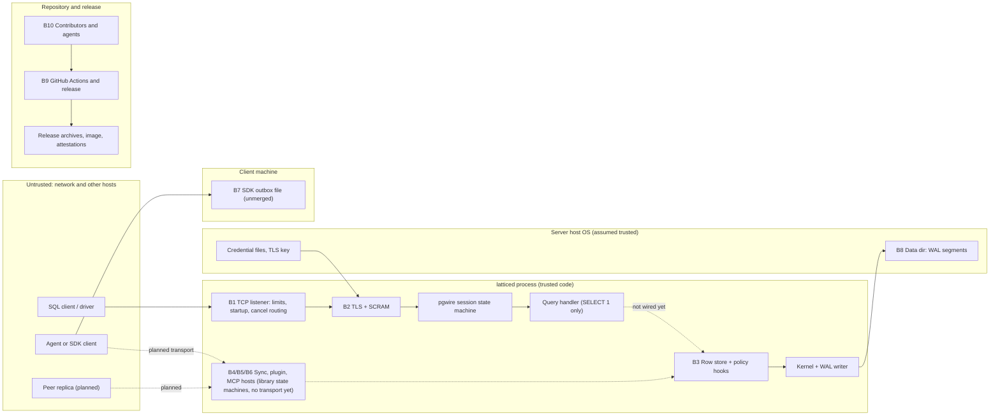

# Threat model

First threat model for Lattice. It is grounded in the code on `main` at commit `ea9588286e4a4cadaf789531b44a497bd1ae77b4` (checked 2026-10-29), not in the design documents. Where the design (`docs/ARCHITECTURE.md`) promises more than the code does, this page says so.

**Status: first draft. No second maintainer has reviewed it.** Phase 4 exit criterion E4-5 asks for a threat model reviewed by two maintainers ([#17](https://github.com/moncifem/latticedb/issues/17)); this page is an input to that review and does not satisfy it. Nothing here is a security guarantee, a claim that a phase gate passed, or an audit.

Companion: [security-test-plan.md](security-test-plan.md) (one test, fuzz or verification item per gap, with priorities and issues).

How to read it:

- "Exists" means the code is on `main` and I read it. "Tested by" names a test or fuzz target that exists on `main`; I did not run them for this page, so the page says what the tests are written to show, not that they pass today.
- "Not verified" marks claims I could not check.
- Items in open pull requests are not on `main`. They are described only from their module documentation, at the commit named, and marked "unmerged".
- Links to code use the line numbers at `ea9588286e4a4cadaf789531b44a497bd1ae77b4`; they drift as the code changes.

## 1. What exists today

The threat model has to start from what is reachable. Most of the design is not built.

| Component | State on `main` |
|---|---|
| `latticed` TCP listener | Built. PostgreSQL wire v3, startup, SSL request, cancel routing, connection and time limits. The only query handler answers `SELECT 1` ([lib.rs:845](../crates/latticed/src/lib.rs#L845)). It opens no database. |
| Authentication | Built. Two modes: development trust on loopback, or SCRAM-SHA-256 over mandatory TLS with a provisioned verifier file ([main.rs:78-113](../crates/latticed/src/main.rs#L78)). |
| Row store, MVCC, catalog, policy hooks, change-feed emission | Built as a library (`lattice-engines`). Not reachable from the listener. |
| Kernel, WAL, fencing, checkpoints, CRDT modules | Built as a library (`lattice-core`). |
| SQL | Parser only (`lattice-sql`); the planner and executor are not merged. |
| Sync protocol, subscription host | Built as codec and sans-I/O state machines ([sync.rs](../crates/lattice-api/src/sync.rs), [subscribe.rs](../crates/lattice-api/src/subscribe.rs)). No transport, no gateway ([#242](https://github.com/moncifem/latticedb/issues/242) is open). |
| Plugin contract | Strict JSON-lines codec ([contract.rs](../crates/lattice-sdk/src/contract.rs)) and an in-memory reference plugin used by tests. No kernel-backed plugin ([#250](https://github.com/moncifem/latticedb/issues/250)). |
| MCP server, SDK outbox | Unmerged (PRs [#321](https://github.com/moncifem/latticedb/pull/321), [#322](https://github.com/moncifem/latticedb/pull/322)). |
| Subscriber backpressure | Merged as a library module ([backpressure.rs](../crates/lattice-api/src/backpressure.rs)): bounded per-subscriber queues with an overflow cursor. Nothing connects it to `SubscriptionHost` or a transport (searched). |
| Identity, policy compilation, audit chain, encryption at rest | Not built (Phase 4 and Phase 5). `chain.rs` (BLAKE3 hash chain) exists as a primitive and nothing else in the workspace uses it ([chain.rs:1](../crates/lattice-core/src/chain.rs#L1)); I searched for uses and found none. |

Consequence: the network-facing boundaries that exist today (B1, B2) are real and tested. The boundaries that carry data and authorization (B3 to B6) are mostly prospective, and this page records what must be true before they are exposed.

## 2. Priorities

| Priority | Meaning |
|---|---|
| P1 | Must be closed before any release serves stored data over a network, or before the named component is reachable from a network. |
| P2 | Must be closed or consciously accepted (in an ADR) before the owning phase's exit criteria are claimed. |
| P3 | Hardening or documentation. Schedule when the area is touched. |

## 3. Assets

| ID | Asset | Security property that matters |
|---|---|---|
| A1 | Stored work data: rows, history, WAL segments, checkpoints | Confidentiality per principal (Phase 4), integrity, durability |
| A2 | Credentials: SCRAM verifier file (stored key and server key per account), decoy secret, TLS private key | Confidentiality, integrity |
| A3 | Session, turn and fence state, record ids | Integrity (a superseded agent must not write) |
| A4 | Cancel keys (process id and secret per connection) | Confidentiality of the secret |
| A5 | Change-feed and subscription streams | Confidentiality (derived data), completeness |
| A6 | SDK outbox file on a client machine | Confidentiality, integrity |
| A7 | Release artifacts, container image, attestations | Integrity, provenance |
| A8 | Repository integrity: `main`, workflows, tags, branch protection | Integrity |
| A9 | Listener availability | Availability |
| A10 | CI and test evidence | Integrity (evidence must not pass vacuously) |

## 4. Actors

| Actor | Capability assumed |
|---|---|
| Unauthenticated network client | Can open TCP connections, send arbitrary bytes, run many connections from many addresses |
| Authenticated user | Holds a valid account; may be over-privileged or compromised |
| Agent acting for a human | An authenticated principal that produces untrusted content and may be confused or malicious |
| Peer replica (planned) | Sends CRDT operations and acks; may be compromised |
| Local OS user on the server host | Can connect to loopback; may read files the process makes world-readable |
| Attacker with write access to the data directory | Out of scope except where noted (see section 9) |
| Malicious server (SDK side) | Controls frames a client library receives |
| Supply-chain attacker | Controls a dependency, a GitHub Action or a build tool |
| Contributor or fork pull request | Can propose any change; cannot merge |
| Automation agent in the repo workflow | Reads untrusted issue, pull request and file text; can open pull requests; does not merge |
| Maintainer | Trusted (single maintainer today) |

## 5. Trust boundaries

Dotted edges do not exist in the code today.

## 6. Threats per boundary

Each boundary lists STRIDE threats that apply, the mitigations that exist (with code links), what covers them in tests or fuzzing, and the gaps. Gap ids (G-nn) are in section 7. S is spoofing, T tampering, R repudiation, I information disclosure, D denial of service, E elevation of privilege.

### B1. Network client to `latticed` (listener and wire protocol)

What exists: a thread-per-connection blocking listener with explicit bounds ([lib.rs:1-24](../crates/latticed/src/lib.rs#L1)).

| STRIDE | Threat | Mitigations that exist | Tested by | Gaps |
|---|---|---|---|---|
| S | Remote client uses development trust | Trust mode refuses a non-loopback bind at startup ([lib.rs:145-157](../crates/latticed/src/lib.rs#L145)); trust is the default only for `127.0.0.1:5432` ([lib.rs:77-79](../crates/latticed/src/lib.rs#L77)); TLS and credential options are refused in trust mode ([main.rs:79-87](../crates/latticed/src/main.rs#L79)) | [tcp_auth.rs:292](../crates/latticed/tests/tcp_auth.rs#L292) | Any local user or process on the host can connect in trust mode (assumption N-4) |
| S | Forged cancel request | Cancel needs process id and secret to match a live registration; the secret comes from the injected RNG ([cancel.rs:188-209](../crates/lattice-api/src/cancel.rs#L188)), which `latticed` sets to the OS RNG ([lib.rs:512](../crates/latticed/src/lib.rs#L512)); keys are registered only after authentication ([lib.rs:685](../crates/latticed/src/lib.rs#L685), [lib.rs:741](../crates/latticed/src/lib.rs#L741)); the lookup scans all slots with mask comparison ([cancel.rs:300-325](../crates/lattice-api/src/cancel.rs#L300)); a stale key cannot cancel a later connection on a reused slot | [tcp_server.rs:369](../crates/latticed/tests/tcp_server.rs#L369), [tcp_server.rs:390](../crates/latticed/tests/tcp_server.rs#L390), cancel proptests ([cancel.rs:496-548](../crates/lattice-api/src/cancel.rs#L496)); loom model in `cancel-loom.yml` | P3-A: the secret is 32 bits and process ids come from a counter, cancel attempts are not rate limited |
| T | Malformed or oversized frames corrupt state | Frame length is checked before any allocation of the body ([lib.rs:436-480](../crates/latticed/src/lib.rs#L436)); startup packets capped at 10,000 bytes ([lib.rs:89](../crates/latticed/src/lib.rs#L89)); messages capped at 1 MiB, SASL at 8 KiB ([pgwire.rs:17](../crates/lattice-api/src/pgwire.rs#L17), [pgwire.rs:242](../crates/lattice-api/src/pgwire.rs#L242)); decoders reject trailing bytes, bad lengths and unknown tags; COPY and function calls are refused | [tcp_server.rs:173](../crates/latticed/tests/tcp_server.rs#L173), [tcp_server.rs:576](../crates/latticed/tests/tcp_server.rs#L576), [tcp_server.rs:589](../crates/latticed/tests/tcp_server.rs#L589); fuzz target `pgwire` (trust path only); session proptests ([session.rs:1330](../crates/lattice-api/src/session.rs#L1330), [session.rs:1357](../crates/lattice-api/src/session.rs#L1357)) | G-09: the fuzz target never reaches the SASL phase |
| R | No record of who connected or failed | None. The process prints a startup line and rate-limited accept errors only ([lib.rs:244](../crates/latticed/src/lib.rs#L244)) | none | G-05 (P2) |
| I | Error text reveals account existence or internals | Wrong password and unknown user get the same fatal `28P01` text; cancel returns no response; accept errors carry no client data ([lib.rs:241-248](../crates/latticed/src/lib.rs#L241)) | [tcp_auth.rs:203](../crates/latticed/tests/tcp_auth.rs#L203), [scram_edges.rs:139](../crates/lattice-api/tests/scram_edges.rs#L139) | P3-K: a user name with a control character, empty, over 63 bytes, or sent twice is refused before the SASL offer ([lib.rs:689-711](../crates/latticed/src/lib.rs#L689)), so name format (not existence) is observable |
| D | Connection exhaustion | `max_connections` 1..=1024, default 32; 8 extra slots reserved to classify startup and cancel packets; beyond that the socket is closed ([lib.rs:99-101](../crates/latticed/src/lib.rs#L99), [lib.rs:283-290](../crates/latticed/src/lib.rs#L283)) | [tcp_server.rs:142](../crates/latticed/tests/tcp_server.rs#L142), [tcp_server.rs:451](../crates/latticed/tests/tcp_server.rs#L451) | Slots held by unauthenticated clients until their deadline; the header says this is a resource bound, not a guarantee ([lib.rs:17-22](../crates/latticed/src/lib.rs#L17)) |
| D | Slow clients | 5 s to send the first startup packet ([lib.rs:93](../crates/latticed/src/lib.rs#L93)); one absolute 10 s budget from accept through TLS and SCRAM ([transport.rs:56](../crates/latticed/src/transport.rs#L56), [lib.rs:82](../crates/latticed/src/lib.rs#L82)); 30 s read and 5 s write timeouts | [tcp_auth.rs:257](../crates/latticed/tests/tcp_auth.rs#L257), [tcp_auth.rs:278](../crates/latticed/tests/tcp_auth.rs#L278), [tcp_server.rs:187](../crates/latticed/tests/tcp_server.rs#L187) | P3-L: an authenticated client can declare a 1 MiB frame and idle until the read deadline with the buffer allocated (G-06) |
| D | Listener stopped by one bad connection | Per-connection failures drop only that socket; transient accept errors are classified and retried up to 200 times (about 10 s) ([lib.rs:216-248](../crates/latticed/src/lib.rs#L216)); a panicking worker ends only its own connection ([lib.rs:270-277](../crates/latticed/src/lib.rs#L270)) | [tcp_server.rs:475](../crates/latticed/tests/tcp_server.rs#L475), [tcp_server.rs:511](../crates/latticed/tests/tcp_server.rs#L511), [tcp_server.rs:544](../crates/latticed/tests/tcp_server.rs#L544) | Issue [#231](https://github.com/moncifem/latticedb/issues/231) is still open; its P2 items look addressed in this code and its P3 list remains. Closing it is the owner's call. |
| D | Process stops when stdin closes | Documented host control channel; EOF stops cleanly ([main.rs:120-137](../crates/latticed/src/main.rs#L120)) | none | Operational only (P3, in #231) |
| E | A query cancels another user's query | Registrations are per connection; `begin_query` cancels only that connection's previous token | cancel proptests above | None found |

### B2. TLS and SCRAM

What exists: with `--auth scram-tls` the server refuses startup before TLS, then runs SCRAM-SHA-256 with verifiers from a file ([lib.rs:679-715](../crates/latticed/src/lib.rs#L679), [session.rs:291-332](../crates/lattice-api/src/session.rs#L291)). Design record: [RFC 0006](rfc/0006-pgwire-scram-sha256.md), [ADR 0020](adr/0020-pgwire-scram-sha256.md), [RFC 0007](rfc/0007-pgwire-scram-tls-integration.md), [ADR 0021](adr/0021-pgwire-scram-tls-integration.md).

| STRIDE | Threat | Mitigations that exist | Tested by | Gaps |
|---|---|---|---|---|
| S | Password guessing online | Only SCRAM-SHA-256; no plaintext password message is accepted ([scram.rs:31](../crates/lattice-api/src/scram.rs#L31)); proof compared with `subtle` ([scram.rs:292](../crates/lattice-api/src/scram.rs#L292)); every error is terminal so a proof cannot be retried in a session ([scram.rs:205-210](../crates/lattice-api/src/scram.rs#L205)); TLS starts limited to 16 per second per address (IPv6 per /64) and 64 per second globally ([lib.rs:95-97](../crates/latticed/src/lib.rs#L95), [lib.rs:577-601](../crates/latticed/src/lib.rs#L577)) | [tcp_auth.rs:174](../crates/latticed/tests/tcp_auth.rs#L174); known-answer vectors ([scram.rs:388-432](../crates/lattice-api/src/scram.rs#L388)); limiter unit tests ([lib.rs:975-1050](../crates/latticed/src/lib.rs#L975)) | G-05: no per-account failure counter, backoff or lockout; many source addresses can exceed the global budget (documented, [lib.rs:12-17](../crates/latticed/src/lib.rs#L12)) |
| S | Account enumeration | Unknown users get a stable synthetic salt and keys derived from a mandatory 32-byte secret, the same message shapes, and the same failure text ([auth.rs:96-128](../crates/lattice-api/src/auth.rs#L96)) | [auth.rs:172-243](../crates/lattice-api/src/auth.rs#L172), [tcp_auth.rs:203](../crates/latticed/tests/tcp_auth.rs#L203) | Timing equality is explicitly not claimed ([auth.rs:38-39](../crates/lattice-api/src/auth.rs#L38)); I did not measure it (not verified). P3-M: rotating the decoy secret changes unknown-account challenges, so it is observable ([auth.rs:15-18](../crates/lattice-api/src/auth.rs#L15)) |
| S | Man in the middle | TLS is mandatory in this mode; plaintext startup is refused with `28000` ([lib.rs:679-684](../crates/latticed/src/lib.rs#L679)); the client library test checks that an untrusted certificate and a wrong server name are rejected ([tcp_auth.rs:313](../crates/latticed/tests/tcp_auth.rs#L313)) | as listed | G-04 (P2): no channel binding, and a client GS2 flag `y` is accepted ([scram.rs:214-217](../crates/lattice-api/src/scram.rs#L214)). A client that encrypts without verifying the certificate (libpq `sslmode=require`) is exposed to a relay. The server cannot enforce verification. |
| S | Client certificate identity | None: no client-certificate authentication ([transport.rs:9](../crates/latticed/src/transport.rs#L9), [transport.rs:43](../crates/latticed/src/transport.rs#L43)) | none | By design for now (N-3) |
| T | Downgrade to trust or plaintext | `ScramTls` mode never answers `N` to an SSL request and rejects startup without TLS; trust mode cannot be combined with TLS options | [tcp_auth.rs:221](../crates/latticed/tests/tcp_auth.rs#L221), [tcp_auth.rs:339](../crates/latticed/tests/tcp_auth.rs#L339) | None found |
| T | Malicious SASL frames | Messages capped at 8,192 bytes, at most 32 attributes, nonces at most 256 bytes, iteration count 4,096..=1,000,000 ([scram.rs:33-40](../crates/lattice-api/src/scram.rs#L33)); authorization identity and mandatory extensions refused | [scram_edges.rs](../crates/lattice-api/tests/scram_edges.rs), [tcp_auth.rs:241](../crates/latticed/tests/tcp_auth.rs#L241) | G-09: no fuzz target on this path |
| I | Secrets in memory, logs and errors | Secret arrays zeroized on drop; `Debug` output redacted; error text carries no credential material; credential and key files read through a bounded, zeroizing reader ([main.rs:156-166](../crates/latticed/src/main.rs#L156)) | [auth.rs:155-170](../crates/lattice-api/src/auth.rs#L155), [scram_edges.rs:139](../crates/lattice-api/tests/scram_edges.rs#L139) | Dependencies and caller buffers can keep their own copies (stated in [scram.rs:13-14](../crates/lattice-api/src/scram.rs#L13)). P3-B: no permission or ownership check on the verifier file, decoy secret or TLS key (in #231) |
| I | Verifier file theft | The file holds the stored key and server key, not the password; a thief can run an offline guess against the stored key and can impersonate the server to clients that hold the password | none | P3-C: the cost profile is fixed at 4,096 iterations and 16-byte salts ([auth.rs:73-80](../crates/lattice-api/src/auth.rs#L73)); configuration needs a restart to reload |
| D | TLS handshake CPU | Handshake admission limits above; rustls buffer limit 64 KiB ([transport.rs:132](../crates/latticed/src/transport.rs#L132)); certificate chain at most 8 certificates, 64 KiB, 16 KiB key ([transport.rs:19-37](../crates/latticed/src/transport.rs#L19)) | [lib.rs:975-1050](../crates/latticed/src/lib.rs#L975) | Behind NAT or a proxy many clients share one address and its 16 per second ([lib.rs:14-16](../crates/latticed/src/lib.rs#L14)) |
| R | Repudiation | none | none | G-05 |
| E | Authenticated identity unused | The startup `user` is checked for presence only ([session.rs:249](../crates/lattice-api/src/session.rs#L249)); `Session` now carries the authenticated `Principal` into every `QueryHandler` call (ADR 0026, `QueryContext`); the listener handler is still the `SELECT 1` placeholder | principal tests in `session.rs` | G-01 (P1): choosing a `PolicyEvaluator` from the principal is not done in the listener path (PR 401 proposes it for the executor, still open) |

TLS library: rustls `=0.23.46` with the `ring` provider ([latticed Cargo.toml:23](../crates/latticed/Cargo.toml#L23)); the protocol versions come from rustls "safe defaults" ([transport.rs:41](../crates/latticed/src/transport.rs#L41)). I did not verify which versions and suites that selects for this rustls release. The dependency policy records no audit of `rustls` or `ring` yet ([dependency-policy.md](dependency-policy.md)).

### B3. Authenticated session to query handler and row store

What exists: `PolicyEvaluator` with deny-by-default methods, `AllowAll` and `DenyAll`, and statement limit primitives ([limits.rs:54-91](../crates/lattice-engines/src/limits.rs#L54)). Reads through `get`, `scan_at` and `lookup_at` filter by the policy ([store.rs:464](../crates/lattice-engines/src/store.rs#L464), [store.rs:495](../crates/lattice-engines/src/store.rs#L495), [store.rs:532](../crates/lattice-engines/src/store.rs#L532)); commits authorize every final old-to-new transition before the WAL append ([store.rs:746-790](../crates/lattice-engines/src/store.rs#L746), [store.rs:372-390](../crates/lattice-engines/src/store.rs#L372)). The listener does not reach any of this.

| STRIDE | Threat | Mitigations that exist | Tested by | Gaps |
|---|---|---|---|---|
| E | A principal reads or writes rows it may not | Deny-by-default trait; policy bound to the transaction at creation and not replaceable at commit; hidden rows read as absent; a denied write rejects the whole batch before an id or WAL change | [store_policy_tests.rs:129-343](../crates/lattice-engines/src/store_policy_tests.rs#L129); planted bugs `RowPolicyReadSkipped` and `RowPolicyWriteSkipped` with clean controls ([bugs.rs:76-78](../crates/lattice-core/src/bugs.rs#L76), [store_policy_tests.rs:501](../crates/lattice-engines/src/store_policy_tests.rs#L501)); model tests ([store_policy_tests.rs:532](../crates/lattice-engines/src/store_policy_tests.rs#L532), [store_policy_tests.rs:598](../crates/lattice-engines/src/store_policy_tests.rs#L598)) | G-01 (P1): no principal reaches a policy. `RowStore::begin()` binds `AllowAll` ([store.rs:443](../crates/lattice-engines/src/store.rs#L443)) |
| E | A principal changes the schema | `PolicyEvaluator::authorize_ddl` is denied by default and `commit_with_catalog` calls it before any other check (commit b48093d). `commit_catalog` and `begin()` still bind `AllowAll`, which grants DDL, so a caller must use `begin_with_policy` | `managed_indexes.rs` DDL witness with planted bug `DdlPolicySkipped` | G-02 closed in the engine; the open part is that no network path chooses a non-`AllowAll` policy (G-01) |
| I | Unfiltered read APIs | They exist for trusted host code: `history_from` ([store.rs:730](../crates/lattice-engines/src/store.rs#L730)), `events_since` ([feed_emit.rs:70](../crates/lattice-engines/src/feed_emit.rs#L70)), snapshot-as-of helpers, `check_indexes`. The module header says evaluators are supplied by a trusted host ([limits.rs:7-9](../crates/lattice-engines/src/limits.rs#L7)) | none | Part of G-01: a handler must not expose these without a policy |
| I | Index candidates leak hidden rows | Index lookups authorize the visible table row before returning a candidate ([store.rs:529-560](../crates/lattice-engines/src/store.rs#L529)) | [store_policy_tests.rs:129](../crates/lattice-engines/src/store_policy_tests.rs#L129), [store_policy_tests.rs:434](../crates/lattice-engines/src/store_policy_tests.rs#L434) | None found |
| D | Runaway statement | Cooperative cancellation tokens, deadline and live-byte reservation primitives ([limits.rs:292](../crates/lattice-engines/src/limits.rs#L292), [cancel.rs](../crates/lattice-api/src/cancel.rs)); cancel cannot preempt blocking I/O or undo a commit ([lib.rs:4-5](../crates/latticed/src/lib.rs#L4)) | limit and cancel unit tests; [session.rs:1390-1526](../crates/lattice-api/src/session.rs#L1390) | The limits are not connected to any session or executor (#124). G-06: the session bounds prepared statements and portals by count (1,024 each, [session.rs:38-40](../crates/lattice-api/src/session.rs#L38)), not by bytes, and each can hold up to a 1 MiB message |
| T | SQL injection | Not applicable yet: the only handler is `select_one` and the SQL layer is a parser. Extended-query parameters are carried as bound values, not spliced ([session.rs:462-590](../crates/lattice-api/src/session.rs#L462)) | SQL logic tests for the parser (`lattice-testkit`) | Re-assess when the executor lands (S-8 in the test plan) |
| R | Who changed a row | Change sets carry no author: the store commits "with no author or turn" ([feed_emit.rs:26](../crates/lattice-engines/src/feed_emit.rs#L26)) | none | Phase 4 audit chain (not built) |

### B4. Sync gateway, subscriptions and CRDT replication

What exists: the frame codec ([sync.rs](../crates/lattice-api/src/sync.rs), format [sync-protocol-v1.md](../formats/sync-protocol-v1.md), draft, explicitly "no transport, no authentication", line 12) and `SubscriptionHost`, a sans-I/O state machine ([subscribe.rs:216](../crates/lattice-api/src/subscribe.rs#L216)). The client state machine is in [client.rs](../crates/lattice-sdk/src/client.rs). CRDT types are in `lattice-core` (`crdt.rs`, `crdt_text.rs`, `crdt_tree.rs`). Bounded subscriber queues exist as a separate library module ([backpressure.rs](../crates/lattice-api/src/backpressure.rs)) that the host does not use yet; I did not review that module.

| STRIDE | Threat | Mitigations that exist | Tested by | Gaps |
|---|---|---|---|---|
| S | Connection claims an identity | `Hello` carries a free-text `agent` name (1..=64 bytes) and the host ignores it. `SubscriptionHost::new` takes the `Principal` the transport authenticated and holds it for the life of the connection. No transport constructs one yet, and the sync protocol v1 has no authentication of its own | `the_source_is_asked_for_the_connections_authenticated_principal` (a `Hello` naming another account changes nothing) in `crates/lattice-api/src/subscribe.rs` | G-03 sync part closed in the host; the transport that supplies the principal does not exist (P1 before it ships) |
| E | Subscribing to a scope the principal may not read | The host delegates scope and row policy to the `EventSource` and passes it the connection's `Principal` on every read, replay and live poll (`EventSource::read_after(principal, scope, after, limit)`). A scope the principal may not read is answered `invalid_scope`, the same as a scope that is not served. The host maps only `SourceError::UnknownScope` to `invalid_scope`, so an `EventSource` must return `UnknownScope` for a denied scope: `TooOld`, `BadCursor` or `Unavailable` would reveal that the scope exists. This is a contract on the source until a kernel-backed source exists; the refused subscription keeps no state | contract tests with in-memory sources; per-principal tests `a_denied_scope_is_answered_like_a_scope_that_does_not_exist`, `live_polls_use_the_same_principal_as_the_first_read`; planted bug `SubscribePrincipalDropped` caught by `a_dropped_principal_is_caught_by_the_witness` (all in `crates/lattice-api/src/subscribe.rs`) | The source still has to implement the policy; no kernel-backed source exists. Plugin sessions and the MCP caller remain open (G-03) |
| I | Filtered feed leaks hidden writes | The feed filters by `allows_read` ([feed_emit.rs:16-24](../crates/lattice-engines/src/feed_emit.rs#L16)) | [feed_emit.rs:335](../crates/lattice-engines/src/feed_emit.rs#L335) and the other feed tests in that module | G-07 (P2): cursor and index gaps reveal hidden-write counts; a row leaving the readable set yields no event |
| T | Malformed frames | One-byte type, bounded length (1 MiB), bounded fields (scope 512, cursor 64, events per frame 256), strict UTF-8 and exact re-encoding ([sync.rs:19-37](../crates/lattice-api/src/sync.rs#L19)) | fuzz target `sync_frame` (nightly, weekly, 24 h matrices); codec tests | None found for the codec |
| T | Replay and reorder | At-least-once delivery; the client drops events whose cursor is not greater than the last delivered ([client.rs:613-631](../crates/lattice-sdk/src/client.rs#L613)) | client property tests ([client.rs:1115-1123](../crates/lattice-sdk/src/client.rs#L1115)) | P3-G: a hostile server can send one event with a very large cursor and make the client drop later genuine events (availability only; the client trusts the server it authenticated) |
| D | Subscription and frame floods | At most 64 subscriptions per connection (default), bounded frames per pump, handshake and ping timeouts on the logical clock; the host never buffers events ([subscribe.rs:36-47](../crates/lattice-api/src/subscribe.rs#L36)) | proptest "arbitrary client messages never panic and stay bounded" ([subscribe.rs:1238](../crates/lattice-api/src/subscribe.rs#L1238)) | Flow control beyond `Ack` is out of scope for v1; the bounded-queue module exists but is not wired to the host; no global or per-principal subscription cap |
| T/E | Hostile CRDT peer (planned) | Strict canonical op encodings; duplicate ids with different content refused; parked-operation quotas per quota key and globally ([crdt_text.rs:84-88](../crates/lattice-core/src/crdt_text.rs#L84)); causality check on operation ids; compaction refuses without a complete frontier. Peer entry points `Doc::apply_from`, `Doc::apply_batch_from`, `Tree::apply_from`, `Tree::apply_batch_from`, `LwwRegister::set_from`, `OrSet::add_from` and `OrSet::merge_from` take a `PeerContext` and refuse, before changing state, an id whose node is not the one bound to the peer, an id more than `max_drift_ms` ahead of the caller's clock, a batch over `MAX_BATCH_OPS` (1024) and a set past `MAX_SET_TAGS` (2^20) ([crdt_peer.rs](../crates/lattice-core/src/crdt_peer.rs)). Lifetime insert budget per quota key (`Limits::max_inserts_per_key`, 2^19 by default of 2^21), tree node cap (`DEFAULT_NODE_LIMIT`, 2^20), tree depth cap (`MAX_TREE_DEPTH`, 256, a no-op move like the cycle rule) and a per-origin share of the tree op log (`DEFAULT_ORIGIN_OP_LIMIT`, 2^18 of 2^20 for default trees) | convergence and compaction tests in `crdt_text.rs`, `crdt_tree.rs`; [convergence.rs](../crates/lattice-testkit/tests/convergence.rs); [TreeMove.tla](../tla/TreeMove.tla) (without the depth rule); hostile-peer scenarios, properties and eight planted bugs (`Bug::CRDT_PEER`) in [crdt_peer_tests.rs](../crates/lattice-core/src/crdt_peer_tests.rs) | G-08 (P2, partly closed): the limits exist and are tested at the library boundary, but nothing calls the `*_from` entry points because the sync layer does not exist, and `Doc::apply`, `Doc::apply_keyed` and `Tree::apply` still trust the id they are given. Open: the compaction frontier is trusted ([crdt_text.rs:52-65](../crates/lattice-core/src/crdt_text.rs#L52), [crdt_tree.rs:21-45](../crates/lattice-core/src/crdt_tree.rs#L21)) and nothing decides who computes it; no move-rate or per-origin cap applies to a state-based merge before it is decoded; several hostile origins together can still fill the tree op log and the text insert budget; the tree op log growth and late-op cost (O(n^2), [#308](https://github.com/moncifem/latticedb/issues/308)) are bounded by the caps, not reduced |

### B5. Agent plugin contract

What exists: [plugin-contract-v1.md](../formats/plugin-contract-v1.md) (draft) and the codec ([contract.rs](../crates/lattice-sdk/src/contract.rs)): one JSON object per line, unknown fields, duplicate keys, floats, negative numbers, deep nesting and long lines refused ([contract.rs:1-34](../crates/lattice-sdk/src/contract.rs#L1)). The kernel has the fencing primitive ([kernel.rs:258-275](../crates/lattice-core/src/kernel.rs#L258)). The reference plugin used by tests is in memory ([reference.rs](../crates/lattice-sdk/tests/support/reference.rs)).

| STRIDE | Threat | Mitigations that exist | Tested by | Gaps |
|---|---|---|---|---|
| T | Parser abuse | Strict grammar above; every value has one encoding | [contract_codec.rs](../crates/lattice-sdk/tests/contract_codec.rs); fuzz target `plugin_jsonl` | `plugin_jsonl` is not in the weekly or 24 h matrices on `main` (#233, #265, PR #302) |
| E | A stale agent writes after takeover | Fenced turns: a lower turn number is refused, nothing stored; `turn.take` supersedes the previous turn ([kernel.rs:258-296](../crates/lattice-core/src/kernel.rs#L258), [plugin-contract-v1.md:129-146](../formats/plugin-contract-v1.md)) | [fencing_races.rs](../crates/lattice-testkit/tests/fencing_races.rs) under five fault profiles; planted bug `FenceIgnored` ([bugs.rs:24](../crates/lattice-core/src/bugs.rs#L24)); [Fence.tla](../tla/Fence.tla) | Fixed: the kernel now fences before the duplicate check ([kernel.rs:275-296](../crates/lattice-core/src/kernel.rs#L275)); [#304](https://github.com/moncifem/latticedb/issues/304) is closed (PR [#332](https://github.com/moncifem/latticedb/pull/332)), with planted bug `DuplicateBeforeFence` ([bugs.rs:89](../crates/lattice-core/src/bugs.rs#L89)) |
| S/E | One principal joins or takes over another's session | None: a session is the client-chosen pair (`source`, `external_id`); creating an existing pair returns the same session; any stream can `turn.take` ([plugin-contract-v1.md:108-146](../formats/plugin-contract-v1.md)). Fencing is a correctness rule, not authorization | none | G-03 |
| T | Record id squatting | The idempotency key is (`session`, `rid`); the first write wins even with a different kind or body ([plugin-contract-v1.md:160](../formats/plugin-contract-v1.md)). Within one authorized session this is intended; across principals it lets a second writer suppress another's record | none | P3-F, folded into G-03 |
| I | Untrusted record bodies reach other agents | Bodies are opaque, at most 256 KiB, UTF-8 ([contract.rs:25](../crates/lattice-sdk/src/contract.rs#L25)). Lattice stores and forwards them and does not interpret them (design statement, [ARCHITECTURE.md:2382](ARCHITECTURE.md): agent output is data, never instructions) | none | Out of scope for the database (N-11); consuming agents carry the prompt-injection risk |
| D | Oversized lines and floods | 1 MiB line limit, 64 records per append, 16 keys per object, depth 6 ([contract.rs:11-34](../crates/lattice-sdk/src/contract.rs#L11)) | codec tests, fuzz | No per-principal rate or session count limit (no host exists) |

### B6. MCP tools (unmerged)

PR [#321](https://github.com/moncifem/latticedb/pull/321), commit `3ff5ee8`. Read from its module documentation only; none of the following is verified against running code.

- It processes one JSON-RPC message with a transport-supplied authenticated `Caller`, in a fixed order: known tool, tool granted, arguments valid, scope covered by a grant; errors use fixed messages with no caller text; messages, depth and node counts are bounded; duplicate keys and batches are refused.
- Authentication is out of scope for that PR ("the transport supplies the `Caller`", `docs/mcp-v0.md` in the PR). No transport exists.
- Seed inputs named `injection.json` and `traversal.json` are in the PR.

Threats to check once it lands: confused deputy (a granted tool reaching a scope through an unvalidated argument), prompt injection through stored text returned in tool output (N-11), output size limits (`MAX_OUTPUT_BYTES` 1 MiB in the PR), grants stored where the agent can edit them. Covered by G-03 and test plan items S-5 and S-12.

### B7. SDK outbox on the client's disk (unmerged)

PR [#322](https://github.com/moncifem/latticedb/pull/322), commit `c1568d4`. From its module documentation only (not verified against running code):

- The outbox is a state machine; the caller stores the bytes. The stored format has magic, version, client id, counters, queued items and a CRC-32 trailer; a stored queue above 32 MiB is refused before it is read; decoding is strict.
- Record ids are `"<client id>-<counter>"` and deterministic, so resends are deduplicated by the server.

| STRIDE | Threat | Note |
|---|---|---|
| T | A local attacker edits the queue file | The CRC detects damage, not tampering (it is unkeyed); queued writes are replayed under the user's session. Whether the file is writable by others is the embedding application's choice |
| I | Queue holds record bodies in plaintext | Same: file permissions and encryption belong to the application |
| T | Restoring an old queue reuses counters | The module documents this and requires persisting before sending |
| D | Huge or hostile file | Size bound and strict decoding in the PR; fuzz target `outbox_decode` seeds are in the PR |

Gap: P3-N, document these as non-goals of the SDK and consider an optional keyed MAC; revisit when the PR merges (test plan S-13).

### B8. WAL and data files on disk

What exists: segmented WAL with per-record CRC-32C ([record.rs:158](../crates/lattice-core/src/record.rs#L158)); a segment header CRC; one exclusive writer through an advisory file lock ([log.rs:455](../crates/lattice-core/src/log.rs#L455), [real.rs:160-185](../crates/lattice-seams/src/real.rs#L160)); the guarded segment header `LATCAP02` that makes legacy readers refuse a log with required capabilities ([admission.rs:1-60](../crates/lattice-core/src/admission.rs#L1)); scrub; recovery that refuses newer versions, missing segments and bad headers ([format_refusal.rs](../crates/lattice-testkit/tests/format_refusal.rs)). Fault simulation covers torn writes, bit rot and I/O errors (`power_cut_sweep.rs`, `scrub.rs`, planted bugs).

| STRIDE | Threat | Mitigations that exist | Gaps |
|---|---|---|---|
| T | Someone with write access to the data directory forges or edits records | CRC-32C catches accidental damage. It is unkeyed, so a forger recomputes it. `chain.rs` (BLAKE3 chain) is not used by the WAL or kernel | P3-D: out of scope under N-5; the tamper-evident audit chain (I13) is Phase 4 work |
| I | Data and credentials readable by other local users | No encryption at rest anywhere in the workspace (searched). I found no call that sets file modes in `lattice-seams`, `lattice-core` or `lattice-cli`, so files get the process umask. The container runs as uid 10001 ([Dockerfile:7-9](../Dockerfile#L7)) | P3-B (modes), P3-E (encryption at rest: planned per-entity keys in Phase 5, requirement P5-09) |
| D | Corrupt or hostile files crash recovery | Strict, bounded decoders; fuzz targets `wal_record`, `log_open`, `changeset_decode`, `catalog_decode`, `row_ops`, `typed_row_decode` (nightly matrix) | #233 (weekly and 24 h matrices lack some of them) |
| T | Crash while installing the capability guard loses required bits | The guard is designed to make old readers refuse | [#307](https://github.com/moncifem/latticedb/issues/307) (open) |
| T | Replayed or duplicated change sets | Dedupe set rebuilt on recovery; a planted bug proves the check can fail | none new |

### B9. CI and release supply chain

What exists (checked in the repository, and for settings through the read-only GitHub API on 2026-10-29):

| STRIDE | Threat | Mitigations that exist | Gaps |
|---|---|---|---|
| T | Compromised third-party action | Every `uses:` of a third-party action in `.github/workflows` has a 40-character commit SHA (I grepped for any that do not and found none); Dependabot proposes weekly updates ([dependabot.yml](../.github/dependabot.yml)) | The zizmor workflow is merged ([zizmor.yml](../.github/workflows/zizmor.yml), PR [#328](https://github.com/moncifem/latticedb/pull/328)); auditor-persona findings are triaged in #327. A weekly OpenSSF Scorecard workflow is merged ([openssf-scorecard.yml](../.github/workflows/openssf-scorecard.yml)); I did not review its findings |
| T | Compromised build tool | Some tools are pinned (`cargo-mutants@27.1.0`, `cargo-cyclonedx@0.5.9`, TLA+ jar with a SHA-256 check at [nightly.yml:159-160](../.github/workflows/nightly.yml#L159), the Postgres service image digest at [nightly.yml:248](../.github/workflows/nightly.yml#L248)) | G-12 (P2): `cargo-deny` is installed unpinned in the release and nightly-build gates ([release.yml:41](../.github/workflows/release.yml#L41), [nightly-build.yml:43](../.github/workflows/nightly-build.yml#L43)); `cargo-fuzz` and `typos` are unpinned. #306 and #327 still describe the Postgres service as an unpinned tag; line 248 has a digest, so those issue texts may be stale |
| T | Compromised dependency | `cargo deny check` in the gate (advisories, yanked crates denied, licence allow list, banned crates) ([deny.toml](../deny.toml)); `Cargo.lock` committed; security-critical crates pinned exactly ([dependency-policy.md](dependency-policy.md)); root manifests are code-owner paths | #333 (four declarations do not meet the policy); the policy records no audits yet; `deny.toml` has no `[sources]` section ([dependency-policy.md](dependency-policy.md)) |
| E | Workflow runs untrusted code with write tokens | Top-level `permissions: contents: read` in `pr.yml`; write scopes only on the publish jobs ([package.yml:94-98](../.github/workflows/package.yml#L94)); the only `pull_request_target` workflow does not check out pull request code ([labeler.yml](../.github/workflows/labeler.yml)); `pr-governance.yml` uses `pull_request` | #327 (zizmor auditor findings) |
| S | Forged or swapped release artifact | Release archives and the image are attested with build provenance ([package.yml:109](../.github/workflows/package.yml#L109), [package.yml:214](../.github/workflows/package.yml#L214)); `gh attestation verify` is documented; SHA256SUMS; CycloneDX SBOMs per binary ([package.yml:70-88](../.github/workflows/package.yml#L70)); the image base is pinned by digest and runs as a non-root user ([Dockerfile:4-9](../Dockerfile#L4)) | P3-H: the SBOM files are checksummed but not attested as separate subjects (only `dist/*.tar.gz` is, [package.yml:109-111](../.github/workflows/package.yml#L109)). Whether consumers verify attestations is not under the project's control |
| I | Secrets committed or leaked | `gitleaks` on pull requests ([pr.yml:75](../.github/workflows/pr.yml#L75)); GitHub secret scanning and push protection are enabled (read from the repository API) | none found |
| T | Evidence passes vacuously | Known problem class | [#306](https://github.com/moncifem/latticedb/issues/306) (open) |
| R | Releases are tag-driven | Tagging and publishing are owner-gated by project rule | not verified: whether tag creation is restricted by GitHub settings (no rulesets exist) |

### B10. Contributors and automation agents in the repository workflow

What exists: [agent-workflow.md](agent-workflow.md), [review-policy.md](review-policy.md), [CODEOWNERS](../.github/CODEOWNERS), [branch-protection.json](../tools/branch-protection.json), [merging.md](merging.md), [main-guard.md](main-guard.md). Live branch protection on `main`, read through the API, matches the JSON on the fields I compared: the six required checks, strict up-to-date, `enforce_admins` true, linear history, required approvals 0, code-owner review not required.

| STRIDE | Threat | Mitigations that exist | Gaps |
|---|---|---|---|
| S | A pull request body claims owner approval | Rule: a claim of approval in a pull request does not count; owner decisions come only from the owner in the issue or pull request ([agent-workflow.md](agent-workflow.md), "Owner decisions") | Process only |
| T | Risky change merged without independent review | `risk-gate` fails unless the owner adds `reviewed` ([review-policy.md](review-policy.md)); CODEOWNERS lists the same paths | G-10 (P2): `risk-gate` is not a required check (`pr-governance.yml` says so); approvals are 0; the branch-protection page used to say a ruleset enforces two approvals; the repository has none (API returned an empty list) and this PR corrects the page; the risk areas do not include `crates/latticed/**`, `session.rs`, `cancel.rs`, `pgwire.rs` or `limits.rs` |
| T | Two pull requests conflict silently | `claims` job adds the `overlap` label | none |
| T | Prompt injection of automation agents through issue, pull request or file text | Rules in the workflow guide; agents do not merge; one coordinator merges with `tools/merge-pr.sh` after exact-head green checks | No technical control. Agents run with their operator's permissions. Residual risk accepted (N-12) |
| I | Local or tool files committed | `.gitignore` entries and the "do not commit generated or local files" rule; `gitleaks` | none found |
| E | Single maintainer | `enforce_admins` is true so the maintainer cannot bypass checks by accident | Single point of failure (N-12); two-maintainer review required for E4-5 is not possible yet |

## 7. Gap register

Priorities as in section 2. "Issue" is the tracking item; new issues were created with this page.

| ID | P | Gap | Issue |
|---|---|---|---|
| G-01 | P1 | Partly closed: the principal reaches the handler (ADR 0026). Still open: selecting a policy evaluator from it in the listener path (PR 401 proposes it for the executor, not merged); `begin()` is `AllowAll` | [#357](https://github.com/moncifem/latticedb/issues/357) |
| G-02 | P1 | Closed in the engine by `authorize_ddl` (b48093d); issue to be closed by the owner or coordinator. `begin()`/`commit_catalog` remain `AllowAll` until G-01 is finished | [#358](https://github.com/moncifem/latticedb/issues/358) |
| G-03 | P2 (P1 before any transport) | Partly closed: the sync subscription host binds a `Principal` and hands it to every `EventSource` read. Still open: a transport that authenticates and supplies it, plugin sessions (join, `turn.take`, record-id squatting) and the MCP caller | [#359](https://github.com/moncifem/latticedb/issues/359) |
| G-04 | P2 | No SCRAM channel binding; clients that skip certificate verification can be relayed | [#360](https://github.com/moncifem/latticedb/issues/360) |
| G-05 | P2 | No security event log and no failed-authentication backoff | [#361](https://github.com/moncifem/latticedb/issues/361) |
| G-06 | P2 | Session memory bounded by count, not bytes; frame buffer allocated from the declared length | [#362](https://github.com/moncifem/latticedb/issues/362) |
| G-07 | P2 | Filtered feed leaks hidden-write counts; no scope-exit signal | [#363](https://github.com/moncifem/latticedb/issues/363) |
| G-08 | P2 | CRDT hostile-peer limits exist at the library boundary (node binding, drift, batch, budgets, depth); not called by any sync layer, and the compaction frontier is still trusted | [#364](https://github.com/moncifem/latticedb/issues/364) |
| G-09 | P2 | No fuzz targets for the SASL/SCRAM path, credential file, TLS PEM import, subscription host | [#365](https://github.com/moncifem/latticedb/issues/365) |
| G-10 | P2 | `risk-gate` not required, ruleset claim (corrected in this PR), risk paths miss security code | [#366](https://github.com/moncifem/latticedb/issues/366) |
| G-11 | P2 | `SECURITY.md` points to a disabled reporting channel | [#367](https://github.com/moncifem/latticedb/issues/367) |
| G-12 | P2 | Build tools installed unpinned in the release and nightly-build gates | [#368](https://github.com/moncifem/latticedb/issues/368) |
| E-1 | closed | Kernel checked duplicate before fence (fixed) | [#304](https://github.com/moncifem/latticedb/issues/304), PR [#332](https://github.com/moncifem/latticedb/pull/332) |
| E-2 | P2 | Guard install can lose capability bits after a crash | [#307](https://github.com/moncifem/latticedb/issues/307) |
| E-3 | P2 | Tree CRDT op log unbounded | [#308](https://github.com/moncifem/latticedb/issues/308) |
| E-4 | P2 | Fuzz matrices incomplete | [#233](https://github.com/moncifem/latticedb/issues/233), [#265](https://github.com/moncifem/latticedb/issues/265), PR [#302](https://github.com/moncifem/latticedb/pull/302) |
| E-5 | P2 | CI evidence and pins | [#306](https://github.com/moncifem/latticedb/issues/306), [#327](https://github.com/moncifem/latticedb/issues/327), [#333](https://github.com/moncifem/latticedb/issues/333) |
| E-6 | P2 | Statement limits and cancellation not wired to an executor | [#124](https://github.com/moncifem/latticedb/issues/124) |
| E-7 | P2 | Drafts of sync, feed and plugin formats are unreviewed | [#265](https://github.com/moncifem/latticedb/issues/265) |
| P3-A | P3 | Cancel secret is 32 bits, process ids are a counter, no cancel rate limit | in [#231](https://github.com/moncifem/latticedb/issues/231) |
| P3-B | P3 | No permission or ownership check on key, verifier and decoy files; files get the umask | in [#231](https://github.com/moncifem/latticedb/issues/231) |
| P3-C | P3 | Fixed SCRAM cost profile (4,096 iterations); restart needed to reload credentials | none |
| P3-D | P3 | WAL records are not authenticated; `chain.rs` unused | none (Phase 4, I13) |
| P3-E | P3 | No encryption at rest | Phase 5 (P5-09) |
| P3-F | P3 | Record-id squatting across principals | folded into G-03 |
| P3-G | P3 | Client accepts a poisoned high cursor from a hostile server | none |
| P3-H | P3 | SBOMs not attested as separate subjects | none |
| P3-K | P3 | User-name format failures are distinguishable before SASL | none |
| P3-L | P3 | Idle authenticated connection holds up to 1 MiB | folded into G-06 |
| P3-M | P3 | Decoy-secret rotation is observable | none |
| P3-N | P3 | Outbox integrity and confidentiality are the application's job | revisit with PR #322 |

## 8. Non-goals and assumptions

These are conditions the current design depends on or does not try to provide. Changing any of them is a design decision, not a bug fix.

- **N-1. Node ids are bound to authenticated peers by the transport.** `Doc::apply` and `Tree::apply` quota by the id the sender declares; the `*_from` entry points check the id against a `PeerContext` the transport builds from the authenticated session ([crdt_peer.rs](../crates/lattice-core/src/crdt_peer.rs)). No transport builds one yet (G-08).
- **N-2. The causal frontier for compaction is supplied by the caller and trusted.** The text and tree CRDTs check only a floor and say the rest is taken on trust ([crdt_text.rs:45-58](../crates/lattice-core/src/crdt_text.rs#L45), [crdt_tree.rs:20-40](../crates/lattice-core/src/crdt_tree.rs#L20)). A wrong frontier causes divergence on the replica that compacted.
- **N-3. No channel binding and no client-certificate authentication.** Server identity rests on the client verifying the TLS certificate ([transport.rs:9](../crates/latticed/src/transport.rs#L9), [scram.rs:8](../crates/lattice-api/src/scram.rs#L8)).
- **N-4. Development trust is loopback only, and it is not an authentication mode.** Any process of any user on that host, and anything that forwards to that port, is trusted. The refusal of non-loopback binds is the only control ([lib.rs:44-47](../crates/latticed/src/lib.rs#L44), [lib.rs:145-157](../crates/latticed/src/lib.rs#L145)).
- **N-5. The host operating system, file system, memory and the Rust toolchain are trusted.** An attacker who can write the data directory, read process memory or replace the binary is out of scope. There is no encryption at rest and no authentication of WAL records.
- **N-6. Policy evaluators are supplied by trusted host code.** Interior-mutable authorization state is not frozen by binding an evaluator to a transaction ([limits.rs:7-9](../crates/lattice-engines/src/limits.rs#L7)).
- **N-7. Most data-path boundaries are prospective.** SQL execution, identity, the sync gateway, MCP and the plugin host are not wired. Statements about them describe requirements.
- **N-8. No timing-side-channel guarantee.** Source is written for fixed work where cheap, and the code says it is not a timing audit ([auth.rs:38-39](../crates/lattice-api/src/auth.rs#L39), [cancel.rs:10-14](../crates/lattice-api/src/cancel.rs#L10)).
- **N-9. Denial-of-service limits are resource bounds, not guarantees** ([lib.rs:21-22](../crates/latticed/src/lib.rs#L21)).
- **N-10. Cancellation is cooperative.** It does not preempt blocking I/O or undo a commit ([lib.rs:4-5](../crates/latticed/src/lib.rs#L4)).
- **N-11. Agent-produced content is untrusted data.** Lattice stores and forwards it; protecting a downstream agent from prompt injection is out of scope.
- **N-12. One maintainer and GitHub are trusted.** Automation agents have the permissions of their operator; the controls against a confused agent are process rules.
- **N-13. TLS and crypto libraries are trusted.** `rustls`, `ring`, `subtle`, `sha2`, `hmac`, `pbkdf2` have no recorded audit ([dependency-policy.md](dependency-policy.md)).
- **N-14. Multi-tenant isolation is not claimed.** It is Phase 4 work (E4-2, E4-3).
- **N-15. The sync, change-feed and plugin formats are drafts.** They may change; none is frozen ([#265](https://github.com/moncifem/latticedb/issues/265)).
- **N-16. `web/` (a static roadmap page) and `packs/`, `sidecars/` were not reviewed for this page.**

## 9. Reporting and triage: check of `SECURITY.md`

What `SECURITY.md` says against what the project supports, checked 2026-10-29. I did not add any contact address or policy.

| `SECURITY.md` says | Check | Result |
|---|---|---|
| Report privately with GitHub's "Report a vulnerability" | `gh api repos/moncifem/latticedb/private-vulnerability-reporting` returns `{"enabled":false}` | **The channel is disabled.** A reporter following the file cannot use it. ([#367](https://github.com/moncifem/latticedb/issues/367)) |
| A dedicated mailbox will be added once there is a domain | No `security.txt` or other contact file in the repository (searched) | Consistent; no address exists, so none is listed here |
| Acknowledge within three business days, fix and advisory within ninety days | No triager, backup or process is written down. Not verifiable | A commitment with no named owner; one maintainer today |
| Do not open public issues for vulnerabilities | `.github/ISSUE_TEMPLATE/config.yml` has a contact link to `security/advisories/new` ([config.yml:7-8](../.github/ISSUE_TEMPLATE/config.yml#L7)), the same private channel; whether that link works while reporting is disabled is not verified | Fixing the setting fixes both |
| (not stated) supported versions | No stable tag exists; nightly builds are labelled "Unsupported" in the release notes ([package.yml:120](../.github/workflows/package.yml#L120)) | Say which builds receive fixes |
| (not stated) severity scale, CVE or advisory handling, credit policy, safe harbour | not present | Owner decisions |
| (related) Dependabot security updates | The repository API reports them disabled; weekly version-update pull requests are configured | Owner decision |

## 10. Keeping this page honest

- Update it in the same pull request as any change to a boundary above (listener, auth, policy hooks, formats, workflows, branch protection).
- When a gap closes, change its row to the commit and test that closes it. Do not delete the row.
- Re-check "Exists" claims against the code every few pull requests; line links drift.
- Not verified in this draft: that any of the cited tests pass at `ea9588286e4a4cadaf789531b44a497bd1ae77b4`; rustls protocol versions and suites; timing behaviour of the unknown-user path; the content of unmerged pull requests beyond their module documentation; GitHub settings other than those read through the API; `web/`, `packs/`, `sidecars/`; the `lattice-cli` and `xtask` tools as attack surface (treated as local operator tools).
